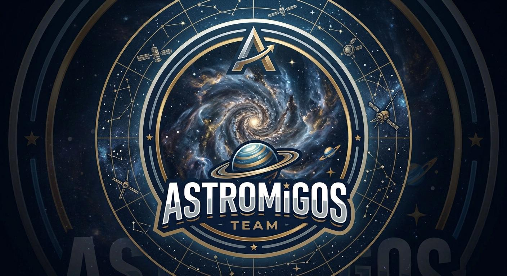

<p align="center">
  
</p>

# Astromigos

**Crew health, connected.** A browser-based spaceflight health simulation that connects personal health trends, interactive anatomy, actionable alerts, and follow-up review.

Astromigos explores a practical question: **How can a small crew understand a developing health problem and coordinate the next step when immediate help from Earth may be unavailable?**

The prototype brings measurements, context, explanations, suggested steps, and individual history into one workspace. Its goal is to help a user understand what changed, who needs attention, and what still requires human review.

> Educational decision-support prototype. All live device readings, health scenarios, forecasts, and medical-history examples are simulated. Public Artemis II names and portraits identify demonstration profiles; they do not represent the astronauts' actual health, medical records, or current mission telemetry. This is not a medical device, diagnosis service, NASA-endorsed application, or clinically validated system.

## Explore the idea

| Guide | What it explains |
| --- | --- |
| [The idea and its purpose](docs/CONCEPT.md) | The problem, intended users, proposed value, and scope. |
| [Architecture and data](docs/ARCHITECTURE.md) | Simulation, baselines, anomaly detection, state, 3D rendering, and storage. |
| [Demo walkthrough](docs/DEMO.md) | A short presentation and six reproducible scenarios. |
| [GitHub Pages deployment](docs/DEPLOYMENT.md) | Local setup, publishing, workflow behavior, and troubleshooting. |
| [Validation and limitations](docs/VALIDATION.md) | What the tests establish and what remains unproven. |
| [Roadmap](docs/ROADMAP.md) | Potential next steps, clearly separated from implemented work. |

## What works today

- **Individual crew profiles.** Reid Wiseman, Victor Glover, Christina Koch, and Jeremy Hansen appear with official public portraits and their mission roles.
- **Ground and crew views.** A detailed monitoring workspace and a simpler individual view share the same simulated state.
- **Interactive 3D anatomy.** Select anatomical structures and body systems to inspect their associated signals. Reference-only structures are identified separately.
- **Personal baselines.** Measurements are compared with a synthetic individual's activity context and prior readings. Missing data is shown as unknown, never normal.
- **Explainable alerts and suggestions.** Statistical and rule-based checks produce plain-language explanations and numbered next steps from a versioned catalog.
- **Critical escalation.** Critical conditions show a persistent medical-attention message. Logging an action or acknowledging an alert does not imply recovery.
- **Individual medical-history workspaces.** Separate records for each astronaut, category summaries, mission events, and fictional user-entered records stored in the browser.
- **Problem and follow-up tracker.** Open it through Tools or a recommendation's “Track follow-up” button. Link the triggering issue, suggested steps, actions, readings, and review notes. Resolution requires cleared signals and a written review.
- **Timelines, trends, and forecasts.** Explore retained samples, personal ranges, event markers, and clearly hypothetical projections.
- **Communication-delay simulation.** Compare near-Earth support with delayed Earth replies. Messages and replies are simulated.
- **Scenario controls.** Pause, restart, and run at real time, 1 minute/second, 1 hour/second, or 6 hours/second.
- **Supporting tools.** Daily check-ins, mission overview, shift-handover reports, what-if comparisons, data provenance, keyboard shortcuts, and a guided tour.

## Run locally

Use Node.js 24 and npm. No API key, database, or backend service is needed for the app.

```sh
cd frontend/web
npm ci
npm run dev
```

Open the local URL printed by Vite. To verify and preview a production build:

```sh
npm test
npm run build
npm run preview
```

The build output is `frontend/web/dist`. The committed GitHub Actions workflow builds this directory and publishes it to GitHub Pages after Pages is enabled for the repository. See [deployment instructions](docs/DEPLOYMENT.md).

## A useful first demo

1. Start with **Nominal day** and select an astronaut.
2. Open their **Medical history** and explain that its records are fictional.
3. Choose **Acute cardio event** at **1 min/s** and observe the developing alert.
4. Read the suggested steps and open **Track follow-up**.
5. Log a simulated action, inspect changing readings, and show that the case still requires review.
6. Switch to **Progressive fatigue** at **6 h/s** to demonstrate a slower pattern.

Scenario time is independent of the historical Artemis II flight. The app is a simulation, not a reconstruction of that mission.

## Repository layout

```text
frontend/web/             React application, engine, assets, tests, and scripts
  src/engine/             Synthetic devices, baselines, detection, risk, and forecasts
  src/features/           Crew, anatomy, alerts, history, case tracking, and tools
  src/state/              Shared live simulation state
  public/                 Logos, portraits, anatomy assets, and asset licenses
data/                     Existing public-data inputs, processed records, and provenance
docs/                     Current Astromigos project documentation
docs-site/                Earlier AHI technical reference portal, retained for context
.github/workflows/        Validation and GitHub Pages deployment
```

## Data and storage

The application runs in the browser. Device telemetry is generated locally and labeled `SIMULATED`. Check-ins and demo records entered through the UI are identified as user input. The included NASA OSDR lab panels are separate historical reference datasets from Inspiration4, not live Artemis II readings.

Medical-history entries and display preferences may persist in this browser's local storage. They are not uploaded to a clinical service, shared between devices, or protected by a login system. Use fictional information only. Simulation restarts reset live scenario events and start a new case-tracker run; archived clinical records and cross-device synchronization are not implemented.
