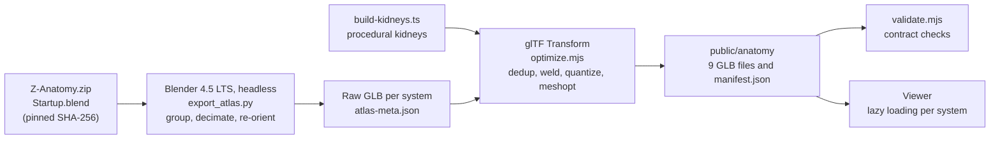

# 3D Anatomy Rendering

The body in the center of the Astronaut Health Intelligence Platform (AHI) is a **real anatomical atlas**: the open Z-Anatomy model, prepared in Blender and shipped as one compressed glTF binary (GLB) per anatomical system. The viewer (three.js with React Three Fiber) loads the systems on demand, shades them by tissue class and lets the user select any of its 250 structures. Health status, alerts and live vitals are drawn on top of the anatomy.

If the atlas cannot load, the viewer switches automatically to the earlier **procedural model** (generated in code), so the dashboard always has a body to show.

Code: `frontend/web/src/features/anatomy/`. The page data (status per region, live heart rate and breathing rate) is <OriginBadge origin="SIMULATED" /> and <OriginBadge origin="DERIVED" />. The geometry is not health data: it is a third party reference asset with its own license, documented in [3D anatomy assets](../data/anatomy-assets).

::: info One reference body for everyone
The atlas is a single adult reference model, shown for every crew member. It is not a scan of the astronaut and it shows no individual anatomy. Status colors come from the simulated health data, never from the model.
:::

## Source model and why

| Question | Answer |
| --- | --- |
| Which model | Z-Anatomy, "the libre 3D atlas of anatomy", itself based on BodyParts3D |
| License | CC BY-SA 4.0, so the derived files can be redistributed with attribution |
| Why this one | A whole body with named structures organized by anatomical system, which is what layers, selection and the health mapping need; a Blender source that can be processed headless and reproducibly |
| What AHI changed | Kept only physical bodies, grouped about 2,230 source objects into 250 structures, decimated, moved to the viewer frame and compressed |
| What AHI left out | Non commercial upstream items (ear, kidney), reproductive structures (neutral reference body), labels and helpers |

Full provenance, the required attribution lines, the list of modifications and the exclusions are in [3D anatomy assets](../data/anatomy-assets).

## Asset pipeline

The published files are generated, never edited by hand. One command (`npm run anatomy:build`, about 4 to 5 minutes) runs the whole chain.

| Step | Script (`frontend/web/scripts/anatomy/`) | Result |
| --- | --- | --- |
| 1. Source | `fetch-source.mjs` | Downloads the archive from one allowed host, checks the SHA-256, extracts `Startup.blend` into a cache folder ignored by git |
| 2. Blender export | `export_atlas.py` | Selects the real bodies, converts vessel and nerve curves to tubes, groups, decimates, moves to the atlas frame, writes one raw GLB per system |
| 3. Kidneys | `build-kidneys.ts` | AHI procedural kidneys (the upstream kidney model is not redistributable) |
| 4. Optimize | `optimize.mjs` | glTF Transform: dedup, weld, prune, quantized normals, meshopt compression; writes `manifest.json` |
| 5. Validate | `validate.mjs` (`npm run anatomy:validate`) | Checks the published files against the manifest contract |
| Optional | `decode-for-preview.mjs`, `render_previews.py` | Preview sheets of the published files (`--previews`) |

Blender runs with `--factory-startup --disable-autoexec`, so scripts embedded in the source file never run. Prerequisites and options: [3D anatomy assets](../data/anatomy-assets#rebuild).

## Manifest contract {#manifest-contract}

`public/anatomy/manifest.json` is the contract between the pipeline, the viewer and the health mapping. Its type is `AtlasManifest` in `src/features/anatomy/atlas/types.ts`. The manifest holds anatomy facts only; which region and metrics relate to a structure is decided in code ([Anatomy to health mapping](./data-model#anatomy-to-health-mapping)).

| Manifest field | Content |
| --- | --- |
| `version` | Bumped when ids or files change in an incompatible way (currently `1`) |
| `generatedAt` | Build time (ISO 8601) |
| `bounds` | Whole body extent in the atlas frame, in meters |
| `source` | `name`, `url`, `license`, `sha256` of the source archive, `retrievedAt`, `attribution` lines, `excluded` (upstream content left out, with the reason) |
| `systems` | One entry per file: `id`, `label`, `file`, `bytes`, `triangles`, `structureCount` |
| `structures` | One `AtlasStructure` per selectable structure |

| `AtlasStructure` field | Type | Meaning |
| --- | --- | --- |
| `id` | string | Stable kebab-case id, unique in the atlas. It is also the GLB node name, for example `femur-left` |
| `name` | string | English anatomical name for display, for example "Left femur" |
| `system` | `AnatomySystemId` | `integumentary`, `skeletal`, `muscular`, `cardiovascular`, `respiratory`, `nervous`, `digestive`, `urinary` or `other`. Also the unit of lazy loading |
| `tissue` | `TissueClass` | Drives the viewer material (19 classes, see [Materials](#materials-by-tissue-class)) |
| `side` | `'L'`, `'R'` or `null` | Paired structures carry their side; midline and merged structures are `null` |
| `center`, `min`, `max` | `[x, y, z]` | Bounding box center and extents in the atlas frame (meters). Used for camera framing and label anchors |
| `triangles` | number | Triangle count of the mesh |
| `sourceObjects` | string[] | Names of the source objects merged into the structure (provenance and debugging) |
| `origin` | `'z-anatomy'` or `'ahi-procedural'` | Where the geometry comes from. The two kidneys are `ahi-procedural` |
| `parent` | string, optional | Id of a larger structure this one belongs to (three cases: coronary arteries and cardiac veins belong to `heart`, the deep structures of the cerebrum belong to `brain`) |

The application relies on seven ids, listed in `REQUIRED_STRUCTURE_IDS`: `skin`, `heart`, `lung-left`, `lung-right`, `brain`, `kidney-left`, `kidney-right`. Everything else is discovered from the manifest at run time. `manifest.contract.test.ts` validates the real manifest and every GLB against this contract in the unit tests.

**Coordinate frame of every file:** meters, Y up, body facing +Z, feet on y = 0, centered on x = 0 and z = 0. Anatomical left is +X. Every structure is one mesh node with an identity transform.

## Systems and files {#systems-and-files}

Numbers read from `manifest.json` (build of 2026-11-14). MB means bytes divided by 1,048,576.

| System | File | Structures | Triangles | Bytes | MB |
| --- | --- | --- | --- | --- | --- |
| `integumentary` | `integumentary.glb` | 1 | 48,503 | 256,684 | 0.24 |
| `skeletal` | `skeletal.glb` | 41 | 184,971 | 995,640 | 0.95 |
| `muscular` | `muscular.glb` | 133 | 299,818 | 1,737,700 | 1.66 |
| `cardiovascular` | `cardiovascular.glb` | 29 | 89,893 | 527,100 | 0.50 |
| `respiratory` | `respiratory.glb` | 6 | 44,991 | 235,056 | 0.22 |
| `nervous` | `nervous.glb` | 17 | 133,356 | 694,596 | 0.66 |
| `digestive` | `digestive.glb` | 10 | 41,990 | 228,016 | 0.22 |
| `urinary` | `urinary.glb` | 4 | 10,826 | 57,676 | 0.06 |
| `other` | `other.glb` | 9 | 26,008 | 135,708 | 0.13 |
| **Total** | 9 files | **250** | **880,356** | **4,868,176** | **4.64** |

What each system holds:

| System | Content |
| --- | --- |
| `integumentary` | `skin`: the whole body surface as one structure |
| `skeletal` | Skull, mandible, teeth, vertebrae by region, ribs, sternum, cartilages and the limb bones per side (hand and foot bones merged) |
| `muscular` | 64 structures per side (large muscles one by one, small ones merged by group) plus 5 midline groups |
| `cardiovascular` | Heart, coronary arteries, cardiac veins, great vessels, arteries and veins by body region |
| `respiratory` | Lungs, trachea, bronchi, larynx, diaphragm |
| `nervous` | Brain (cortex), deep structures of the cerebrum, cerebellum, brainstem, spinal cord and the nerves by region |
| `digestive` | Tongue, salivary glands, pharynx, esophagus, stomach, intestines, liver, gallbladder, pancreas |
| `urinary` | Kidneys (procedural), ureters, urinary bladder |
| `other` | Eyes, thyroid, pituitary, pineal, adrenal glands, thymus, spleen |

## Component map

Everything lives in `frontend/web/src/features/anatomy/`. The public API did not change with the atlas: `AnatomyViewer({ className, showControls, autoRotate, bloom, labelScale, compact, legend })`.

| File or folder | Role |
| --- | --- |
| `AnatomyViewer.tsx` | Entry point. Chooses the atlas viewer or the procedural fallback, inside an error boundary |
| `atlas/types.ts` | Manifest contract (`AtlasManifest`, `AtlasStructure`, `REQUIRED_STRUCTURE_IDS`) |
| `atlas/manifest.ts` | Loads and caches the manifest (`loadAtlasManifest`, `useAtlasManifest`). No three.js |
| `atlas/health.ts` | The only place that links anatomy to health data. Pure TypeScript, unit tested |
| `viewer/AtlasViewer.tsx` | Canvas, overlays (tooltip, loading, legend, controls, caption), quality tiers |
| `viewer/AtlasScene.tsx` | Lazy loading of the visible systems, picking, per frame driver |
| `viewer/runtime.ts` | Imperative three.js side: one mesh per structure, states, heart and lung motion |
| `viewer/tissueMaterials.ts` | One material per tissue class, plus the shader patch for the viewer states |
| `viewer/Studio.tsx` | Lighting, environment, floor and contact shadow |
| `viewer/AtlasCamera.tsx` | Orbit controls, fly-to, preset views, idle rotation |
| `viewer/SystemControls.tsx` | Layers popover, skin opacity, presets, view buttons, reset |
| `viewer/Attribution.tsx` | Persistent source caption and the "About the reference anatomy" popover |
| `viewer/layers.ts` | Layers derived from the manifest, presets, camera focus, label anchors |
| `viewer/atlasLoader.ts` | GLB download with byte progress, meshopt decoding, session cache |
| `viewer/atlasStore.ts` | Local view state (hover, layers, skin opacity, camera requests) and lab switches |
| `procedural/` | The previous procedural viewer (signed distance fields polygonized with Surface Nets, built in Web Workers), kept as the automatic fallback |
| `Labels.tsx`, `Legend.tsx`, `regions.ts`, `hooks.ts` | Shared by both viewers: floating labels, status legend, region configuration |
| `lab.tsx` (with `anatomy-lab.html`) | Development lab page |

The panel that describes a selected structure is outside this folder: `src/features/attention/StructureDetail.tsx` and `RegionEvents.tsx` ([Product tour](../product/product-tour#selecting-a-structure)).

## Loading strategy and offline constraint

| Decision | Detail |
| --- | --- |
| Lazy chunk | The whole viewer is loaded with a dynamic `import()` from the center stage |
| Manifest first | `manifest.json` is fetched once per session. While it loads the viewer says "Loading reference anatomy" |
| Default systems preloaded | As soon as the manifest is known, the files of the default layers start downloading, before the canvas mounts. That is every file except `muscular.glb`: 8 files, about 3.0 MB |
| On demand | `muscular.glb` (1.66 MB) is fetched the first time the muscle layer is needed (selected, in alert or switched on) |
| Progress | Streamed `fetch` with byte progress; totals come from the sizes in the manifest. The first load shows a progress card, later loads a small pill at the top |
| Session cache | Parsed geometry is cached for the whole session, so switching astronaut or remounting the viewer never downloads or parses a file twice. Only positions and normals are kept on the GPU |
| Validation | A response that is not a GLB (for example an HTML page returned for a missing file) is rejected before parsing |

**Offline constraint.** The demo must work without internet access, so every file comes from the app's own server. The viewer requests only files under its own `/anatomy/` folder: the meshopt decoder is the one bundled with three.js (no Draco, no decoder from a CDN) and the lighting environment is built in code (no remote HDR image).

## Materials by tissue class

The upstream model has flat colors and no textures. The viewer assigns one physically based material per tissue class (`TISSUE` in `tissueMaterials.ts`); surface detail comes from geometry and lighting.

| Tissue classes | Look |
| --- | --- |
| `skin` | Translucent, with a depth pre-pass so the skin never blends with itself. Opacity is set by the user (default 22%) |
| `bone`, `airway`, `gland` | Matte standard material in the natural tissue color |
| `muscle`, `tendon`, `lung` | Soft fiber or velvet like reflection at grazing angles (sheen) |
| `cartilage`, `tooth`, `heart`, `brain`, `liver`, `kidney`, `gut`, `eye`, `organ` | Thin wet layer on top (clearcoat), strongest on the eyes |
| `artery`, `vein`, `nerve` | Red, blue and yellow thin tubes, pushed outward in proportion to the view distance so they stay readable in a full body shot and keep their true caliber in a close up |

Tissue colors are a reference anatomy look, not a status encoding. Materials are shared: one instance per tissue, body region and variant (solid, ghost, hover, selected). A small shader patch adds the viewer states on top of the standard lighting through shared uniforms, so one write per region per frame updates every material.

## Lighting and rendering

| Element | Detail |
| --- | --- |
| Environment | Procedural environment map built from six light panels (drei `Lightformer`), rendered once |
| Lights | A key light that casts shadows, a fill light and two rim lights, plus a faint hemisphere light. The rig turns with the camera, so every preset view is lit the same way |
| Shadows | The shadow map is refreshed only when the rig has turned a little or the content changed, never per frame. A contact shadow under the feet is redrawn only when the content changes |
| Floor | A soft pool of light with thin measurement rings |
| Tone mapping | ACES filmic |
| Post processing | Bloom only above luminance 1 (status highlights), then tone mapping. Can be disabled with the `bloom` prop |
| Quality tiers | `high`: device pixel ratio up to 1.75, 4x multisampling, shadows. `low`: pixel ratio 1, 2x multisampling, no shadows. The viewer drops to `low` when the performance monitor reports a decline |
| Intro | A band of light sweeps up the body once when the first geometry arrives |

## Interaction

### Navigation and preset views

- **Orbit** (rotate, zoom, bounded pan) with damping. The orbit target never leaves the body.
- **Preset views**: Front, Back, Left and Right (the body's own left and right), with an animated transition.
- **Reset**: frames the whole body again and clears the selection.
- **Idle rotation**: the body turns slowly after 5 seconds without interaction, and stops while something is selected or hovered.
- Whole body shots are fitted to the free height between the top margin and the controls, and fitted again when the container resizes.

### Selection

- **Hover** (not on touch screens) shows a tooltip with the structure name, its system, the status of its region and a key value, or "Not monitored" for context only structures.
- **Click** selects a structure. The camera flies to it from its own side of the body, everything else turns into a see-through ghost and the right panel opens the structure detail. Clicking the selected structure again, or empty space, clears the selection. `Esc` goes back.
- **Body system chips** beside the body select a whole region instead of one structure.
- The viewer calls `selectStructure(id, regionOfStructure(structure))` on the app store. The selection contract is documented in [Data model](./data-model#selection-contract).

### Layers and skin opacity

The **Layers** popover lists one toggle per anatomical system found in the manifest, with the structure count in its tooltip.

| Layer | Default | Notes |
| --- | --- | --- |
| Skin | on | Translucent. The **Skin opacity** slider goes from 0 to 100% (default 22%) |
| Muscular | automatic | Appears when muscles are selected or their region is in alert |
| Skeletal, Cardiovascular, Respiratory, Digestive, Urinary | on | |
| Nervous | on | Brain, cerebellum, brainstem and spinal cord |
| Nerves | off | Peripheral nerves are a separate layer because they are visually busy and context only |
| Other | off | Glands, thymus, spleen |
| Eyes | follows Skin and Other | No toggle of its own, so open eyelids never show empty sockets |

- **Presets**: Default, Organs, Skeleton, Muscles and All. Each one sets the layers and a matching skin opacity.
- The layer of the selected region or structure is always visible, whatever the toggles say.
- In narrow containers the controls collapse to a compact pill and the view buttons move into the popover.

## Visual states {#visual-states}

Status colors are the same `STATUS_META` colors used everywhere in the app ([Design system](../product/design-system#status-language)). Region status comes from the engine ([Risk assessment](../intelligence/risk-assessment#body-regions)).

| State | What you see | Meaning |
| --- | --- | --- |
| Normal | Natural tissue color, no highlight | The region is nominal (`LOW`), or the structure is context only |
| Hovered | Cyan tint and a tooltip | The structure under the pointer. Click to select |
| Selected | Cyan rim on the selection; every other structure becomes a faint blue ghost and the skin fades | Focus on one structure or one region. Ghosting is a viewing aid, not a status |
| Related to alert | Status colored rim that pulses (amber `MODERATE`, orange `HIGH`, red `CRITICAL`, stronger and faster with severity); monitored organs also get a glow that shows through the rib cage, and the body wall in front of them turns see-through | The region the structure reports under is not nominal. The color marks the region, not a finding in that structure |
| Data unavailable | Desaturated grey tissue, no pulse; heart or lungs stop moving | The region is `NO_DATA`. Missing data is never drawn as normal |

- When a region status changes, a short **scan pulse** (an expanding wavefront in the status color) starts from that region. It does not fire on first load or when switching crew member.
- Whole body systems (skin, muscles, skeleton) glow less than single organs, because hundreds of structures light up at once.
- Context only structures (digestive organs, glands, nerves, eyes and others) never show a status color.

::: info Eyes
The eyes are two atlas structures (`eye-left`, `eye-right`). They can be selected, but they are context only: no eye monitoring device feeds this prototype, so they have no status. SANS tracking from periodic exams is on the [roadmap](../resources/roadmap).
:::

## Live physiology

The scene reads the selected astronaut's live heart rate and breathing rate from the store **every frame, without subscribing**, so the animation never causes React re-renders.

| Structure | Driven by | How |
| --- | --- | --- |
| Heart, with the coronary arteries and cardiac veins | Live `HEART_RATE` | The beat phase advances by HR / 60 per second. Each beat is a "lub dub" curve (S1, then S2 at about 30% of the period); the heart scales up by up to 5% around its center |
| Lungs | Live `RESPIRATORY_RATE` | The breath phase advances by RR / 60 per second, about 40% inhale and 60% exhale; the lungs scale by up to about 3 to 4% on three axes |

When the heart or lungs region is `NO_DATA`, or the value is missing, the motion stops. A heart that stops beating during the sensor failure scenario is deliberate.

## Picking

- Raycasts run against bounding volume hierarchies built per system (drei `Bvh`).
- Hover picking is throttled to one raycast every 45 ms while the pointer moves, and never runs while dragging.
- Priority: a solid structure wins over a ghosted one, and the translucent skin only counts when nothing else is hit, so inner anatomy stays reachable through it. When the skin is nearly opaque (75% or more) it is picked like any solid surface.
- A click is a pointer press and release within 6 pixels; a drag never selects.

## Labels and legend

- **Floating labels** appear for every region that is not nominal and for the focused region. They are plain DOM above the canvas, positioned by a projector inside the scene with no React render per frame. Anchors come from the manifest (the organ center, or a fixed spot of the body for whole body systems).
- Labels use shape, color and words, never color alone.
- **Legend**: collapsible, open by default when the viewer is wider than 820 px, with the note "Vs personal baseline. Simulated data."
- **Source caption**: "Reference anatomy: Z-Anatomy atlas (CC BY-SA 4.0)" stays visible under the body. Its info button opens the credits and the statement that this is one reference model.
- In **presentation mode** labels, tooltip, legend and controls scale up by 1.3.

## Performance observations {#performance-observations}

::: warning Observations, not benchmarks
The numbers below were observed by the team on one development laptop (AMD Ryzen 5 3500U with integrated Radeon Vega 8 graphics, headless Chrome, frame rate capped at 60 by vsync). They were not repeated on other machines and are not a benchmark. They were taken on the asset build just before the published one, which had about 0.1% more triangles.
:::

| Situation | Frame rate | Draw calls | Triangles drawn per frame (all passes) |
| --- | --- | --- | --- |
| Lab page, default systems | 58 to 60 fps | 119 | about 578k |
| Lab page, all systems | 56 to 59 fps | 273 | about 930k |
| Ground view at 1440x900 | 55 to 57 fps | | |
| Crew view | 58 fps | | |
| Ground view with a body system detail open | 39 to 42 fps | | |

- With a detail panel open the previous procedural viewer measured 38 fps in the same state, so the panel, not the 3D scene, is the limit there.
- Hover pick: 0.4 to 2.8 ms per raycast.
- Atlas on screen 2.4 to 3.6 s after navigation with a warm browser cache.

What keeps it fast:

| Decision | Effect |
| --- | --- |
| One GLB per system, loaded on demand | The largest file (muscles) is not downloaded for the default view |
| Meshopt compression, quantized normals | 4.64 MB for 880k triangles |
| One mesh per structure, shared materials and uniforms | Material changes happen on events; per frame work is a few uniform writes and the heart and lung matrices |
| Cheap unlit ghost shader | Dozens of overlapping ghost layers in a close up stay affordable |
| Shadows rendered on demand | No shadow pass on most frames |
| Bounds trees and throttled hover | Picking stays in the millisecond range |
| Shader warm up | Ghost and alert shaders compile with the first frame, not at the first selection or alert |

## Fallback and error handling {#fallback}

A 3D failure must never break the dashboard.

| Situation | Behavior |
| --- | --- |
| Manifest still loading | Message "Loading reference anatomy" |
| Manifest missing, malformed, or without the required structures | Procedural model, with the notice "Reference atlas unavailable. Showing simplified model." |
| A system that holds a required structure fails to load | Same fallback |
| An optional system fails to load | The body stays; that layer toggle is disabled and marked "n/a" |
| The atlas viewer throws while rendering | The error boundary shows the procedural model |
| The procedural model also fails | Message "3D body view unavailable"; the rest of the dashboard keeps working |

The procedural viewer is a separate lazy chunk, downloaded only when it is needed. It shows the seven body regions with the same status language and live animation, but it has no selectable structures: region selection, chips, alerts and the region detail keep working, and a structure selected earlier is described as unavailable.

## Development lab

`npm run dev` also serves a dev only lab page at `/anatomy-lab.html`. It fakes region statuses and vitals through the store so every visual state can be checked (layers, structure selection, statuses, the forced fallback), and shows renderer statistics: frame rate, draw calls, triangles, pick time and structure count.

## Limitations

- One reference model at one scale for every crew member. The source is an adult male model; only the groin was made neutral, so the build, the proportions and the chest remain those of the source. It does not adapt to sex, height or body composition (a female reference model is on the [roadmap](../resources/roadmap)).
- No textures: the source has none, so surface detail comes from geometry and materials.
- The kidneys are simple procedural shapes and sit behind the intestines when seen from the front; selecting the kidneys region flies the camera to the back.
- Hover is disabled on touch devices (a tap selects).
- The low quality tier is one way: once the performance monitor has reported a decline the viewer stays in `low` until it is remounted.
- The rendering itself has no automated tests. The data layer has: manifest contract, health mapping and selection ([Testing strategy](../engineering/testing)). Visual states are checked by hand on the lab page.

Asset limitations (decimation, grouping, missing structures) are listed in [3D anatomy assets](../data/anatomy-assets#limitations). All platform limitations: [Limitations and known issues](../validation/limitations).

## How to update the model

1. Follow the rebuild and update procedure in [3D anatomy assets](../data/anatomy-assets#update-procedure). The full guide, with every rule and option, is <CodeLink path="docs/anatomy-assets.md" /> in the repository.
2. Keep structure ids stable. The seven required ids must exist; `npm run anatomy:validate` and `manifest.contract.test.ts` fail otherwise.
3. To change which region a structure reports under, edit `atlas/health.ts` only ([How to map a structure to a region](../engineering/contributing#map-a-structure-to-a-region)).
4. Update the numbers on this page from the new `manifest.json`.

## Status

<StatusBadge status="IMPLEMENTED" /> Atlas viewer, structure selection, health mapping, per system lazy loading and the procedural fallback. <StatusBadge status="PLANNED" /> Female reference model, textures and eye monitoring ([Feature status matrix](../overview/feature-status#user-interface)).

## Next steps

- [3D anatomy assets](../data/anatomy-assets): provenance, license and rebuild steps.
- [Anatomy to health mapping](./data-model#anatomy-to-health-mapping): which structures relate to which metrics.
- [Product tour](../product/product-tour#_3d-body-and-body-system-chips): how users interact with the body.
- [Design system and accessibility](../product/design-system): status colors and cues.
