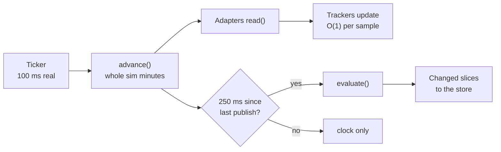

# Engine & Simulation

This page explains how the health engine of the Astronaut Health Intelligence Platform (AHI) is built as software: its modules, how it is driven by the clock, how it publishes results and how it stays fast and bounded. What each analytic method computes is in [Health intelligence](../intelligence/overview).

## Modules

| File | Role |
| --- | --- |
| `engine.ts` | `HealthEngine`: owns adapters, trackers and state; `advance()`, `evaluate()`, actions, audit |
| `config.ts` | Every tunable number and fixed threshold ([Thresholds](../intelligence/thresholds)) |
| `catalog.ts` | Metric catalog, body regions, mission, crew, scenarios, Earth link profiles |
| `sim/profiles.ts` | Per astronaut physiology parameters |
| `sim/schedule.ts` | Daily schedule and activity context |
| `sim/physiology.ts` | "True" state: targets, circadian rhythm, scenario effects, lag, Ornstein-Uhlenbeck noise |
| `sim/cabin.ts` | Cabin CO2, temperature, humidity, dose rate |
| `sim/scenarios.ts` | Scenario severities over time and hypothetical intervention relief |
| `sim/adapters.ts` | Device adapters that emit canonical observations |
| `series.ts` | Bounded history: last 2 h at 1 min, 5 days at 5 min; daily metrics keep 40 points |
| `baseline.ts`, `stats.ts` | Robust statistics and the baseline reservoir |
| `anomaly.ts` | Streaming `MetricTracker` per subject and metric |
| `risk.ts` | Combined rules, risk score, confidence, headline, body regions |
| `forecast.ts` | Damped Holt projection with 80% interval |
| `recommendations.ts`, `alerts.ts` | Recommendation catalog, autonomy, alert lifecycle and escalation |
| `comms.ts`, `checkins.ts` | Earth link, daily check-ins |
| `missionDays.ts` | Long term mission view (one summary per astronaut and mission day) |
| `intervention.ts` | What-if comparison (pure function) |
| `random.ts`, `text.ts` | Seeded random streams, formatting helpers |

The engine is **pure TypeScript with no DOM, no React and no network**. It runs headless in tests and in the evaluation script.

## Simulation clock and publishing

The store keeps a simulated clock (`clock.simNow`) and a speed in simulated seconds per real second: 1, 60, 600 or 3600 (shown as Real time, 1 min/s, 10 min/s, 1 h/s; default 60).

1. A real time **ticker** (`startTicker()`, every 100 ms) advances the clock: `simNow += dtReal x speed`.
2. The **engine steps in whole sim minutes**. When an advance needs more than 60 sim minutes, it steps 5 minutes at a time, with a safety cap of 3,000 steps per advance.
3. **Analytics are published at most every 250 ms of real time.** Each publication re-evaluates the engine and hands the store only the slices whose engine version changed. Unchanged slices keep their object references.
4. **Event timing** (message arrival, escalation, check-ins, status frames every 15 sim minutes) uses scheduled sim times, never the moment of evaluation, so results do not depend on the simulation speed.

## Startup

On startup the engine pre-generates **5 days of minute level history** (2 h at 1 min resolution, older data at 5 min), **14 days of daily metrics and check-ins**, and **24 h of status timeline frames**, so baselines are `READY` and the timeline is populated immediately. Everything is seeded (`SIM.seed = 20261114`) and reproducible: the same seed gives the same result (tested).

## Bounded memory

| Structure | Bound |
| --- | --- |
| Continuous history | 2 h at 1 min plus 5 days at 5 min per metric |
| Daily metrics | 40 points |
| Baseline reservoir | 1,440 values per context bucket (28 for daily metrics) |
| Alerts / anomalies / audit / recommendations | 150 / 200 / 300 / 120 |
| Messages / check-ins | 120 / 120 |
| Status timeline | the history window |

## Long term mission days

`missionDays` holds one `MissionDaySummary` per astronaut and mission day (day 44 at startup). Older days are a seeded synthesis per profile (sleep, about 6% missed exercise sessions, resting HR and HRV, about 0.42 mGy per day scaled by a personal shield factor, with 5% higher dose days), scaled so the synthesized dose adds up exactly to the dosimeter reading at the start of the history. Recent days come from the simulated history. Synthesized days are flagged `synthesized: true`.

## Headless evaluation

`npm run evaluate` (`scripts/evaluate.ts`, run with tsx) creates engines without any UI, replays the nominal scenario over 5 seeds and every other scenario once, and writes `src/engine/evaluation.json` and `docs/model-card.md`. The numbers and what they mean are in [Results and evidence](../validation/results).

## Performance figures

Reported in the engine documentation: startup pre-generation takes about 1.2 s warm and 2 to 3 s cold on a laptop, the v2 modules add about 100 ms, and a what-if comparison takes under 5 ms.

## Status

<StatusBadge status="IMPLEMENTED" /> Covered by `engine.test.ts` (startup, reproducibility, bounded history, scenarios, audit), `timeline.test.ts` (status frames, jumps, bounds), `missionDays.test.ts` (coverage, plausibility, determinism, live updates) and `store.test.ts` (slices and references).

## Next steps

- [Data model and contracts](./data-model)
- [Device simulation and scenarios](../intelligence/scenario-simulation)
