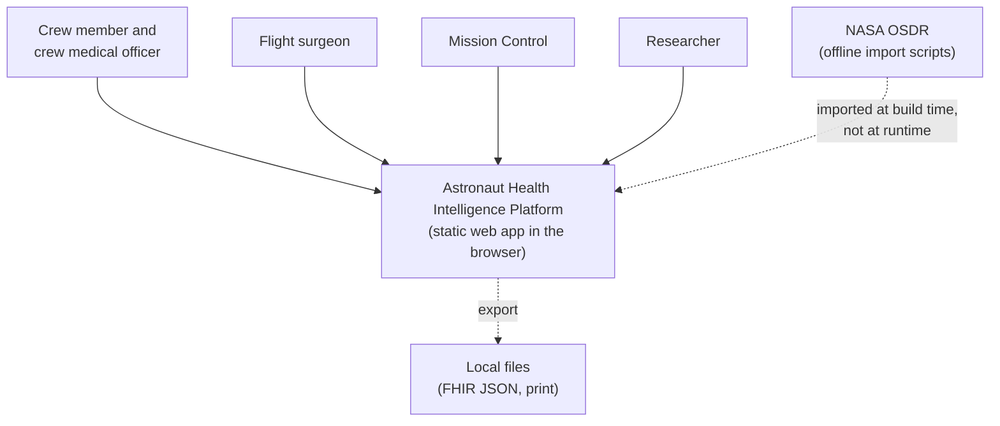
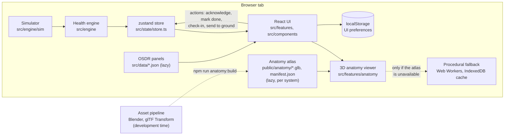
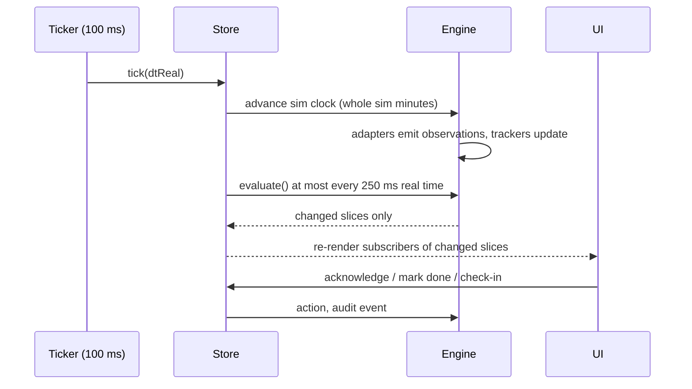

# Architecture Overview

The Astronaut Health Intelligence Platform (AHI) is a **browser only** application today. The simulation of the crew devices, the health engine, the state store and the 3D viewer all run in one browser tab. There is no backend, no database, no authentication and no call to any external service: the app only loads its own static files (code, OSDR panels and the 3D anatomy).

This keeps the hackathon demo reliable (it works offline) while the code follows the contracts of the product spec, so a real backend can plug in later without changing the engine or the UI. The planned backend is described separately in [Target architecture](./target-architecture) (conceptual).

## Context (C4 level 1)

People use one web page. The only external system is NASA OSDR, and it is contacted by the import scripts during development, never by the running app. The same holds for the 3D anatomy: its source model is downloaded by the asset pipeline during development, and the app ships the built files.

## Containers (C4 level 2)

| Container | Technology | Responsibility | Details |
| --- | --- | --- | --- |
| Simulator | TypeScript | Crew physiology, devices, cabin, scenarios; emits canonical observations | [Device simulation](../intelligence/scenario-simulation) |
| Health engine | TypeScript, no DOM | Baselines, anomalies, risk, forecasts, recommendations, alerts, Earth link, check-ins | [Engine and simulation](./engine-and-simulation) |
| Store | zustand | Owns the engine, drives the sim clock, publishes changed slices | [Frontend and state](./frontend) |
| UI | React 19, Tailwind CSS v4, Recharts | Ground view, Crew view, drawers and dialogs | [Frontend and state](./frontend) |
| 3D viewer | three.js, react-three-fiber, drei, postprocessing | Anatomical atlas with selectable structures, status highlights, live heart beat and breathing; procedural fallback | [3D anatomy](./anatomy-3d) |
| Anatomy atlas | Static GLB files (meshopt) and `manifest.json` | Third party reference anatomy (Z-Anatomy, CC BY-SA 4.0), built by the asset pipeline at development time | [3D anatomy assets](../data/anatomy-assets) |
| OSDR panels | Static JSON | Real public lab data as reference | [Dataset catalog](../data/dataset-catalog) |

## Stack

| Layer | Technology |
| --- | --- |
| UI framework | React 19 + TypeScript |
| Build and dev server | Vite 8 |
| Styling | Tailwind CSS v4 |
| 3D | three.js with react-three-fiber, drei and postprocessing (bloom) |
| 3D asset preparation (development time) | Blender 4.5 LTS (headless), glTF Transform, meshoptimizer |
| Charts | Recharts |
| State | zustand |
| Icons | lucide-react |
| Tests | vitest |
| Lint | oxlint |
| Documentation | VitePress (this portal) |

## Data flow

Details of the clock and publishing model: [Engine and simulation](./engine-and-simulation#simulation-clock-and-publishing).

## Performance decisions

| Decision | Effect |
| --- | --- |
| 3D atlas as **one compressed GLB per anatomical system**, loaded on demand | 4.64 MB in total; the default view downloads about 3.0 MB and the largest file (muscles) only when needed |
| **One mesh per structure, shared materials and uniforms** | Selection, alerts and hover change materials on events; per frame work is a few uniform writes |
| **Narrow store selectors** and slice versioning | A 250 ms publication does not re-render the whole app |
| The 3D canvas reads live vitals **without subscribing** | Heart and breathing animation run every frame with no React re-render |
| **Lazy chunks** | The anatomy viewer, the Data and model dialog and the OSDR datasets are loaded with dynamic `import()` |
| **Bounded histories** | Last 2 h at 1 min, 5 days at 5 min; daily metrics keep 40 points; alerts, audit, comms and check-ins have caps |
| Streaming detection | O(1) per sample per metric; baselines recomputed every 24 accepted samples |

Observed by the team on one development laptop with the atlas viewer: 55 to 57 fps in the Ground view at 1440x900, and the atlas on screen 2.4 to 3.6 s after navigation with a warm cache. These are informal observations, not a benchmark ([Results](../validation/results#measured-performance)).

## Next steps

- [Frontend and state](./frontend)
- [Data model and contracts](./data-model)
- [Project structure](../engineering/project-structure)
