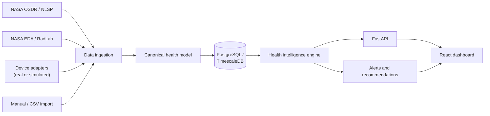
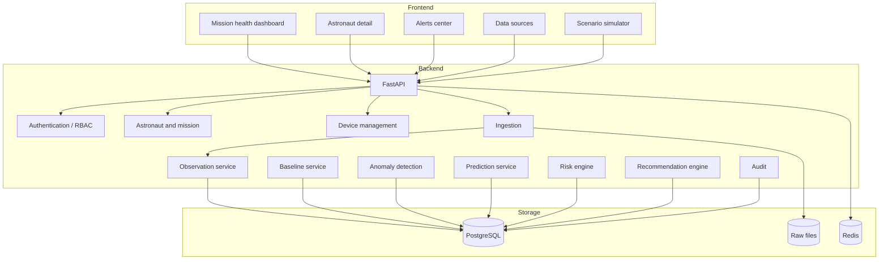
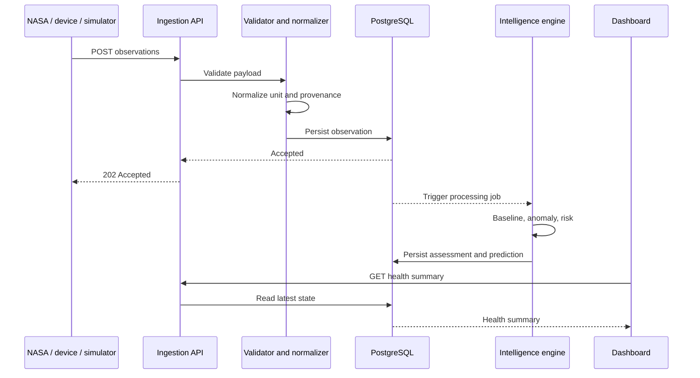

# Target Architecture

::: warning Conceptual, not implemented
Everything on this page is a **design target** from the product spec (`PROJECT_MASTER.md`, sections 7 and 10). There is no backend, no REST API, no database and no authentication in the current implementation. The running prototype is described in [Architecture overview](./overview).
:::

The Astronaut Health Intelligence Platform (AHI) was built browser first so the hackathon demo is reliable offline, but its contracts (canonical `HealthObservation`, device adapter interface, `data_origin`, versioned rules) were chosen so that a server can be added without changing the engine rules or the UI.

## Architectural decision

**Modular monolith with asynchronous processing** (spec section 7.1): one deployable backend with clear internal modules, background jobs for imports and analytics, and no microservices, Kafka or Kubernetes in the MVP. A language model must not be the core of any clinical decision.

## Context

Conceptual (not implemented). Adapted from the product spec, section 7.3.

## Components

Conceptual (not implemented). Adapted from the product spec, section 7.4.

## Recommended stack (spec section 7.2)

| Layer | Technology | Status |
| --- | --- | --- |
| Frontend | React + TypeScript + Vite, Tailwind CSS, Recharts | <StatusBadge status="IMPLEMENTED" /> (without shadcn/ui) |
| Backend API | Python + FastAPI, Pydantic schemas | <StatusBadge status="PLANNED" /> |
| ORM and migrations | SQLAlchemy + Alembic | <StatusBadge status="PLANNED" /> |
| Database | PostgreSQL, TimescaleDB optional | <StatusBadge status="PLANNED" /> |
| Cache and jobs | Redis; Celery, RQ or an asyncio worker | <StatusBadge status="PLANNED" /> |
| Data science | pandas, NumPy, SciPy | <StatusBadge status="PLANNED" /> |
| ML and explainability | scikit-learn, XGBoost, SHAP | <StatusBadge status="CONCEPTUAL" /> see [AI and analytics](../intelligence/ai-and-analytics) |
| Tests | pytest, httpx, Playwright | <StatusBadge status="PLANNED" /> (vitest exists for the engine) |
| Observability | OpenTelemetry, structured logs | <StatusBadge status="PLANNED" /> |
| Deployment | Docker Compose | <StatusBadge status="PLANNED" /> |

## Processing flow

Conceptual (not implemented). Adapted from the product spec, section 7.5.

## Planned API (spec section 10)

Base URL `http://localhost:8000/api/v1`. All endpoints are <StatusBadge status="PLANNED" />.

| Method | Endpoint | Purpose |
| --- | --- | --- |
| POST | `/observations` | Ingest a batch of observations for one subject |
| POST | `/datasets/import` | Create an import job |
| GET | `/datasets`, `/data-sources` | List imported datasets and sources |
| POST, GET | `/astronauts` | Create or list pseudonymized astronauts |
| GET | `/astronauts/{id}/health`, `/history`, `/baseline`, `/anomalies`, `/risks`, `/predictions`, `/recommendations` | Per astronaut views |
| POST | `/alerts/{id}/acknowledge` | Acknowledge an alert |
| POST | `/interventions` | Log an intervention |
| POST | `/scenarios/{scenario_id}/run` | Run a simulation |
| GET | `/devices`, `/devices/{id}/status` | Devices |
| GET | `/health/ready`, `/health/live` | Readiness and liveness |

`POST /observations` answers `202 Accepted` with `accepted_count`, `rejected_count` and the batch `data_origin`. The batch format is shown in [Pipeline, normalization and quality](../data/pipeline-and-quality#ingestion-batch-planned-backend).

## Role based access

Planned roles match the personas: crew member, crew medical officer, flight surgeon, Mission Control, researcher and admin or data engineer. Each role sees only what it needs ([Use cases and stakeholders](../overview/use-cases)).

## What carries over from the prototype

| Today | In the target |
| --- | --- |
| `HealthObservation` in `domain.ts` | Pydantic schema with the same fields |
| `DeviceAdapter` (`read()`, `status()`) | Python adapters (`connect`, `disconnect`, `read_observations`, `normalize`, `get_device_status`) |
| Engine modules (baseline, anomaly, risk, forecast, recommendations, alerts) | Backend services with the same rules and versions |
| In-memory audit | Persistent audit table |
| FHIR R4 export in the browser | Same export, server side when needed; FHIR stays an exchange format, not a sensor protocol |

## Next steps

- [Roadmap](../resources/roadmap): the order of these steps.
- [Feature status matrix](../overview/feature-status)
