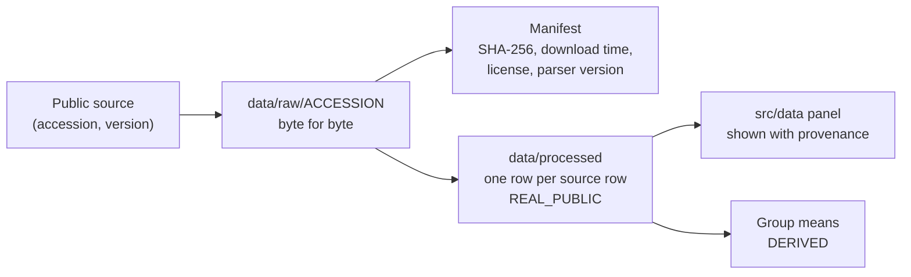

# Data Origins & Provenance

Every record in the Astronaut Health Intelligence Platform (AHI) carries a `data_origin` label from the moment it is created. This page is the canonical definition of the four labels and of the provenance fields that travel with real data.

## The four labels

| Label | Meaning | Where it appears in AHI |
| --- | --- | --- |
| <OriginBadge origin="REAL_PUBLIC" /> | Obtained as is from a public source, with accession, file and checksum recorded | The NASA OSDR lab panels in Data and model. Reference only: never live telemetry and never this crew |
| <OriginBadge origin="DERIVED" /> | Computed from records of known origin; the method is stated | Personal baselines, risk scores, forecasts, group means of the real datasets |
| <OriginBadge origin="SIMULATED" /> | Synthetic values from a simulator; nothing comes from a real person | Every device reading of the crew: wearables, exercise devices, cabin sensors, dosimeters; simulated check-ins and ground replies |
| <OriginBadge origin="MANUAL" /> | Entered by a person in the interface | Check-ins typed in the app, logged interventions, acknowledgements |

The type is `DataOrigin` in `src/types/domain.ts`. In the app, the always visible **SIMULATED** chip in the top bar opens a popover with this breakdown, and **Tools > Data and model > Data origins** lists the four labels with where each appears.

::: info The 3D anatomy is not health data
The anatomical model of the 3D body is a third party **reference asset** (Z-Anatomy, CC BY-SA 4.0), not a record about a person. It has no `data_origin` label; its provenance (source, checksum, license, modifications) is kept in the same spirit in [3D anatomy assets](./anatomy-assets). The status colors drawn on it come from the labeled health data above.
:::

## Rules that follow from the labels

1. **Never mix without a label.** Astronauts are not mixed with analog participants, humans with animals, ground with flight, continuous with point measurements, or different units.
2. **Public data is never live telemetry.** Real historical data appears as reference (or, in the future, as a labeled replay), never as "the crew right now".
3. **Missing is neither zero nor normal.** Missing values are `null` with quality `MISSING`; the app shows `NO_DATA`.
4. **Derived values say how they were derived.** Baselines carry a version and window, forecasts carry a method and interval, group means say "sexes pooled".
5. **The label travels.** It is kept on every observation, in charts, in reports and as a meta tag in the FHIR export.

## Provenance model

Real public data is recorded with full provenance, following section 6.5 of the product spec.

### On every imported observation

`HealthObservation.source_reference` identifies the origin of a single record:

| Field | Example |
| --- | --- |
| `repository` | `NASA OSDR` |
| `dataset_accession` | `OSD-569` |
| `file_name` | `LSDS-7_Complete_Blood_Count_CBC.upload_SUBMITTED.csv` |
| `record_reference` | the source row |

Original value and unit are kept in `metadata` when a unit is normalized. Full field rules: [Data model](../architecture/data-model#healthobservation-canonical-model).

### On every dataset

One manifest per dataset (`data/manifests/<ACCESSION>.json`) holds a `DatasetRecord`:

| Group | Fields |
| --- | --- |
| Source | `source_name`, `source_url`, `dataset_accession`, `dataset_version`, `title` |
| Retrieval | `downloaded_at`, `file_name`, `sha256`, `parser_version` |
| Rights | `license`, `access_classification` |
| Study | `study_population`, `mission`, `study_design`, `collection_phase`, `notes` |
| Label | `data_origin` |

Fields without information in the source stay `null` with the note "not stated". **A field is never filled by assumption.** The manifests of the two datasets in use are described in the [Dataset catalog](./dataset-catalog).

## Where provenance is visible

| Place | What you see |
| --- | --- |
| Top bar SIMULATED chip | Simulated device adapters, planned real data, derived values |
| Data and model, Real datasets tab | Source, accession, version, file, SHA-256, download time, license ("not stated" when absent), assay protocol |
| Region detail | Data quality and data origin badges per metric, and on every alert and statistical flag |
| Structure detail and 3D body | "Reference anatomy" badge (Z-Anatomy atlas or AHI procedural) on the selected structure; source caption under the body |
| Handover report | A SIMULATED DATA label in the header |
| FHIR export | Data origin as a meta tag on every resource |

## Next steps

- [NASA data sources](./sources): what each NASA source offers and its status.
- [Governance and privacy](./governance-and-privacy): handling rules.
- [Pipeline, normalization and quality](./pipeline-and-quality): how a dataset gets in.
