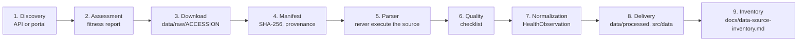

# Pipeline, Normalization & Quality

A guide for data contributors (data engineers, data scientists, researchers) of the Astronaut Health Intelligence Platform (AHI): what data the platform needs, how it must be normalized and checked, and in which format to deliver it. It is a concise English version of `docs/data-guide.md` (pt-BR), checked against NASA sources on 2026-11-14. The pipeline is implemented for the two OSDR datasets; everything else on this page is the contract for future imports.

## In one minute

1. **The platform shows 21 metrics today, and all of them come from simulators or from the check-in typed in the app** (`SIMULATED` or `MANUAL`, see the [Data dictionary](./data-dictionary)). The only exception: two real Inspiration4 blood panels (OSD-569 and OSD-575), shown as historical reference.
2. **The job is to replace simulation with real data where it exists**, and where it does not, to **anchor the simulation in citable scientific sources**.
3. **There is no public continuous physiological telemetry of astronauts.** Do not look for "the ISS vital signs API". For those metrics: calibrate the simulator with published ranges and keep the `SIMULATED` label.
4. **Real public data with the most impact:** ISS cabin environment and radiation in **NASA EDA** (priority 1), human lab panels in **NASA OSDR** (done), and the **NASA Standard Measures** to justify the metric catalog.
5. **Every delivery uses the canonical `HealthObservation`** with full provenance.

## Pipeline



| Path | Content |
| --- | --- |
| `data/raw/<ACCESSION>/` | Original file byte for byte, API responses as received |
| `data/manifests/<ACCESSION>.json` | Provenance manifest |
| `data/processed/<ACCESSION>.observations.json` | Canonical long format |
| `frontend/web/src/data/<ACCESSION>.json` | Compact UI version (target: under 200 KB) |
| `frontend/web/scripts/<source>/` | Reproducible discovery and import scripts |

Pipeline rules:

1. **Reproducible**: one documented command redoes the import (for example `node scripts/osdr/import.mjs`).
2. **Downloaded files are untrusted data**: save each in its own folder, parse as text only, never execute anything.
3. **Keep the original value** (`metadata.original_value`, `original_unit`) when converting units, and document the factor.
4. **Idempotent**: re-importing does not duplicate (stable `observation_id`).
5. **Prefer SUBMITTED over TRANSFORMED** files when the former has an explicit unit column.

## Normalization rules

These rules come from section 6.3 of the product spec and are applied by the OSDR import scripts and by every simulated adapter (`makeObservation` in `src/engine/sim/adapters.ts`).

| Rule | How |
| --- | --- |
| One canonical record | Every value becomes a `HealthObservation` with a `metric_code` from the catalog |
| Canonical units | Convert to the unit in the [Data dictionary](./data-dictionary); keep `metadata.original_value` and `original_unit` and document the factor |
| Incompatible units | Rejected, never blindly converted |
| Time | ISO 8601 in UTC; the original time zone is recorded |
| Missing values | `null` with `quality.status = MISSING`, never zero |
| Out of physical range | Flagged `QUESTIONABLE`, never deleted |
| Deduplication | Stable, idempotent `observation_id`; re-importing does not duplicate |
| Quality | `quality.status` (`VALID`, `QUESTIONABLE`, `INVALID`, `MISSING`), `confidence`, `is_estimated` |
| Context | `context.mission_phase` and `context.activity` when known |
| Origin | `data_origin` on every record ([Data origins](./data-origins)) |

In the running engine, the personal band is clamped to each metric's physical limits and questionable readings cannot escalate beyond MODERATE ([Anomaly detection](../intelligence/anomaly-detection#data-quality)).

## Quality checklist

Every dataset must pass before it enters the app:

- [ ] **Schema**: every required `HealthObservation` field present.
- [ ] **Unit**: known and compatible with the `metric_code`. Incompatible units are rejected, not blindly converted.
- [ ] **Timestamps**: valid, UTC, ordered. Original time zone recorded.
- [ ] **Missing**: `null` with `quality.status = MISSING`, counted in the manifest.
- [ ] **Duplicates**: detected and removed by idempotent key, counted.
- [ ] **Plausible range**: values outside the physical range are **flagged** `QUESTIONABLE`, never deleted.
- [ ] **Provenance**: complete manifest with verified SHA-256.
- [ ] **Metadata consistency**: sex, organism, mission and time points match the ISA metadata and description. Discrepancies noted in the manifest.
- [ ] **Population**: `population_type` set. No analog or animal data labeled as astronaut.
- [ ] **License and access**: recorded, or "not stated".
- [ ] **No em or en dash characters** in text generated for the interface.

A dataset enters the app only if it has an official public source with a stable URL, identifiable units and period, verified population and design, passes the checklist, has a clear use in the app, and comes with a fitness report saved in `docs/data-source-inventory.md`.

## Delivery schemas

The source of truth is `frontend/web/src/types/domain.ts`. Full field rules: [Data model](../architecture/data-model#healthobservation-canonical-model).

### HealthObservation from a real source

```json
{
  "observation_id": "stable idempotent key from the source",
  "subject_id": "C001",
  "mission_id": "SpaceX Inspiration4",
  "device_id": "LAB-CBC",
  "metric_code": "WBC",
  "value": 5.4,
  "unit": "Thousand/uL",
  "measured_at": "<ISO 8601 UTC>",
  "data_origin": "REAL_PUBLIC",
  "source_reference": {
    "repository": "NASA OSDR",
    "dataset_accession": "OSD-569",
    "file_name": "LSDS-7_Complete_Blood_Count_CBC.upload_SUBMITTED.csv",
    "record_reference": "row 42"
  },
  "quality": { "status": "VALID", "confidence": 1.0, "is_estimated": false },
  "context": { "mission_phase": "POST_FLIGHT", "activity": "REST" },
  "metadata": {
    "original_value": "5.4",
    "original_unit": "Thousand/uL",
    "population_type": "COMMERCIAL_ASTRONAUT",
    "timepoint_label": "R+1"
  }
}
```

::: info Illustrative values
Values, codes and dates above are placeholders to show the shape. `WBC` is a lab metric planned in the product spec, not part of the live catalog. Use the real values of the downloaded file.
:::

Proposed `metadata.population_type` values: `ISS_ASTRONAUT`, `COMMERCIAL_ASTRONAUT`, `ANALOG_PARTICIPANT` (HERA, bed rest, confinement), `GROUND_CONTROL`, `NOT_APPLICABLE` (cabin).

### Cabin environment (EDA delivery)

Same `HealthObservation` with `subject_id: "CABIN"`, the payload mission as `mission_id` (for example `RR-18`), `source_reference.repository: "NASA EDA"`, and `metadata.eda_column` (for example `CO2_ppm_ISS`) plus a note such as "ISS cabin during payload mission RR-18".

### Ingestion batch (planned backend)

For when the backend exists (`POST /api/v1/observations`, product spec section 10.2, <StatusBadge status="PLANNED" />). Today data enters as static JSON.

```json
{
  "subject_id": "AST-01",
  "mission_id": "MISSION-001",
  "source_id": "SIM-ASTROSKIN-001",
  "data_origin": "SIMULATED",
  "observations": [
    { "metric_code": "HEART_RATE", "value": 82, "unit": "bpm", "measured_at": "2026-11-13T14:30:00Z", "quality_status": "VALID" }
  ]
}
```

### Dataset manifest

One `data/manifests/<ACCESSION>.json` per dataset with the `DatasetRecord` fields listed in [Data origins and provenance](./data-origins#on-every-dataset). Fields without information in the source stay `null` with the note "not stated". **Never fill a field by assumption.**

## Simulated vs real today

| Domain | What the app shows | Origin today | Can it become real? | Priority |
| --- | --- | --- | --- | --- |
| Vital signs | HR, HRV, SpO2, breathing, BP, skin temperature | SIMULATED (Bio-Monitor) | Unlikely as a public continuous series. Calibrate with literature | P1 (calibration) |
| Sleep and activity | Sleep duration and efficiency, activity | SIMULATED (actigraphy) | Possible through analog studies (labeled analog) | P1 |
| Exercise | CEVIS, ARED and T2 performance | SIMULATED | Unlikely. Calibrate with countermeasure literature | P2 |
| Cognition and self report | Reaction time, mood, fatigue, stress | SIMULATED and MANUAL | Protocol reference in the Standard Measures | P2 |
| Hydration | Hydration index | SIMULATED | Unlikely | P2 |
| **Cabin environment** | CO2, temperature, humidity | SIMULATED | **Yes: NASA EDA (ISS)** | **P0** |
| **Radiation** | Dose rate and accumulated dose | SIMULATED | **Yes: NASA EDA and RadLab** | **P0** |
| **Lab** | Blood count and metabolic panel | **REAL_PUBLIC** (OSD-569, OSD-575) | Already real. Expand | Done, P1 to expand |
| Mission context | Phases, schedule, comm delay | Configuration | Yes, from OSDR and EDA metadata | P1 |
| Devices | State, battery, signal | SIMULATED | No public source. Keep simulated | Out of scope |

## Metric by source strategy

| Metric | Best real source | Realism | Strategy |
| --- | --- | --- | --- |
| `CO2`, `CABIN_TEMPERATURE`, `RELATIVE_HUMIDITY` | NASA EDA (ISS) | **High** | Import 1 or 2 missions with CO2 as a `REAL_PUBLIC` replay |
| `RADIATION_DOSE_RATE`, `RADIATION_DOSE` | NASA EDA (doses), RadLab | **High** | Import the EDA series; RadLab when it is back |
| Blood count and metabolic panel | NASA OSDR | **Done** | Expand with OSD-656 and the OSD-575 multiplex panels if they can be explained clearly |
| Cortisol, immune markers | OSDR (Inspiration4 and other human studies) | Medium | Look for tables with clinical units, no omics |
| `SLEEP_DURATION`, `SLEEP_EFFICIENCY`, `ACTIVITY_LEVEL` | NLSP and OSDR (analogs) | Medium to low | Actigraphy from HERA or bed rest, labeled analog; otherwise calibrate with literature |
| `REACTION_TIME`, `MOOD`, `STRESS`, `PERCEIVED_FATIGUE` | Standard Measures (protocol), NLSP | Low | Protocol and scale reference; keep SIMULATED and MANUAL |
| `HEART_RATE`, `HRV_RMSSD`, `SPO2`, `RESPIRATORY_RATE`, BP, `SKIN_TEMPERATURE` | No public continuous series found | **Very low** | Calibrate the simulator with published ranges (with DOI); document in the model card |
| `EXERCISE_LOAD` | Countermeasure literature (CEVIS, ARED, T2) | Low | Calibration and documentation |
| `HYDRATION` | None | Very low | Keep simulated and state it as a limitation |
| Mission phases and dates | OSDR and EDA metadata | High | Use real dates in replays |

## Contributor priorities

| Priority | Deliverable | Source | Done when |
| --- | --- | --- | --- |
| **P0** | Real ISS cabin replay (CO2, temperature, humidity) | EDA | 1 or 2 missions with CO2, manifest, canonical JSON with `subject_id: CABIN` and `REAL_PUBLIC`, fitness report |
| **P0** | Real radiation dose series | EDA (RadLab if back) | Rate and accumulated dose with unit and method documented |
| **P0** | Scientific justification of the catalog | Standard Measures and HRP hazards | Table metric x Standard Measure x hazard, with links |
| **P1** | Grounding for the demo thresholds | NASA habitability standard (NASA-STD-3001 family) and literature | Each threshold with a source (document, section, version) or the demo label kept |
| **P1** | Vital sign and sleep simulator calibration | Literature with DOI | Ranges per metric (mean, spread, circadian variation) with references |
| **P1** | Analog sleep or cognition data | NLSP and OSDR | An analog dataset with provenance, or an "access on request" record |
| **P1** | More lab data | OSDR | Cortisol or immune markers with clinical units |
| **P2** | Exercise data | Countermeasure literature | Documented performance ranges |
| **P2** | Real mission dates in replays | OSDR and EDA metadata | Phases and dates filled from the source |

## What not to do

- Present rodent, plant, cell or analog data as astronaut data.
- Fill gaps with zero, a mean or a "typical" value without marking it `DERIVED` or `is_estimated`.
- Use the lab reference range as an app alert limit.
- Quote a number as an "official NASA limit" without document, section and version.
- Download or try to access controlled access data.
- Import large omics files into the interface.
- Forget to record the SHA-256 and the download date.

## Next steps

- [NASA data sources](./sources): what was validated at each NASA source.
- [Governance and privacy](./governance-and-privacy): rules that apply to every import.
- [Standards, contracts and extending: add a real dataset](../engineering/contributing#add-a-real-dataset)
