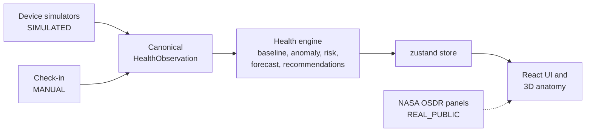

<figure>

<figcaption>Ground view during a simulated scenario. All device data in this prototype is simulated and labeled <code>SIMULATED</code>.</figcaption>
</figure>

## See it in action

Real screenshots of the running prototype. Every value on screen is simulated, except the NASA OSDR lab panels in the Data and model dialog.

<figure>

<figcaption><b>Acute event.</b> A combined rule fires within simulated minutes; actions say who can act.</figcaption>
</figure>
<figure>

<figcaption><b>Crew view.</b> Plain language, at most two things to do, a 30 second check-in.</figcaption>
</figure>
<figure>

<figcaption><b>Your normal, not an average.</b> Personal band, history and an 80% forecast interval.</figcaption>
</figure>
<figure>

<figcaption><b>Far from Earth.</b> Under Mars delays the crew gets an on board first step.</figcaption>
</figure>

## Architecture at a glance

Everything runs in the browser today: no backend, no database, no external service. The app only loads its own static files, including the 3D anatomy. A backend is planned behind the same contracts (see <a href="./architecture/target-architecture">Target architecture</a>).

  <a href="./intelligence/overview">Methods and their status</a>
  <a href="./intelligence/ai-and-analytics">AI and analytics approach</a>
  <a href="./architecture/overview">Architecture overview</a>
  <a href="./engineering/quick-start">Run it locally</a>

<strong>Decision support only.</strong> The Astronaut Health Intelligence Platform does not diagnose, does not recommend medication and does not replace the flight surgeon or Mission Control. Fixed thresholds are demo configuration, not official NASA limits. Simulated data is not clinical evidence. Read <a href="./overview/responsible-use">Responsible use</a>.

