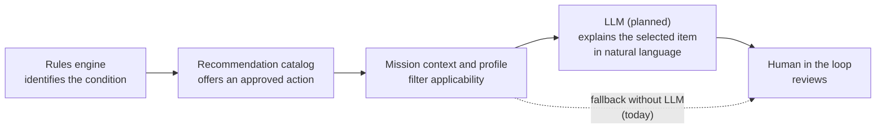

# AI & Analytics Approach

"Health intelligence" in the Astronaut Health Intelligence Platform (AHI) means **explainable statistics and transparent rules**, not a black box. This page says precisely what kind of analytics runs in the platform, what does not, and why.

::: tip In one sentence
At runtime there is **no language model (LLM), no trained machine learning model, no retrieval (RAG), no agent and no prompt**. The engine is statistical and rule based. A guarded LLM explanation layer is **planned** (spec US-024), and the project was built with AI assistance (Claude Code) as a development tool, which is not a platform feature.
:::

This was verified on 2026-11-14: `frontend/web/package.json` has no LLM or ML library (dependencies are React, three.js and its helpers, Recharts, zustand, lucide-react and clsx), and no source file under `frontend/web/src` calls a model API.

## Four families of techniques

| Family | What it is | In AHI | Status |
| --- | --- | --- | --- |
| **Statistical processing** | Descriptive statistics on each person's recent data | Median, MAD, quantiles, robust z-score, EWMA drift, persistence counts, 30 min window means | <StatusBadge status="IMPLEMENTED" /> |
| **Rule based scoring** | Explicit, versioned rules with ids and a documented formula | Metric rules, three combined rules, noisy-OR risk score, confidence, recommendation catalog, autonomy | <StatusBadge status="IMPLEMENTED" /> |
| **Traditional predictive models** | Statistical time series models and trained ML models | Damped Holt linear smoothing (a classical time series method with no training step) is implemented; Isolation Forest is planned; ARIMA, XGBoost and SHAP are not implemented | <StatusBadge status="IMPLEMENTED" /> Holt only |
| **Language models (LLMs)** | Generative text models | None at runtime; a guarded explanation layer is planned | <StatusBadge status="PLANNED" /> |

### Statistical processing

Each person is compared with themselves. The baseline uses medians and MAD because they resist outliers; drift uses an EWMA because a slow change is invisible to a single reading. Pages: [Personal baseline](./personal-baseline), [Anomaly detection](./anomaly-detection).

### Rule based scoring

Rules turn statistics into decisions a human can audit: each hit has a rule id, a level, a plain-language label and a weight, and the score formula fits in one line. Pages: [Risk assessment](./risk-assessment), [Recommendations](./recommendations), [Thresholds](./thresholds).

### Traditional predictive models

| Method | Status | Why |
| --- | --- | --- |
| Damped Holt linear smoothing with 80% interval | <StatusBadge status="IMPLEMENTED" /> | Simple, stable, needs no training data, uncertainty is explicit ([Forecasting](./forecasting)) |
| Isolation Forest (multivariate anomaly) | <StatusBadge status="PLANNED" /> | Spec US-019 (P1): requires an appropriate dataset, documented features, versioning and a false positive evaluation |
| ARIMA | <StatusBadge status="NOT_IMPLEMENTED" /> | Spec P2; not needed for 6 to 24 h horizons on short series |
| XGBoost risk model | <StatusBadge status="NOT_IMPLEMENTED" /> | Needs a labeled dataset of real outcomes, which does not exist publicly |
| SHAP explanations | <StatusBadge status="NOT_IMPLEMENTED" /> | Only meaningful for a trained model; rules already list their factors |
| IQR rule, CUSUM | <StatusBadge status="NOT_IMPLEMENTED" /> | Covered by robust z and EWMA drift |

### Why no trained model today

- **No suitable data.** There is no public continuous astronaut telemetry and no labeled outcomes; training on simulated data would only learn the simulator.
- **Explainability first.** Spec section 9.1: build explainable statistics first, then add ML. A flight surgeon must be able to see why a level changed.
- **Small, personal series.** Personal baselines with robust statistics work with a few days of data per person; a population model would need many people.
- **Non goal.** The spec explicitly excludes training a robust clinical model on small historical datasets (section 2.4).

## Planned LLM explanation layer

<StatusBadge status="PLANNED" /> Spec US-024 (P2) and section 9.7 describe a narrow role for a language model, placed **after** the rules:

Conceptual (not implemented): only the dashed path exists today.

Guardrails from the spec, which any implementation must keep:

| The LLM may | The LLM may not |
| --- | --- |
| Explain an already selected recommendation in natural language | Invent a clinical limit |
| Return a structured answer that shows source and limitations | Diagnose |
| Be switched off, with a fallback that works without it | Recommend medication or create a treatment |
| | Turn correlation into causation |
| | Hide uncertainty or the simulated origin of the data |

Governance rule 12 of the spec adds: generative AI only for controlled explanation and summarization ([Governance and privacy](../data/governance-and-privacy)).

## AI in the development process

The codebase and these documents were developed with the help of an AI coding assistant (Claude Code). That is a property of how the project was built, like the choice of editor; it does not run inside the platform, does not see crew data and does not make any decision in the product. All engine behavior is in reviewed source code and covered by tests ([Testing strategy](../engineering/testing)).

## Next steps

- [Overview and methods status](./overview)
- [Model card](../validation/model-card)
