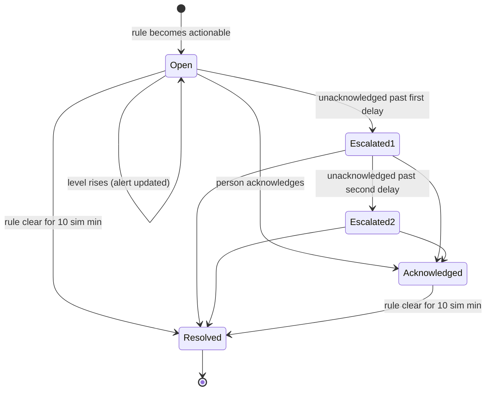

# Alerts & Escalation

## What it does

The Astronaut Health Intelligence Platform (AHI) turns actionable rule hits into **alerts** that a person must acknowledge. It keeps one alert per subject and rule, resolves it when the rule has been clear for a while, and **escalates** CRITICAL and HIGH alerts that nobody acknowledges. Every step is written to the audit trail, and serious alerts downlink a health packet to Earth.

## Inputs

| Input | Detail |
| --- | --- |
| Actionable rule hits | From [Risk assessment](./risk-assessment), with combined rules grouping their components (one alert instead of five, unless a component is CRITICAL) |
| Human actions | Acknowledge (from the alerts drawer or the critical banner) |
| Sim clock | Escalation and resolution use scheduled sim times, independent of simulation speed |

Self report rules never raise alerts.

## Method

| Behavior | Value (demo configuration) |
| --- | --- |
| Deduplication | One active alert per subject and rule. A rise in level updates it, or raises a new one if it was already acknowledged |
| Auto resolve | After the rule has been clear for 10 sim minutes (`resolvedAt`) |
| CRITICAL escalation | Level 1 after 5 sim minutes unacknowledged, level 2 after 15 |
| HIGH escalation | Level 1 after 30 sim minutes, level 2 after 90 |
| MODERATE | Never escalates |
| Stop | Acknowledging or resolving the alert stops escalation |
| Late evaluation | Jumps straight to the right escalation level (no missed steps at high speed) |
| History | Up to 150 alerts kept |
| Audit | `ALERT_ACK`, `ALERT_ESCALATED` with time and actor |
| Health packet | Alerts reaching HIGH or CRITICAL downlink one health packet to Earth per alert ([Earth link](./self-report-and-earth-link#earth-link)) |

## Outputs

- `Alert`: `severity`, `title`, `detail`, `region`, `metric`, `ruleId`, `createdAt`, `acknowledgedAt`, `acknowledgedBy`, `resolvedAt`, `escalatedAt`, `escalationLevel`.
- In the UI: the alerts bell count (pulses red when one is CRITICAL), the alerts drawer (Open and History tabs, "Unacknowledged for 6 min. Escalated."), the critical banner over the stage, timeline markers and an optional two tone chime (off by default).

## Limitations

- Escalation only changes what is shown and logged; there is no paging, no external notification and no on call roster.
- Timings are demo configuration, not an operational alerting policy.
- Alerts and audit live in memory and are lost on reload.

## Status

<StatusBadge status="IMPLEMENTED" /> Covered by `alerts.test.ts` (CRITICAL and HIGH escalation timings, late evaluation, stop on acknowledgement or resolution, audited escalations) and `risk.test.ts` (dedupe per subject and rule, auto resolve, acknowledged history, grouping). Spec requirement: US-025.

## Next steps

- [Self-report and Earth link](./self-report-and-earth-link)
- [Product tour: alerts drawer](../product/product-tour#alerts-drawer)
