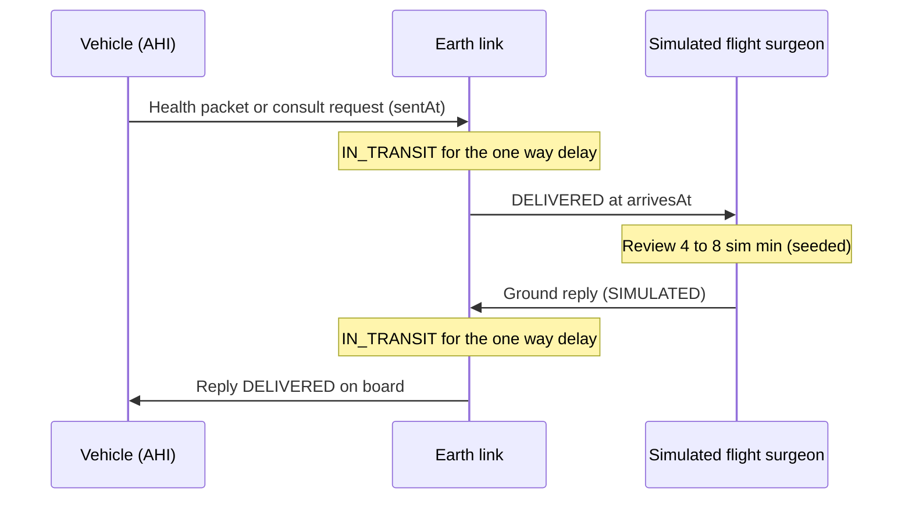

# Self-report & Earth Link

Two features of the Astronaut Health Intelligence Platform (AHI) address the hazards of **isolation and confinement** and **distance from Earth**. Background on both hazards: [Spaceflight health hazards](../science/spaceflight-hazards).

## Self-report

### What it does

A 30 second daily check-in, simplified in the style of the NASA Standard Measures, captures mood, fatigue, stress, sleep quality and symptoms. The answers are compared with **the person's own previous answers** and corroborate objective signals; they never raise an alert on their own.

### Inputs

| Question | Scale (1 to 5) |
| --- | --- |
| How is your mood? | Very low, Low, Okay, Good, Very good |
| How tired do you feel? | Rested, Slightly tired, Tired, Very tired, Exhausted |
| How stressed do you feel? | Calm, A little, Moderate, High, Very high |
| How well did you sleep? | Very poorly, Poorly, Fair, Well, Very well |

Plus optional symptom tags and a free note. Record format: [Data dictionary](../data/data-dictionary#daily-check-in-record).

- **Simulated** check-ins: one per astronaut each sim morning at about 07:00 UTC (personal offset of plus or minus 20 min), for the 14 pre-generated days and live. Answers follow the simulated state with seeded noise: progressive fatigue raises fatigue and stress and lowers mood and sleep quality; cabin CO2 makes a reported headache much more likely; exercise decline adds muscle soreness; sleep quality follows last night's efficiency and duration.
- **Manual** check-ins typed in the UI are `MANUAL` and replace that UTC day's simulated check-in.

### Method

Mood, fatigue and stress become the `MOOD`, `PERCEIVED_FATIGUE` and `STRESS` metrics (brain region), handled as daily metrics with a personal baseline:

```text
band = median of own answers +/- 2 x max(1.4826 x MAD, 0.75)
     = median +/- 1.5 when answers are very consistent (MAD = 0)
```

Integer answers often give a MAD of 0, so the floor of 0.75 sets the band. One answer 2 points away is outside the band. Two check-ins in a row outside the band, or one answer 3 points away, is MODERATE (rules R-PSY-01 to R-PSY-03).

| Rule of self report | Effect |
| --- | --- |
| Capped at MODERATE | `maxLevel` on the three metrics |
| One shared weight in the score | A check-in alone reaches MODERATE at most |
| Never raises an alert | Creates onboard recommendations only |
| Corroboration | High fatigue (4 or 5) in the last 2 check-ins adds a factor to R-FAT-01 without raising its level |
| Symptoms (R-PSY-04) | Informational factor, weight 0.05, for example "You reported a headache today"; never a diagnosis |

### Outputs

Check-in records (`CheckIn`), self report metric states, R-PSY factors and recommendations, audit events `CHECKIN_RECORDED`, timeline markers.

### Limitations

Self report is subjective; the simulated answers are a model of how people might answer; the scale is a simplification, not a validated questionnaire.

## Earth link

### What it does

The Earth link simulates the communication delay between the vehicle and Earth. Messages take the one way light time of the active profile, a simulated flight surgeon reviews and replies, and under Mars delays the crew gets an on board first step ([Recommendations](./recommendations#autonomy)).

### Inputs

| Profile | One way delay | Round trip |
| --- | --- | --- |
| ISS (low Earth orbit) | 0.5 s | 1 s |
| Moon | 1.3 s | 2.6 s |
| Mars (closest) | about 4 min | about 8 min |
| Mars (farthest) | about 22 min | about 44 min |

Delays are approximate public figures for light time, in `catalog.ts`.

### Method



```text
arrivesAt     = sentAt + one way delay
reply sentAt  = delivery time + review time (4 to 8 sim min, seeded per message)
earliest answer to a question = 2 x one way delay + 4 min
```

- Status is `IN_TRANSIT` until the sim clock passes `arrivesAt`, then `DELIVERED`. Timing does not depend on how often the engine runs (tested).
- Health packets are sent automatically once per alert reaching HIGH or CRITICAL; consult requests and handover reports are sent by a person.
- The simulated reply acknowledges, asks to continue the onboard protocol and to re-check in 10, 30, 60 or 120 min (CRITICAL, HIGH, MODERATE, LOW). It never prescribes medication and says it is simulated. Handover reports get no reply.
- Messages already in transit keep their arrival time when the profile changes.

### Outputs

`CommMessage` (`direction`, `kind`, `title`, `body`, `sentAt`, `arrivesAt`, `status`, related alert or recommendation, `data_origin`), audit events `COMM_SENT`, `COMM_RECEIVED`, `COMM_PROFILE_CHANGED`, and the Earth link drawer.


### Limitations

No real communication system is involved. Delays, review times and replies are demo configuration (`COMMS` in `config.ts`); ground replies are templates, not medical advice. Bandwidth, blackouts and message loss are not modeled.

## Status

<StatusBadge status="IMPLEMENTED" /> Covered by `checkins.test.ts` (8 tests: pre-generation, metrics, morning check-ins, fatigue and CO2 effects, manual replacement, MODERATE cap with no alert, high fatigue run) and `comms.test.ts` (9 tests: delivery and reply timing, independence from processing rate, non-prescriptive replies, automatic health packets, on board first step under Mars and not under ISS, audit).

## Next steps

- [Mission features](../product/mission-features): how both look in the app.
- [Alerts and escalation](./alerts)
