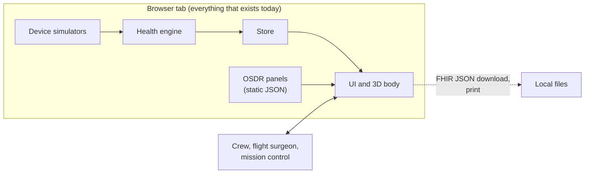

# Introduction

The **Astronaut Health Intelligence Platform** (AHI) is a health monitoring and decision support prototype for astronauts on long duration missions, built for the **NASA Space Apps Challenge 2026**, challenge *Health Monitoring Software*.

It brings together (simulated) data from the equipment astronauts wear and use, compares every signal with each person's own normal, detects deviations and trends, and shows the result on a 3D anatomical body, so anyone on the crew can understand their health at a glance and act early.

::: warning Decision support, not a medical device
AHI does not diagnose, does not recommend medication and does not replace the flight surgeon or Mission Control. All device data is **simulated** and labeled `SIMULATED` everywhere. Fixed thresholds are demo configuration, not official NASA limits. Details: [Responsible use](./responsible-use).
:::

## The problem

Long missions expose crews to risks that affect health, wellbeing and performance. NASA's Human Research Program groups them into five hazards of human spaceflight (radiation, isolation and confinement, distance from Earth, gravity fields, hostile and closed environments). The science behind them is summarized in [Spaceflight health hazards](../science/spaceflight-hazards).

Health signals come from many places: wearables, exercise devices, periodic exams, biological samples and cabin sensors. They arrive at different rates, units and formats, and not all of them are continuous. Medical support on Earth is far away; on a Mars mission any answer from the ground takes many minutes. The crew needs to understand its own state quickly and notice slow trends before they become operational problems.

## Objectives

The objectives come from the product spec (`PROJECT_MASTER.md`, section 2.3). The status column says how far the prototype goes.

| # | Objective | Status in the prototype |
| --- | --- | --- |
| 1 | Integrate historical, public and simulated data | <StatusBadge status="IMPLEMENTED" /> simulated devices plus two real OSDR panels as reference |
| 2 | Normalize measurements into one consistent model | <StatusBadge status="IMPLEMENTED" /> canonical `HealthObservation` |
| 3 | Present a health and mission context dashboard | <StatusBadge status="IMPLEMENTED" /> Ground view and Crew view |
| 4 | Establish an individual baseline | <StatusBadge status="IMPLEMENTED" /> [Personal baseline](../intelligence/personal-baseline) |
| 5 | Detect deviations and persistent patterns | <StatusBadge status="IMPLEMENTED" /> [Anomaly detection](../intelligence/anomaly-detection) |
| 6 | Project trends when there is enough data | <StatusBadge status="IMPLEMENTED" /> [Forecasting](../intelligence/forecasting) |
| 7 | Classify operational attention levels with transparent rules | <StatusBadge status="IMPLEMENTED" /> [Risk assessment](../intelligence/risk-assessment) |
| 8 | Present non-prescriptive, explainable recommendations | <StatusBadge status="IMPLEMENTED" /> [Recommendations](../intelligence/recommendations) |
| 9 | Record alerts, decisions and interventions | <StatusBadge status="IMPLEMENTED" /> in-browser audit trail, no persistence |
| 10 | Demonstrate controlled scenarios | <StatusBadge status="IMPLEMENTED" /> six scenarios and a guided demo |

The complete list of capabilities, including what is planned or deliberately absent, is in the [Feature status matrix](./feature-status).

## What AHI does

1. **Compares each person with their own baseline** (their personal normal range), per activity context.
2. **Detects deviations and trends**: sudden changes, slow drifts, persistent patterns and data quality problems.
3. **Combines signals with transparent rules** into an operational attention level (`LOW`, `MODERATE`, `HIGH`, `CRITICAL`) with a documented score and contributing factors.
4. **Projects short term trends** with an uncertainty interval, only when there is enough data.
5. **Suggests non-prescriptive next steps**, says why, and says who can act (crew on board or flight surgeon on Earth).
6. **Shows it all on a 3D body**, with plain language first and technical detail second.

The engine is statistical and rule based. There is no machine learning model and no language model at runtime: see [AI and analytics approach](../intelligence/ai-and-analytics).

## Scope

| In scope (prototype) | Out of scope |
| --- | --- |
| Simulated crew of four and a simulated cabin, six scenarios | Real astronaut data, real patients |
| Personal baselines, anomaly rules, risk score, forecasts, recommendations, alerts | Diagnosis, autonomous clinical decisions, medication or treatment |
| Earth link delay model, check-in, mission overview, handover report, what-if | Live connection to ISS devices or any real communication system |
| Two real NASA OSDR lab panels as historical reference | Training a clinical model on small historical datasets |
| FHIR R4 export of the current state | A certified clinical interface |

These non goals come from section 2.4 of the product spec.

## System boundaries

- Inside the boundary: simulation, engine, store and UI, all in one browser tab. The app calls no external service; it only loads its own static files, including the 3D anatomy.
- Outside: people (who read and act), and files they export. No backend, no database, no authentication: these are [planned](../architecture/target-architecture).

## What is real and what is simulated

| Item | Origin | Notes |
| --- | --- | --- |
| Every crew device reading (vitals, sleep, exercise, cabin, radiation) | <OriginBadge origin="SIMULATED" /> | Seeded in-browser simulator, labeled everywhere |
| Check-ins typed in the app, logged actions, acknowledgements | <OriginBadge origin="MANUAL" /> | Entered by a person in the interface |
| Personal baselines, risk scores, forecasts, group means | <OriginBadge origin="DERIVED" /> | Computed from records of known origin |
| Inspiration4 blood panels (OSD-569, OSD-575) | <OriginBadge origin="REAL_PUBLIC" /> | Historical reference only, never mixed with the simulated crew |
| The anatomical model of the 3D body | third party reference asset | Z-Anatomy atlas (CC BY-SA 4.0). One reference body for every crew member, not a scan and not health data ([3D anatomy assets](../data/anatomy-assets)) |

The labels are defined in [Data origins and provenance](../data/data-origins).

## Principles

- **Decision support only.** Every HIGH or CRITICAL item requires human review.
- **Personal baseline first.** Status compares you with yourself; the few fixed thresholds are a demo safety net ([Thresholds](../intelligence/thresholds)).
- **Transparency.** Rule ids, weights, model versions and data origins are visible. Correlation is presented as co-occurrence, never as cause.
- **Missing data is never normal.** It becomes `NO_DATA`, shown in grey with the words "Signal lost".
- **Plain language first.** "All good", "Keep an eye", "Act soon", "Act now", then the technical term.
- **Color is never the only cue.** Status always combines color, icon and words.

## Next steps

- [Use cases and stakeholders](./use-cases)
- [Run it locally](../engineering/quick-start)
- [Product tour](../product/product-tour)
