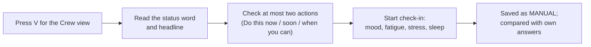
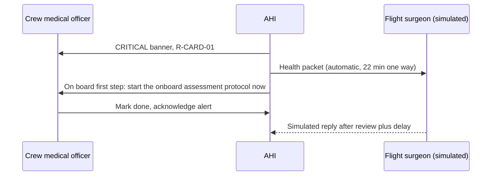

# User Journeys & Roles

How each stakeholder of the Astronaut Health Intelligence Platform (AHI) moves through the app to get a job done. Every journey below works in the running prototype with simulated data. Who the stakeholders are and why: [Use cases and stakeholders](../overview/use-cases).

::: info Roles are views, not permissions
There is no login. "Roles" here are ways of using the same screen; the Ground view and the Crew view are layouts. Role based access is [planned](../architecture/target-architecture#role-based-access).
:::

## Roles at a glance

| Role | Main view | Typical actions | Can act on board |
| --- | --- | --- | --- |
| Crew member | Crew view | Read own status, do the top actions, daily check-in | Yes, `ONBOARD` items |
| Crew medical officer | Ground view or Crew view | Start the onboard assessment protocol, mark actions done, consult Earth | Yes |
| Flight surgeon | Ground view | Investigate, acknowledge alerts, read factors and forecasts, hand over | Through the Earth link (delayed) |
| Mission Control | Ground view, Tools | Cabin, devices, dose planning, mission overview | Cabin actions on board are done by the crew |
| Researcher | Tools > Data and model | Inspect real datasets, provenance and the model card | No |

## Journey 1: crew member, morning check

1. The crew member opens the **Crew view** (toggle in the top bar or `V`): a big status word ("All good", "Act soon"), one sentence, and "Your body vs your normal".
2. At most **two actions** are shown, each with an autonomy badge. With nothing to do the screen says "Nothing to do right now. Keep your usual routine."
3. **Start check-in** opens the 30 second questionnaire. The answer becomes that day's check-in and is labeled `MANUAL`.

## Journey 2: flight surgeon, investigating a change

1. In the **Ground view**, a crew card or the timeline shows a lane turning amber.
2. Select the astronaut (click the card or press `1` to `4`). **What needs attention** shows the status, score, confidence and contributing factors.
3. Click the **Heart** chip (or the highlighted organ in the 3D body). The detail panel lists each metric with "11% above your normal", the normal range and the robust z.
4. Expand HRV: the trend chart shows the personal band, gaps where data is missing, the forecast cone and markers for alerts, actions and check-ins. **Why is this my normal?** shows the window, readings, median and MAD.
5. Read the forecast: "Projected to leave your normal range in ~5 h" or "Not enough data to forecast yet".

## Journey 3: acute event under Mars delay

1. A **CRITICAL banner** appears; the alerts bell pulses. Recommended actions say why and who can act.
2. Under **Mars farthest**, the app adds "Crew medical officer: start the onboard assessment protocol now" and states that the earliest Earth reply is about 48 min away.
3. The crew marks the rest action **done** (logged in the audit trail) and **acknowledges** the alert, which stops escalation.
4. A health packet travels to Earth; the simulated reply comes back after the review time plus the delay.

## Journey 4: Mission Control, cabin and budgets

1. The **Cabin** part of the vitals strip shows CO2, temperature, humidity and dose rate.
2. During the cabin CO2 scenario, the recommendation "Ventilate the module and check the CO2 scrubber" is tagged **Can act on board now**; the breathing rate shift is reported as co-occurrence.
3. **Tools > Mission overview** shows cumulative dose against the demo budget, exercise adherence and sleep per week.

## Journey 5: shift handover

1. **Tools > Shift handover** generates a report of the last 24 sim hours: crew at a glance, details, cabin, Earth link messages.
2. **Print**, **Export FHIR R4 Bundle (JSON)** or **Send to ground** (queued on the Earth link with the delay).

## Journey 6: researcher, real data with provenance

1. **Tools > Data and model > Real datasets**: pick OSD-569 or OSD-575 and an analyte.
2. See each subject across 7 time points, the lab range printed in the source, the `DERIVED` group mean, the assay protocol and the SHA-256 of the file.
3. **Model card** and **Data origins** tabs explain what the engine can and cannot do.

## Journey 7: judge or newcomer, guided demo

Click **Start demo**: the 10 step tour sets up each scene by itself (acute event, Mars delay, fatigue drift, what-if, Crew view, tools). Details: [Demo scenarios and guided demo](./demo-scenarios#guided-demo).

## Next steps

- [Product tour](./product-tour)
- [Design system and accessibility](./design-system)
