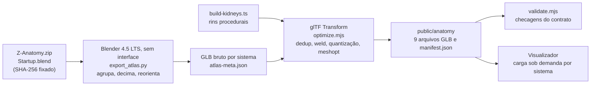

# Renderização da anatomia 3D

O corpo no centro da Astronaut Health Intelligence Platform (AHI) é um **atlas anatômico real**: o modelo aberto Z-Anatomy, preparado no Blender e distribuído como um binário glTF (GLB) comprimido por sistema anatômico. O visualizador (three.js com React Three Fiber) carrega os sistemas sob demanda, aplica materiais por classe de tecido e permite selecionar qualquer uma das 250 estruturas. O status de saúde, os alertas e os vitais ao vivo são desenhados por cima da anatomia.

Se o atlas não carregar, o visualizador troca sozinho para o **modelo procedural** anterior (gerado em código), para o painel sempre ter um corpo para mostrar.

Código: `frontend/web/src/features/anatomy/`. Os dados da página (status por região, frequência cardíaca e respiratória ao vivo) são <OriginBadge origin="SIMULATED" /> e <OriginBadge origin="DERIVED" />. A geometria não é dado de saúde: é um asset de referência de terceiros, com licença própria, documentado em [Assets de anatomia 3D](/pt/data/anatomy-assets).

::: info Um corpo de referência para todos
O atlas é um único modelo adulto de referência, mostrado para todos os tripulantes. Não é um exame do astronauta e não mostra anatomia individual. As cores de status vêm dos dados de saúde simulados, nunca do modelo.
:::

## Modelo de origem e por quê

| Pergunta | Resposta |
| --- | --- |
| Qual modelo | Z-Anatomy, "the libre 3D atlas of anatomy", baseado no BodyParts3D |
| Licença | CC BY-SA 4.0, então os arquivos derivados podem ser redistribuídos com atribuição |
| Por que este | Um corpo inteiro com estruturas nomeadas e organizadas por sistema anatômico, que é o que as camadas, a seleção e o mapeamento de saúde precisam; uma fonte em Blender que pode ser processada sem interface e de forma reproduzível |
| O que a AHI mudou | Manteve só os corpos físicos, agrupou cerca de 2.230 objetos de origem em 250 estruturas, decimou, levou ao referencial do visualizador e comprimiu |
| O que a AHI deixou de fora | Itens da fonte com licença não comercial (ouvido, rim), estruturas reprodutivas (corpo de referência neutro), rótulos e objetos auxiliares |

A proveniência completa, as linhas de atribuição obrigatórias, a lista de modificações e as exclusões estão em [Assets de anatomia 3D](/pt/data/anatomy-assets).

## Pipeline de assets

Os arquivos publicados são gerados, nunca editados à mão. Um comando (`npm run anatomy:build`, cerca de 4 a 5 minutos) roda a cadeia inteira.

| Etapa | Script (`frontend/web/scripts/anatomy/`) | Resultado |
| --- | --- | --- |
| 1. Fonte | `fetch-source.mjs` | Baixa o arquivo de um único host permitido, confere o SHA-256 e extrai o `Startup.blend` para uma pasta de cache ignorada pelo git |
| 2. Exportação no Blender | `export_atlas.py` | Seleciona os corpos reais, converte as curvas de vasos e nervos em tubos, agrupa, decima, leva ao referencial do atlas e grava um GLB bruto por sistema |
| 3. Rins | `build-kidneys.ts` | Rins procedurais da AHI (o modelo de rim da fonte não pode ser redistribuído) |
| 4. Otimização | `optimize.mjs` | glTF Transform: dedup, weld, prune, normais quantizadas, compressão meshopt; grava o `manifest.json` |
| 5. Validação | `validate.mjs` (`npm run anatomy:validate`) | Confere os arquivos publicados contra o contrato do manifesto |
| Opcional | `decode-for-preview.mjs`, `render_previews.py` | Pranchas de pré-visualização dos arquivos publicados (`--previews`) |

O Blender roda com `--factory-startup --disable-autoexec`, então scripts embutidos no arquivo de origem nunca são executados. Pré-requisitos e opções: [Assets de anatomia 3D](/pt/data/anatomy-assets#rebuild).

## Contrato do manifesto {#manifest-contract}

O `public/anatomy/manifest.json` é o contrato entre o pipeline, o visualizador e o mapeamento de saúde. O tipo é `AtlasManifest`, em `src/features/anatomy/atlas/types.ts`. O manifesto guarda só fatos de anatomia; qual região e quais métricas se relacionam a uma estrutura é decidido em código ([Mapeamento da anatomia para a saúde](/pt/architecture/data-model#anatomy-to-health-mapping)).

| Campo do manifesto | Conteúdo |
| --- | --- |
| `version` | Sobe quando ids ou arquivos mudam de forma incompatível (hoje `1`) |
| `generatedAt` | Momento do build (ISO 8601) |
| `bounds` | Extensão do corpo inteiro no referencial do atlas, em metros |
| `source` | `name`, `url`, `license`, `sha256` do arquivo de origem, `retrievedAt`, linhas de `attribution`, `excluded` (conteúdo da fonte deixado de fora, com o motivo) |
| `systems` | Uma entrada por arquivo: `id`, `label`, `file`, `bytes`, `triangles`, `structureCount` |
| `structures` | Um `AtlasStructure` por estrutura selecionável |

| Campo de `AtlasStructure` | Tipo | Significado |
| --- | --- | --- |
| `id` | string | Id estável em kebab-case, único no atlas. É também o nome do nó no GLB, por exemplo `femur-left` |
| `name` | string | Nome anatômico em inglês para exibição, por exemplo "Left femur" |
| `system` | `AnatomySystemId` | `integumentary`, `skeletal`, `muscular`, `cardiovascular`, `respiratory`, `nervous`, `digestive`, `urinary` ou `other`. É também a unidade de carga sob demanda |
| `tissue` | `TissueClass` | Define o material no visualizador (19 classes, veja [Materiais](#materials)) |
| `side` | `'L'`, `'R'` ou `null` | Estruturas pares levam o lado; estruturas medianas ou agrupadas ficam `null` |
| `center`, `min`, `max` | `[x, y, z]` | Centro e limites da caixa envolvente no referencial do atlas (metros). Usados no enquadramento da câmera e nas âncoras dos rótulos |
| `triangles` | number | Número de triângulos da malha |
| `sourceObjects` | string[] | Nomes dos objetos de origem unidos na estrutura (proveniência e depuração) |
| `origin` | `'z-anatomy'` ou `'ahi-procedural'` | De onde vem a geometria. Os dois rins são `ahi-procedural` |
| `parent` | string, opcional | Id de uma estrutura maior à qual esta pertence (três casos: artérias coronárias e veias cardíacas pertencem a `heart`; as estruturas profundas do cérebro pertencem a `brain`) |

A aplicação depende de sete ids, listados em `REQUIRED_STRUCTURE_IDS`: `skin`, `heart`, `lung-left`, `lung-right`, `brain`, `kidney-left`, `kidney-right`. Todo o resto é descoberto pelo manifesto em tempo de execução. O `manifest.contract.test.ts` valida o manifesto real e cada GLB contra esse contrato nos testes unitários.

**Referencial de todos os arquivos:** metros, Y para cima, corpo voltado para +Z, pés em y = 0, centrado em x = 0 e z = 0. A esquerda anatômica é +X. Cada estrutura é um nó de malha com transformação identidade.

## Sistemas e arquivos {#systems-and-files}

Números lidos do `manifest.json` (build de 14/11/2026). MB significa bytes divididos por 1.048.576.

| Sistema | Arquivo | Estruturas | Triângulos | Bytes | MB |
| --- | --- | --- | --- | --- | --- |
| `integumentary` | `integumentary.glb` | 1 | 48.503 | 256.684 | 0,24 |
| `skeletal` | `skeletal.glb` | 41 | 184.971 | 995.640 | 0,95 |
| `muscular` | `muscular.glb` | 133 | 299.818 | 1.737.700 | 1,66 |
| `cardiovascular` | `cardiovascular.glb` | 29 | 89.893 | 527.100 | 0,50 |
| `respiratory` | `respiratory.glb` | 6 | 44.991 | 235.056 | 0,22 |
| `nervous` | `nervous.glb` | 17 | 133.356 | 694.596 | 0,66 |
| `digestive` | `digestive.glb` | 10 | 41.990 | 228.016 | 0,22 |
| `urinary` | `urinary.glb` | 4 | 10.826 | 57.676 | 0,06 |
| `other` | `other.glb` | 9 | 26.008 | 135.708 | 0,13 |
| **Total** | 9 arquivos | **250** | **880.356** | **4.868.176** | **4,64** |

O que cada sistema contém:

| Sistema | Conteúdo |
| --- | --- |
| `integumentary` | `skin`: toda a superfície do corpo como uma única estrutura |
| `skeletal` | Crânio, mandíbula, dentes, vértebras por região, costelas, esterno, cartilagens e os ossos dos membros por lado (ossos da mão e do pé agrupados) |
| `muscular` | 64 estruturas por lado (músculos grandes um a um, pequenos agrupados) mais 5 grupos medianos |
| `cardiovascular` | Coração, artérias coronárias, veias cardíacas, grandes vasos, artérias e veias por região do corpo |
| `respiratory` | Pulmões, traqueia, brônquios, laringe, diafragma |
| `nervous` | Cérebro (córtex), estruturas profundas do cérebro, cerebelo, tronco encefálico, medula espinhal e os nervos por região |
| `digestive` | Língua, glândulas salivares, faringe, esôfago, estômago, intestinos, fígado, vesícula biliar, pâncreas |
| `urinary` | Rins (procedurais), ureteres, bexiga urinária |
| `other` | Olhos, tireoide, hipófise, pineal, glândulas suprarrenais, timo, baço |

## Mapa de componentes {#component-map}

Tudo fica em `frontend/web/src/features/anatomy/`. A API pública não mudou com o atlas: `AnatomyViewer({ className, showControls, autoRotate, bloom, labelScale, compact, legend })`.

| Arquivo ou pasta | Papel |
| --- | --- |
| `AnatomyViewer.tsx` | Ponto de entrada. Escolhe o visualizador do atlas ou o fallback procedural, dentro de um error boundary |
| `atlas/types.ts` | Contrato do manifesto (`AtlasManifest`, `AtlasStructure`, `REQUIRED_STRUCTURE_IDS`) |
| `atlas/manifest.ts` | Carrega e guarda o manifesto em cache (`loadAtlasManifest`, `useAtlasManifest`). Sem three.js |
| `atlas/health.ts` | O único lugar que liga a anatomia aos dados de saúde. TypeScript puro, com testes unitários |
| `viewer/AtlasViewer.tsx` | Canvas, sobreposições (tooltip, carregamento, legenda, controles, legenda de fonte), níveis de qualidade |
| `viewer/AtlasScene.tsx` | Carga sob demanda dos sistemas visíveis, picking, laço por quadro |
| `viewer/runtime.ts` | Lado imperativo em three.js: uma malha por estrutura, estados, movimento do coração e dos pulmões |
| `viewer/tissueMaterials.ts` | Um material por classe de tecido, mais o trecho de shader dos estados do visualizador |
| `viewer/Studio.tsx` | Iluminação, ambiente, piso e sombra de contato |
| `viewer/AtlasCamera.tsx` | Controles de órbita, voo até a seleção, vistas predefinidas, rotação em repouso |
| `viewer/SystemControls.tsx` | Popover de camadas, opacidade da pele, presets, botões de vista, reset |
| `viewer/Attribution.tsx` | Legenda de fonte permanente e o popover "About the reference anatomy" |
| `viewer/layers.ts` | Camadas derivadas do manifesto, presets, foco da câmera, âncoras dos rótulos |
| `viewer/atlasLoader.ts` | Download dos GLB com progresso em bytes, decodificação meshopt, cache de sessão |
| `viewer/atlasStore.ts` | Estado local da vista (hover, camadas, opacidade da pele, pedidos de câmera) e chaves do laboratório |
| `procedural/` | O visualizador procedural anterior (campos de distância com sinal poligonizados com Surface Nets, gerados em Web Workers), mantido como fallback automático |
| `Labels.tsx`, `Legend.tsx`, `regions.ts`, `hooks.ts` | Compartilhados pelos dois visualizadores: rótulos flutuantes, legenda de status, configuração das regiões |
| `lab.tsx` (com `anatomy-lab.html`) | Página de laboratório para desenvolvimento |

O painel que descreve uma estrutura selecionada fica fora desta pasta: `src/features/attention/StructureDetail.tsx` e `RegionEvents.tsx` ([Tour do produto](/pt/product/product-tour#selecting-a-structure)).

## Estratégia de carga e restrição offline {#loading}

| Decisão | Detalhe |
| --- | --- |
| Chunk sob demanda | O visualizador inteiro é carregado com `import()` dinâmico a partir do palco central |
| Manifesto primeiro | O `manifest.json` é buscado uma vez por sessão. Enquanto carrega, o visualizador mostra "Loading reference anatomy" |
| Sistemas padrão pré-carregados | Assim que o manifesto é conhecido, os arquivos das camadas padrão começam a baixar, antes de o canvas montar. São todos os arquivos menos o `muscular.glb`: 8 arquivos, cerca de 3,0 MB |
| Sob demanda | O `muscular.glb` (1,66 MB) é buscado na primeira vez que a camada muscular é necessária (selecionada, em alerta ou ligada) |
| Progresso | `fetch` em streaming com progresso em bytes; os totais vêm dos tamanhos do manifesto. A primeira carga mostra um cartão de progresso; as seguintes, uma pílula pequena no topo |
| Cache de sessão | A geometria já lida fica em cache durante a sessão, então trocar de astronauta ou remontar o visualizador nunca baixa nem processa um arquivo duas vezes. Só posições e normais ficam na GPU |
| Validação | Uma resposta que não é um GLB (por exemplo uma página HTML devolvida para um arquivo ausente) é rejeitada antes do parse |

**Restrição offline.** A demo precisa funcionar sem acesso à internet, então todo arquivo vem do servidor do próprio app. O visualizador só pede arquivos da sua pasta `/anatomy/`: o decodificador meshopt é o que vem com o three.js (sem Draco, sem decodificador de CDN) e o ambiente de iluminação é construído em código (sem imagem HDR remota).

## Materiais por classe de tecido {#materials}

O modelo de origem tem cores chapadas e nenhuma textura. O visualizador atribui um material fisicamente baseado por classe de tecido (`TISSUE` em `tissueMaterials.ts`); o detalhe de superfície vem da geometria e da iluminação.

| Classes de tecido | Aparência |
| --- | --- |
| `skin` | Translúcida, com um passe de profundidade para a pele nunca se misturar com ela mesma. A opacidade é escolhida pelo usuário (padrão 22%) |
| `bone`, `airway`, `gland` | Material padrão fosco na cor natural do tecido |
| `muscle`, `tendon`, `lung` | Reflexo suave de fibra ou veludo em ângulos rasantes (sheen) |
| `cartilage`, `tooth`, `heart`, `brain`, `liver`, `kidney`, `gut`, `eye`, `organ` | Camada fina e úmida por cima (clearcoat), mais forte nos olhos |
| `artery`, `vein`, `nerve` | Tubos finos em vermelho, azul e amarelo, empurrados para fora em proporção à distância da câmera, para continuarem legíveis no corpo inteiro e manterem o calibre real de perto |

As cores dos tecidos são aparência de anatomia de referência, não codificação de status. Os materiais são compartilhados: uma instância por tecido, região do corpo e variante (sólido, fantasma, hover, selecionado). Um pequeno trecho de shader soma os estados do visualizador à iluminação padrão por meio de uniforms compartilhados, então uma escrita por região por quadro atualiza todos os materiais.

## Iluminação e renderização {#lighting}

| Elemento | Detalhe |
| --- | --- |
| Ambiente | Mapa de ambiente procedural feito de seis painéis de luz (`Lightformer` do drei), renderizado uma vez |
| Luzes | Uma luz principal que projeta sombras, uma de preenchimento e duas de contorno, mais uma luz hemisférica fraca. O conjunto gira com a câmera, então toda vista predefinida é iluminada do mesmo jeito |
| Sombras | O mapa de sombras só é refeito quando o conjunto de luzes girou um pouco ou o conteúdo mudou, nunca a cada quadro. Uma sombra de contato sob os pés só é redesenhada quando o conteúdo muda |
| Piso | Uma mancha suave de luz com anéis finos de medição |
| Tone mapping | ACES filmic |
| Pós-processamento | Bloom só acima de luminância 1 (destaques de status), depois o tone mapping. Pode ser desligado pela prop `bloom` |
| Níveis de qualidade | `high`: razão de pixels até 1,75, multisampling 4x, sombras. `low`: razão de pixels 1, multisampling 2x, sem sombras. O visualizador cai para `low` quando o monitor de desempenho acusa queda |
| Entrada | Uma faixa de luz sobe pelo corpo uma vez quando a primeira geometria chega |

## Interação {#interaction}

### Navegação e vistas predefinidas

- **Órbita** (girar, zoom, pan limitado) com amortecimento. O alvo da órbita nunca sai do corpo.
- **Vistas predefinidas**: "Front", "Back", "Left" e "Right" (esquerda e direita do próprio corpo), com transição animada.
- **Reset**: enquadra o corpo inteiro de novo e limpa a seleção.
- **Rotação em repouso**: o corpo gira devagar depois de 5 segundos sem interação, e para enquanto algo está selecionado ou sob o ponteiro.
- O corpo inteiro é ajustado à altura livre entre a margem superior e os controles, e ajustado de novo quando o contêiner muda de tamanho.

### Seleção

- **Passar o ponteiro** (não em telas de toque) mostra um tooltip com o nome da estrutura, o sistema, o status da região e um valor-chave, ou "Not monitored" para estruturas só de contexto.
- **Clicar** seleciona uma estrutura. A câmera voa até ela pelo lado do corpo em que ela está, todo o resto vira um fantasma translúcido e o painel da direita abre o detalhe da estrutura. Clicar de novo na estrutura selecionada, ou no espaço vazio, limpa a seleção. `Esc` volta.
- Os **chips dos sistemas** ao lado do corpo selecionam uma região inteira, não uma estrutura.
- O visualizador chama `selectStructure(id, regionOfStructure(structure))` no store do app. O contrato de seleção está em [Modelo de dados](/pt/architecture/data-model#selection-contract).

### Camadas e opacidade da pele

O popover "Layers" lista uma chave por sistema anatômico encontrado no manifesto, com a contagem de estruturas no tooltip.

| Camada | Padrão | Notas |
| --- | --- | --- |
| "Skin" | ligada | Translúcida. O controle "Skin opacity" vai de 0 a 100% (padrão 22%) |
| "Muscular" | automática | Aparece quando os músculos são selecionados ou a região deles está em alerta |
| "Skeletal", "Cardiovascular", "Respiratory", "Digestive", "Urinary" | ligadas | |
| "Nervous" | ligada | Cérebro, cerebelo, tronco encefálico e medula espinhal |
| "Nerves" | desligada | Os nervos periféricos são uma camada separada porque poluem a imagem e são só de contexto |
| "Other" | desligada | Glândulas, timo, baço |
| Olhos | acompanham "Skin" e "Other" | Não têm chave própria, para as pálpebras abertas nunca mostrarem órbitas vazias |

- **Presets**: "Default", "Organs", "Skeleton", "Muscles" e "All". Cada um define as camadas e uma opacidade de pele adequada.
- A camada da região ou estrutura selecionada fica sempre visível, não importa o que as chaves digam.
- Em contêineres estreitos os controles viram uma pílula compacta e os botões de vista vão para dentro do popover.

## Estados visuais {#visual-states}

As cores de status são as mesmas do `STATUS_META` usadas em todo o app ([Design system](/pt/product/design-system#status-cor-icone-e-palavra)). O status de cada região vem do motor ([Avaliação de risco](/pt/intelligence/risk-assessment)).

| Estado | O que se vê | Significado |
| --- | --- | --- |
| Normal | Cor natural do tecido, sem destaque | A região está nominal (`LOW`), ou a estrutura é só de contexto |
| Sob o ponteiro | Tom ciano e um tooltip | A estrutura sob o ponteiro. Clique para selecionar |
| Selecionado | Contorno ciano na seleção; todas as outras estruturas viram um fantasma azul fraco e a pele esmaece | Foco em uma estrutura ou em uma região. O efeito fantasma é auxílio de visualização, não status |
| Relacionado a alerta | Contorno pulsante na cor do status (âmbar `MODERATE`, laranja `HIGH`, vermelho `CRITICAL`, mais forte e mais rápido conforme a gravidade); os órgãos monitorados também ganham um brilho que atravessa a caixa torácica, e a parede do corpo à frente deles fica translúcida | A região à qual a estrutura pertence não está nominal. A cor marca a região, não um achado naquela estrutura |
| Dado indisponível | Tecido cinza e dessaturado, sem pulso; coração ou pulmões param de se mover | A região está `NO_DATA`. Dado ausente nunca é desenhado como normal |

- Quando o status de uma região muda, um **pulso de varredura** curto (uma frente de onda na cor do status) parte dessa região. Ele não dispara na primeira carga nem na troca de tripulante.
- Sistemas de corpo inteiro (pele, músculos, esqueleto) brilham menos que órgãos isolados, porque centenas de estruturas acendem de uma vez.
- Estruturas só de contexto (órgãos digestivos, glândulas, nervos, olhos e outras) nunca mostram cor de status.

::: info Olhos
Os olhos são duas estruturas do atlas (`eye-left`, `eye-right`). Podem ser selecionados, mas são só de contexto: nenhum aparelho de medição ocular alimenta este protótipo, então não têm status. O acompanhamento da SANS a partir de exames periódicos está no [roadmap](/pt/resources/roadmap).
:::

## Fisiologia ao vivo {#live-physiology}

A cena lê a frequência cardíaca e a respiratória atuais do astronauta selecionado **a cada quadro, sem assinar o store**, então a animação nunca causa renderizações do React.

| Estrutura | Guiada por | Como |
| --- | --- | --- |
| Coração, com as artérias coronárias e as veias cardíacas | `HEART_RATE` ao vivo | A fase do batimento avança FC / 60 por segundo. Cada batimento é uma curva "lub dub" (primeira bulha, depois a segunda a cerca de 30% do período); o coração cresce até 5% em torno do seu centro |
| Pulmões | `RESPIRATORY_RATE` ao vivo | A fase da respiração avança FR / 60 por segundo, com cerca de 40% de inspiração e 60% de expiração; os pulmões crescem até cerca de 3 a 4% nos três eixos |

Quando a região do coração ou dos pulmões está `NO_DATA`, ou o valor está ausente, o movimento para. Um coração que para de bater no cenário de falha de sensor é proposital.

## Picking {#picking}

- Os raios são testados contra hierarquias de volumes envolventes construídas por sistema (`Bvh` do drei).
- O picking de hover é limitado a um raio a cada 45 ms enquanto o ponteiro se move, e nunca roda durante um arrasto.
- Prioridade: uma estrutura sólida vence uma fantasma, e a pele translúcida só conta quando nada mais é atingido, para a anatomia interna continuar alcançável através dela. Quando a pele está quase opaca (75% ou mais), ela é selecionada como qualquer superfície sólida.
- Um clique é pressionar e soltar o ponteiro dentro de 6 pixels; um arrasto nunca seleciona.

## Rótulos e legenda {#labels}

- **Rótulos flutuantes** aparecem para cada região que não está nominal e para a região em foco. São DOM puro sobre o canvas, posicionados por um projetor dentro da cena, sem renderização React por quadro. As âncoras vêm do manifesto (o centro do órgão, ou um ponto fixo do corpo para sistemas de corpo inteiro).
- Os rótulos usam forma, cor e palavra, nunca só cor.
- **Legenda**: recolhível, aberta por padrão quando o visualizador tem mais de 820 px de largura, com a nota "Vs personal baseline. Simulated data."
- **Legenda de fonte**: "Reference anatomy: Z-Anatomy atlas (CC BY-SA 4.0)" fica sempre visível sob o corpo. O botão de informação abre os créditos e a declaração de que este é um único modelo de referência.
- No **modo apresentação**, rótulos, tooltip, legenda e controles crescem 1,3 vez.

## Observações de desempenho {#performance-observations}

::: warning Observações, não benchmarks
Os números abaixo foram observados pela equipe em um único notebook de desenvolvimento (AMD Ryzen 5 3500U com gráficos integrados Radeon Vega 8, Chrome sem interface, taxa de quadros limitada a 60 pelo vsync). Não foram repetidos em outras máquinas e não são um benchmark. Foram medidos no build de assets imediatamente anterior ao publicado, que tinha cerca de 0,1% a mais de triângulos.
:::

| Situação | Quadros por segundo | Draw calls | Triângulos desenhados por quadro (todos os passes) |
| --- | --- | --- | --- |
| Página de laboratório, sistemas padrão | 58 a 60 fps | 119 | cerca de 578 mil |
| Página de laboratório, todos os sistemas | 56 a 59 fps | 273 | cerca de 930 mil |
| "Ground view" em 1440x900 | 55 a 57 fps | | |
| "Crew view" | 58 fps | | |
| "Ground view" com o detalhe de um sistema aberto | 39 a 42 fps | | |

- Com um painel de detalhe aberto, o visualizador procedural anterior mediu 38 fps no mesmo estado; ali o limite é o painel, não a cena 3D.
- Picking de hover: 0,4 a 2,8 ms por raio.
- Atlas na tela 2,4 a 3,6 s depois da navegação, com o cache do navegador aquecido.

O que mantém o visualizador rápido:

| Decisão | Efeito |
| --- | --- |
| Um GLB por sistema, carregado sob demanda | O maior arquivo (músculos) não é baixado para a vista padrão |
| Compressão meshopt, normais quantizadas | 4,64 MB para 880 mil triângulos |
| Uma malha por estrutura, materiais e uniforms compartilhados | Mudanças de material acontecem em eventos; por quadro, só algumas escritas de uniform e as matrizes do coração e dos pulmões |
| Shader fantasma barato, sem iluminação | Dezenas de camadas fantasma sobrepostas em um close continuam viáveis |
| Sombras renderizadas sob demanda | Sem passe de sombra na maioria dos quadros |
| Árvores de volumes e hover limitado | O picking fica na casa dos milissegundos |
| Aquecimento de shaders | Os shaders de fantasma e de alerta compilam no primeiro quadro, não na primeira seleção ou no primeiro alerta |

## Fallback e tratamento de erros {#fallback}

Uma falha do 3D nunca pode quebrar o painel.

| Situação | Comportamento |
| --- | --- |
| Manifesto ainda carregando | Mensagem "Loading reference anatomy" |
| Manifesto ausente, malformado ou sem as estruturas obrigatórias | Modelo procedural, com o aviso "Reference atlas unavailable. Showing simplified model." |
| Falha ao carregar um sistema que contém uma estrutura obrigatória | Mesmo fallback |
| Falha ao carregar um sistema opcional | O corpo continua; a chave dessa camada fica desabilitada e marcada "n/a" |
| O visualizador do atlas lança erro ao renderizar | O error boundary mostra o modelo procedural |
| O modelo procedural também falha | Mensagem "3D body view unavailable"; o resto do painel continua funcionando |

O visualizador procedural é um chunk separado, baixado só quando necessário. Ele mostra as sete regiões do corpo com a mesma linguagem de status e a animação ao vivo, mas não tem estruturas selecionáveis: a seleção de região, os chips, os alertas e o detalhe da região continuam funcionando, e uma estrutura selecionada antes é descrita como indisponível.

## Laboratório de desenvolvimento {#lab}

O `npm run dev` também serve uma página só de desenvolvimento em `/anatomy-lab.html`. Ela simula status de regiões e vitais pelo store para conferir cada estado visual (camadas, seleção de estrutura, status, fallback forçado) e mostra estatísticas do renderizador: quadros por segundo, draw calls, triângulos, tempo de picking e número de estruturas.

## Limitações {#limitations}

- Um único modelo de referência, em uma única escala, para todos os tripulantes. A fonte é um modelo adulto masculino; só a região da virilha foi neutralizada, então a constituição, as proporções e o tórax continuam os da fonte. Ele não se adapta a sexo, altura ou composição corporal (um modelo feminino de referência está no [roadmap](/pt/resources/roadmap)).
- Sem texturas: a fonte não tem, então o detalhe de superfície vem da geometria e dos materiais.
- Os rins são formas procedurais simples e ficam atrás dos intestinos na vista frontal; selecionar a região dos rins leva a câmera para as costas.
- O hover não existe em dispositivos de toque (um toque seleciona).
- O nível de qualidade baixo é um caminho só de ida: depois que o monitor de desempenho acusa queda, o visualizador fica em `low` até ser remontado.
- A renderização em si não tem testes automatizados. A camada de dados tem: contrato do manifesto, mapeamento de saúde e seleção ([Estratégia de testes](/pt/engineering/testing)). Os estados visuais são conferidos à mão na página de laboratório.

As limitações dos assets (decimação, agrupamento, estruturas ausentes) estão em [Assets de anatomia 3D](/pt/data/anatomy-assets#limitations). Todas as limitações da plataforma: [Limitações e problemas conhecidos](/pt/validation/limitations).

## Como atualizar o modelo {#update}

1. Siga o procedimento de rebuild e de atualização em [Assets de anatomia 3D](/pt/data/anatomy-assets#update-procedure). O guia completo, com todas as regras e opções, é o <CodeLink path="docs/anatomy-assets.md" /> no repositório.
2. Mantenha os ids das estruturas estáveis. Os sete ids obrigatórios precisam existir; caso contrário `npm run anatomy:validate` e o `manifest.contract.test.ts` falham.
3. Para mudar a região de uma estrutura, edite só o `atlas/health.ts` ([Como mapear uma estrutura para uma região](/pt/engineering/contributing#map-a-structure-to-a-region)).
4. Atualize os números desta página a partir do novo `manifest.json`.

## Status

<StatusBadge status="IMPLEMENTED" /> Visualizador do atlas, seleção de estrutura, mapeamento de saúde, carga sob demanda por sistema e fallback procedural. <StatusBadge status="PLANNED" /> Modelo feminino de referência, texturas e monitoramento ocular ([Matriz de status das funcionalidades](/pt/overview/feature-status#interface-e-produto)).

## Próximos passos

- [Assets de anatomia 3D](/pt/data/anatomy-assets): proveniência, licença e passos de rebuild.
- [Mapeamento da anatomia para a saúde](/pt/architecture/data-model#anatomy-to-health-mapping): quais estruturas se relacionam a quais métricas.
- [Tour do produto](/pt/product/product-tour#corpo-3d-e-chips-dos-sistemas): como as pessoas interagem com o corpo.
- [Design system e acessibilidade](/pt/product/design-system): cores e pistas de status.
