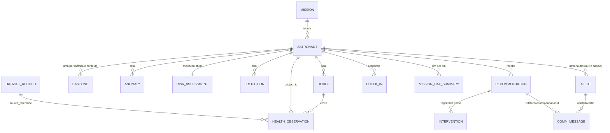

# Modelo de dados e contratos

Na Astronaut Health Intelligence Platform (AHI), todo dado, de qualquer equipamento ou fonte, vira uma **observação canônica** antes de chegar ao motor. A fonte da verdade é `frontend/web/src/types/domain.ts`, que segue a seção 6 do `PROJECT_MASTER.md`.

::: info Regra do contrato
`domain.ts` é compartilhado por motor, store e interface. Só são permitidas **mudanças aditivas**: nunca renomeie nem remova campos usados por outros módulos.
:::

## HealthObservation

Uma linha por medida. Vale para sinais vitais, ambiente da cabine (`subject_id: "CABIN"`), laboratório e autorrelato.

```json
{
  "observation_id": "uuid ou chave idempotente da origem",
  "subject_id": "AST-01",
  "mission_id": "MISSION-001",
  "device_id": "DEV-BIO-AST-01",
  "metric_code": "HEART_RATE",
  "value": 72.4,
  "unit": "bpm",
  "measured_at": "2026-11-13T14:30:00Z",
  "received_at": "2026-11-13T14:30:02Z",
  "data_origin": "SIMULATED",
  "source_reference": {
    "repository": null,
    "dataset_accession": null,
    "file_name": null,
    "record_reference": null
  },
  "quality": { "status": "VALID", "confidence": 1.0, "is_estimated": false },
  "context": { "mission_phase": "IN_FLIGHT", "activity": "REST" },
  "metadata": {}
}
```

| Campo | Obrigatório | Tipo | Regras |
| --- | --- | --- | --- |
| `observation_id` | sim | string | Único. Use uma chave idempotente da origem para deduplicar |
| `subject_id` | sim | string | Pseudônimo (`AST-01`...). `"CABIN"` para ambiente |
| `mission_id` | recomendado | string | Missão ou estudo |
| `device_id` | recomendado | string | Dispositivo ou instrumento lógico |
| `metric_code` | sim | enum | Um dos códigos do catálogo |
| `value` | sim | number ou null | **`null` quando ausente, nunca 0** |
| `unit` | sim | string | Unidade canônica após normalização |
| `measured_at` | sim | ISO 8601 UTC | Sempre UTC |
| `received_at` | recomendado | ISO 8601 UTC | Momento da ingestão |
| `data_origin` | sim | enum | `REAL_PUBLIC`, `DERIVED`, `SIMULATED`, `MANUAL` |
| `source_reference` | sim se importado | objeto | Repositório, accession, arquivo, registro |
| `quality.status` | sim | enum | `VALID`, `QUESTIONABLE`, `INVALID`, `MISSING` |
| `quality.confidence` | recomendado | 0 a 1 | Menor para valores estimados ou duvidosos |
| `quality.is_estimated` | recomendado | boolean | `true` para valores derivados ou interpolados |
| `context.mission_phase` | recomendado | enum | `PRE_FLIGHT`, `IN_FLIGHT`, `POST_FLIGHT` |
| `context.activity` | recomendado | enum | `SLEEP`, `REST`, `WORK`, `EXERCISE`, `EVA` |
| `metadata` | opcional | objeto | Valor e unidade originais, rótulo do ponto de coleta, tipo de população |

Regras do modelo:

- timestamps em UTC, preservando o fuso de origem quando relevante;
- normalizar unidades **sem apagar o valor original**;
- nunca substituir valor ausente por zero;
- registrar qualidade, ausências e método de cálculo;
- registrar fonte e dataset de todo dado importado;
- deduplicar por `observation_id` ou chave idempotente.

## Entidades

As principais entidades do contrato TypeScript:

| Entidade | Responsabilidade |
| --- | --- |
| `Astronaut` | Perfil pseudonimizado (id, callsign, função, idade, sexo, dia de missão) |
| `Mission` | Missão, veículo, fase, início e atraso de comunicação só de ida |
| `Device` | Equipamento lógico: tipo, pessoa, estado, bateria, sinal, última leitura, métricas |
| `HealthObservation` | Medida individual (acima) |
| `Baseline` | Faixa pessoal por métrica: mediana, MAD, p05, p95, faixa baixa e alta, janela, versão |
| `MetricState` | Estado atual de uma métrica: valor, status, z robusto, deriva, persistência, explicação |
| `Anomaly` | Desvio detectado, com método e explicação não diagnóstica |
| `RiskAssessment` | Nível, escore 0 a 100, fatores, regras, confiança, versão do modelo, limitações, frase de status |
| `Prediction` | Projeção com pontos, intervalo, horizonte, tempo até sair da faixa e aviso |
| `Recommendation` | Ação sugerida: título, motivo, prioridade, público, revisão humana, autonomia |
| `Intervention` | Ação registrada ("Mark done") |
| `Alert` | Notificação com reconhecimento, resolução e escalonamento |
| `AuditEvent` | Trilha de auditoria |
| `RegionState` | Status de um sistema do corpo e resumo em linguagem simples |
| `CommMessage` | Mensagem entre nave e Terra, com envio, chegada e estado |
| `CheckIn` | Check-in diário (humor, fadiga, estresse, sono, sintomas) |
| `MissionDaySummary` | Resumo de um dia de missão (sono, exercício, FC de repouso, HRV, dose, nível) |
| `StatusFrame` | Quadro da linha do tempo (status de cada pessoa e da cabine) |
| `InterventionComparison` | Trajetórias com e sem uma ação ("e se") |
| `DatasetRecord` | Registro de proveniência de um dataset real |

### Diagrama de relacionamento



As ligações são por identificador (`astronautId`, `subject_id`, `recommendationId`, `relatedAlertId`). Não há banco de dados nem chaves estrangeiras: as entidades vivem em memória no navegador. A cabine usa `subject_id: "CABIN"` e alertas de cabine têm `astronautId: null`.

## Enumerações

| Tipo | Valores |
| --- | --- |
| `DataOrigin` | `REAL_PUBLIC`, `DERIVED`, `SIMULATED`, `MANUAL` |
| `QualityStatus` | `VALID`, `QUESTIONABLE`, `INVALID`, `MISSING` |
| `RiskLevel` | `LOW`, `MODERATE`, `HIGH`, `CRITICAL` (nível de atenção do protótipo, não classificação médica) |
| `Status` | `RiskLevel` mais `NO_DATA` (cobre dado velho e dispositivo desligado) |
| `MissionPhase` | `PRE_FLIGHT`, `IN_FLIGHT`, `POST_FLIGHT` |
| `ActivityContext` | `SLEEP`, `REST`, `WORK`, `EXERCISE`, `EVA` |
| `BodyRegionId` | `brain`, `heart`, `lungs`, `kidneys`, `muscles`, `bones`, `skin` |
| `DeviceKind` | `BIO_MONITOR`, `ACTIGRAPHY`, `BP_MONITOR`, `EXERCISE_CEVIS`, `EXERCISE_ARED`, `EXERCISE_T2`, `ENV_SENSOR`, `DOSIMETER` |
| `DeviceState` | `ONLINE`, `DEGRADED`, `DATA_STALE`, `OFFLINE` |
| `ScenarioId` | `NOMINAL`, `PROGRESSIVE_FATIGUE`, `ENVIRONMENTAL_CO2`, `PERFORMANCE_DECLINE`, `SENSOR_FAILURE`, `ACUTE_CARDIO` |
| `InterventionKind` | `REST_PROTOCOL`, `SLEEP_EXTENSION`, `HYDRATION`, `EXERCISE_ADJUSTMENT`, `SENSOR_CHECK`, `CABIN_VENTILATION`, `MEDICAL_CONSULT` |
| `CommProfileId` | `ISS`, `MOON`, `MARS_NEAR`, `MARS_FAR` |
| Autonomia da recomendação | `ONBOARD`, `GROUND_REVIEW` |
| Público da recomendação | `CREW`, `FLIGHT_SURGEON`, `MISSION_CONTROL` |

São uniões de strings em TypeScript (o projeto não usa `enum`).

## Mapeamento da anatomia para a saúde {#anatomy-to-health-mapping}

O atlas 3D tem 250 estruturas anatômicas; a plataforma monitora sete regiões do corpo. Um único arquivo, `src/features/anatomy/atlas/health.ts`, decide a qual região uma estrutura pertence. É o **único lugar que liga a anatomia aos dados de saúde**: reaproveita `BodyRegionId` e o catálogo de métricas e não acrescenta nenhum dado próprio. Esta tabela é a cópia canônica desse mapeamento.

| Estruturas (regra) | Região | Métricas relacionadas (do catálogo) | No atlas | Como ler |
| --- | --- | --- | --- | --- |
| Sistema tegumentar: pele | `skin` | `SKIN_TEMPERATURE` | 1 | Uma leitura de superfície da camiseta inteligente. Não é um mapa da pele inteira |
| Sistema esquelético: ossos e cartilagens | `bones` | `RADIATION_DOSE` | 39 | A dose acumulada é exposição de corpo inteiro, mostrada como contexto de saúde óssea de longo prazo. Nenhum aparelho mede densidade óssea |
| Sistema esquelético: dentes (tecido `tooth`) | nenhuma | nenhuma | 2 | **Só contexto** |
| Sistema muscular: músculos e tendões | `muscles` | `ACTIVITY_LEVEL`, `EXERCISE_LOAD` | 133 | Atividade e desempenho no exercício descrevem os músculos como um todo. Não são medidas do músculo selecionado |
| Sistema cardiovascular: coração, artérias, veias | `heart` | `HEART_RATE`, `HRV_RMSSD`, `SYSTOLIC_BP`, `DIASTOLIC_BP` | 29 | Descrevem o coração e a circulação como um todo, não um vaso |
| Sistema respiratório: pulmões, vias aéreas, laringe, diafragma | `lungs` | `SPO2`, `RESPIRATORY_RATE` | 6 | Descrevem a respiração e a troca gasosa como um todo |
| Sistema nervoso: só as estruturas do encéfalo (córtex, estruturas profundas do cérebro, cerebelo, tronco encefálico) | `brain` | `SLEEP_DURATION`, `SLEEP_EFFICIENCY`, `REACTION_TIME`, `MOOD`, `PERCEIVED_FATIGUE`, `STRESS` | 4 | **Indicadores relacionados** de alerta e recuperação. São sinais comportamentais e de autorrelato, nunca medidas neurológicas |
| Sistema nervoso: medula espinhal e nervos | nenhuma | nenhuma | 13 | **Só contexto** |
| Sistema urinário: rins (tecido `kidney`) | `kidneys` | `HYDRATION` | 2 | Índice de hidratação estimado pelos registros de ingestão de líquidos. Um **indicador relacionado**, não uma medida da função renal |
| Sistema urinário: ureteres e bexiga | nenhuma | nenhuma | 2 | **Só contexto** |
| Sistema digestivo; outros órgãos (glândulas, timo, baço, olhos) | nenhuma | nenhuma | 19 | **Só contexto** |

Regras do mapeamento:

- **Indicadores relacionados, não medidas.** Uma métrica pertence a uma região, nunca a uma estrutura. O painel da estrutura diz isso em palavras simples para cada região (`REGION_RELATION`), para um indicador nunca ser lido como medida da estrutura selecionada, nem como diagnóstico.
- **Só contexto** ("Context only" na interface) significa que nenhum aparelho ou métrica do protótipo se relaciona à estrutura. Ela pode ser explorada, mas nunca mostra status de saúde, nem mesmo "All good": não há status porque nada é medido, o que não é o mesmo que normal.
- **As métricas sempre vêm do catálogo.** `relatedMetrics()` devolve os códigos cujo `region` no `METRIC_CATALOG` coincide; o arquivo de mapeamento nunca lista nem inventa indicadores. Definições das métricas: [Dicionário de dados](/pt/data/data-dictionary).
- **Dado ausente nunca é normal.** Uma estrutura monitorada de um astronauta ainda sem estado de saúde fica `NO_DATA`.
- **O manifesto guarda só anatomia.** O pipeline de assets nunca codifica regras de monitoramento, então o atlas pode ser reconstruído sem tocar na lógica de saúde.

Funções principais (todas em TypeScript puro, com testes em `health.test.ts`):

| Função | Devolve |
| --- | --- |
| `regionOfStructure(s)` | O `BodyRegionId` ao qual a estrutura pertence, ou `null` quando é só contexto |
| `isContextOnly(s)` | `true` quando nada monitora a estrutura |
| `relatedMetrics(s)`, `metricsOfRegion(region)` | Códigos de métrica do catálogo para a região |
| `structureStatus(health, s)` | Status da região da estrutura, `NO_DATA` quando falta o estado de saúde, `null` quando é só contexto |
| `primaryStructureOfRegion(manifest, region)` | O órgão que dá nome à região (alvo da câmera); `null` para músculos e ossos, de propósito |
| `selectStructureHealth(state, astronautId, s)` | Tudo o que o painel mostra: região, status, resumo, métricas, métricas ausentes, alertas ativos e sinalizações estatísticas recentes |
| `regionAlerts(...)`, `regionAnomalies(...)` | Alertas ativos (mais graves primeiro) e anomalias (mais novas primeiro) de um astronauta em uma região |

## Contrato de seleção {#selection-contract}

O store do app mantém uma única seleção, compartilhada por todos os painéis e pelo visualizador 3D. Os campos de estrutura são aditivos (marcados "Additive (v3, anatomical atlas)" no `domain.ts`).

| Estado ou ação | Comportamento |
| --- | --- |
| `selectedStructureId` (string ou `null`) | Id da estrutura selecionada no visualizador 3D. `null` quando só uma região, ou nada, está selecionado |
| `selectStructure(id, region?)` | Define a estrutura e a região dela **em uma única atualização** e limpa a métrica selecionada. Para uma estrutura só de contexto a região fica `null`. `selectStructure(null)` limpa estrutura, região e métrica |
| `selectRegion(region)` | Seleciona a região inteira e limpa a estrutura (um chip de sistema sempre significa a região inteira) |
| `selectAstronaut(id)` | Limpa estrutura, região e métrica |
| `selectMetric(metric)` | Mantém a estrutura e a região |

- O visualizador chama `selectStructure(id, regionOfStructure(structure))`, então estrutura e região nunca ficam em desacordo.
- Alertas, fatores e vitais usam `focusTarget()` (`src/features/shared/hooks.ts`): ele seleciona a região e limpa uma estrutura de outra região, mas mantém uma estrutura da mesma região e só abre a métrica.
- `Esc` e o botão "Overview" limpam a seleção (`clearSelection()`).
- Um tick do relógio nunca mexe na seleção.

Coberto por `src/state/selection.test.ts` (13 testes).

## Regras do contrato

- **`domain.ts` só aceita mudanças aditivas.** Campos novos costumam ser opcionais, com comentário dizendo em que versão entraram (por exemplo "Additive (v2)").
- O `AppState` (estado da aplicação) estende `AppStateV2` sem quebrar a versão anterior.
- Toda observação de dispositivo simulado usa `data_origin: 'SIMULATED'`; ausência é `null` com qualidade `MISSING`.
- Métricas, unidades e regiões: [Dicionário de dados](/pt/data/data-dictionary). Proveniência de datasets (`DatasetRecord`): [Origens e proveniência](/pt/data/data-origins#modelo-de-proveniencia).
- Entre o pipeline de assets e o visualizador 3D, o contrato é o `AtlasManifest` em `public/anatomy/manifest.json` ([Contrato do manifesto](/pt/architecture/anatomy-3d#manifest-contract)). Entre a anatomia e a saúde, só o `atlas/health.ts` ([mapeamento](#anatomy-to-health-mapping)). A seleção segue o [contrato de seleção](#selection-contract).

## Contrato de adapters

Cada fonte implementa a interface `DeviceAdapter` (`src/engine/sim/adapters.ts`):

| Método | Devolve |
| --- | --- |
| `read(simNow)` | `HealthObservation[]` do instante |
| `readEvents(from, to)` (opcional) | Métricas diárias de um intervalo, para preencher histórico |
| `status(simNow)` | Estado, bateria, sinal, última leitura e um detalhe em linguagem simples |

O contrato Python previsto no documento mestre tem os mesmos papéis (`connect`, `disconnect`, `read_observations`, `normalize`, `get_device_status`). Ele está em [Arquitetura alvo](/pt/architecture/target-architecture).

## Próximos passos

- [Dicionário de dados](/pt/data/data-dictionary): as 21 métricas.
- [Motor e simulação](/pt/architecture/engine-and-simulation): o que acontece com cada observação.
- [Padrões, contratos e extensões](/pt/engineering/contributing): como estender o contrato.
- [Renderização da anatomia 3D](/pt/architecture/anatomy-3d): o visualizador que usa o mapeamento.
