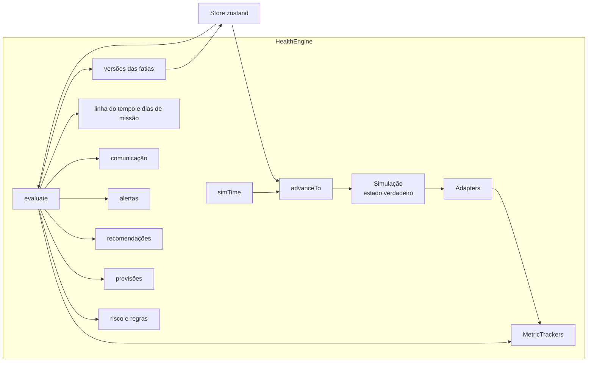

# Motor e simulação

Esta página descreve **como o código do motor se organiza e roda**. Os métodos (fórmulas, premissas, limitações) estão na seção [Inteligência de saúde](/pt/intelligence/overview).

## Módulos

| Arquivo | Papel | Método documentado em |
| --- | --- | --- |
| `engine.ts` | `HealthEngine`: orquestra simulação, detecção, risco, alertas, recomendações, comunicação, check-ins, linha do tempo e dias de missão | Esta página |
| `config.ts` | Todo número ajustável, versões e limiares de demo | [Limiares](/pt/intelligence/thresholds) |
| `catalog.ts` | Métricas, regiões, tripulação, missão, cenários, perfis de comunicação | [Dicionário de dados](/pt/data/data-dictionary) |
| `sim/profiles.ts`, `sim/schedule.ts`, `sim/physiology.ts`, `sim/cabin.ts`, `sim/scenarios.ts`, `sim/adapters.ts` | Simulação | [Simulação](/pt/intelligence/scenario-simulation) |
| `random.ts` | Gerador semeado, hash de sementes, processo OU | [Simulação](/pt/intelligence/scenario-simulation) |
| `series.ts` | Histórico limitado com duas resoluções | Esta página |
| `stats.ts` | Mediana, MAD, quantis, z robusto, EWMA | [Baseline](/pt/intelligence/personal-baseline) |
| `baseline.ts` | Baseline robusta e reservatório | [Baseline](/pt/intelligence/personal-baseline) |
| `anomaly.ts` | `MetricTracker`: detecção em fluxo | [Anomalias](/pt/intelligence/anomaly-detection) |
| `risk.ts` | Regras combinadas, escore, confiança, frase, regiões | [Risco](/pt/intelligence/risk-assessment) |
| `forecast.ts` | Holt amortecido | [Previsão](/pt/intelligence/forecasting) |
| `recommendations.ts`, `intervention.ts` | Catálogo, autonomia, "e se" | [Recomendações](/pt/intelligence/recommendations) |
| `alerts.ts` | Ciclo de vida e escalonamento | [Alertas](/pt/intelligence/alerts) |
| `checkins.ts`, `comms.ts` | Check-in e comunicação com a Terra | [Autorrelato e link com a Terra](/pt/intelligence/self-report-and-earth-link) |
| `missionDays.ts` | Resumos diários de longo prazo | [Recursos da missão](/pt/product/mission-features) |
| `text.ts` | Formatação de valores, durações e frases | |
| `evaluation.json` | Resultado da avaliação gerado por `npm run evaluate` | [Resultados](/pt/validation/results) |

## O HealthEngine

Duas operações principais:

- **`advanceTo(simNow)`** avança a simulação em minutos inteiros e alimenta os trackers. É barata e roda a cada tick.
- **`evaluate()`** calcula tudo o que é análise e incrementa a **versão** de cada fatia que mudou. O store só republica fatias com versão nova.

## Relógio da simulação

| Parâmetro | Valor |
| --- | --- |
| Semente | `20261114` (cada canal de ruído tem seu próprio fluxo) |
| Início dos cenários | 2026-11-14 08:00 UTC (tempo simulado) |
| Histórico gerado na inicialização | 5 dias por minuto e 14 dias de métricas diárias |
| Velocidade padrão | 60 segundos simulados por segundo real |
| Passos grandes | Acima de 60 min simulados por avanço, a simulação anda de 5 em 5 min, com no máximo 3000 passos por avanço |
| Previsões | Recalculadas a cada 10 min simulados |
| Linha do tempo | Um quadro a cada 15 min simulados; 24 h de quadros gerados na inicialização |
| Dia de missão atual | Resumo atualizado no máximo a cada 15 min simulados |

O ticker e a publicação (100 ms e 250 ms reais) estão em [Frontend e estado](/pt/architecture/frontend).

**Independência da velocidade.** Eventos (chegada de mensagens, check-ins, quadros da linha do tempo) usam horários agendados, não o momento da avaliação. Os resultados não dependem da velocidade escolhida nem de quantas vezes o motor é avaliado (teste "appends live frames that follow the risk level, also when the sim jumps far ahead").

## Memória limitada

| Estrutura | Limite |
| --- | --- |
| Histórico por métrica | Últimas 2 h com resolução de 1 min; até 5 dias com 5 min |
| Métricas diárias | 40 pontos |
| Reservatório da baseline | 1440 valores por contexto (28 em métricas diárias) |
| Alertas | 150 |
| Anomalias | 200 |
| Auditoria | 300 eventos |
| Recomendações | 120 |
| Mensagens com a Terra | 120 |
| Check-ins | 120 (4 pessoas x 30 dias) |

O teste "history stays bounded while running" garante que a memória não cresce sem limite.

## Inicialização

1. Cria a tripulação, os dispositivos e o modelo de cabine com a semente.
2. Gera 5 dias de histórico por minuto e 14 dias de métricas diárias e check-ins, recalculando baselines com menos frequência para ser rápido.
3. Gera 24 h de quadros da linha do tempo e os resumos dos dias de missão (dias antigos sintetizados a partir do perfil).
4. Avalia uma vez: as baselines já estão `READY` (teste "pre-generates history so personal baselines are READY immediately").

Observado pelo autor: a geração leva cerca de 1,2 s com cache aquecido e 2 a 3 s a frio em um notebook; os recursos da v2 somam cerca de 100 ms.

## Determinismo

- Nenhum `Math.random` na simulação: todo ruído vem do gerador semeado.
- A mesma semente gera os mesmos dados (teste "is reproducible with the same seed").
- A avaliação usa 5 sementes (`20261114` a `20261118`). Veja [Resultados e evidências](/pt/validation/results).

## Próximos passos

- [Visão geral e status dos métodos](/pt/intelligence/overview).
- [Modelo de dados e contratos](/pt/architecture/data-model).
- [Estratégia de testes](/pt/engineering/testing).
