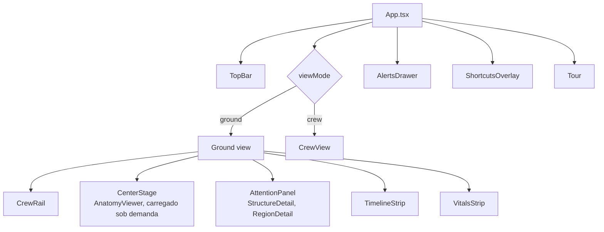
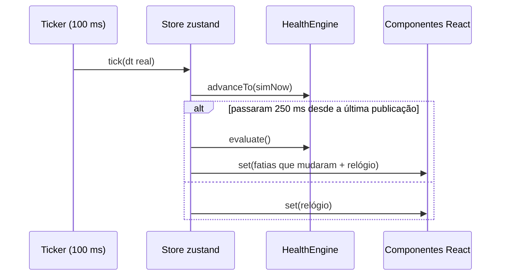

# Frontend e estado

A interface da Astronaut Health Intelligence Platform (AHI) é uma aplicação React 19 de página única, construída com Vite. Esta página descreve como ela se organiza e como o estado chega às telas.

## Estrutura da interface

| Pasta | Conteúdo |
| --- | --- |
| `src/app/` | `App.tsx` (layout das duas visões), `shortcuts.tsx` (atalhos globais), `uiStore.ts` (estado só de interface) |
| `src/features/` | Uma pasta por área: `anatomy` (visualizador do atlas, mapeamento de saúde, fallback procedural), `attention` (painel de atenção, detalhe do sistema, detalhe da estrutura, alertas e sinalizações), `alerts`, `timeline`, `comms`, `checkin`, `mission`, `report`, `whatif`, `datasources`, `crewview`, `crew`, `stage`, `topbar`, `tour`, `vitals`, `lab`, `shared` (hooks e ajudantes de seleção: `focusTarget`, `clearSelection`, `useSelectedStructure`) |
| `src/components/` | Peças compartilhadas: gráfico de tendência, sparkline, medidor de risco, selos de status, formatação |
| `src/lib/` | `status.ts` (cores e rótulos de status) e `fhir.ts` (exportação FHIR R4) |
| `src/state/` | `store.ts`, o store zustand |

O visualizador 3D e o diálogo "Data and model" são carregados sob demanda (`lazy`), para a tela principal abrir antes. O atlas 3D é um arquivo por sistema anatômico, também buscado sob demanda e guardado em cache durante a sessão ([Anatomia 3D](/pt/architecture/anatomy-3d#loading)).

O painel da direita tem três níveis, do mais específico ao mais geral: uma estrutura selecionada no corpo 3D ("Anatomy detail"), uma região do corpo ("Body system detail") ou a visão geral. O detalhe da estrutura reaproveita o detalhe da região, então os dados aparecem de um jeito só.

## Dois stores

| Store | O que guarda | Persistência |
| --- | --- | --- |
| `useAppStore` (`src/state/store.ts`) | O `AppState` do contrato: tripulação, dispositivos, saúde, ambiente, histórico, anomalias, alertas, recomendações, intervenções, auditoria, missão, mensagens, check-ins, dias de missão, linha do tempo, relógio e seleção | Nenhuma: recarregar reinicia a simulação |
| `useUiStore` (`src/app/uiStore.ts`) | Visão ("ground" ou "crew"), modo apresentação, som de alerta | `localStorage` (chave `ahi.ui.v2`), com `try/catch` para funcionar sem armazenamento |

## Como o estado chega à tela

- **Ticker** a cada 100 ms reais (`startTicker()`), chamado uma vez em `App.tsx`.
- **Pausa longa** (aba escondida): o relógio nunca avança mais que 1 s real de uma vez.
- **Publicação seletiva**: a cada 250 ms reais, o motor avalia, e cada fatia (por exemplo `alerts`, `comms`, `checkIns`, `missionDays`, `statusTimeline`) só ganha nova referência quando sua versão no motor mudou. Seletores ficam baratos e componentes não renderizam à toa (teste "publishes v2 slices, keeps references stable and wires the actions").
- **Ações** (`acknowledgeAlert`, `logIntervention`, `dismissRecommendation`, `setCommProfile`, `sendToGround`, `submitCheckIn`) chamam o motor e publicam na hora.
- **Seleção** (`selectAstronaut`, `selectRegion`, `selectMetric`, `selectStructure`, com `selectedStructureId`): uma única seleção compartilhada pelos painéis e pelo visualizador 3D. As regras estão no [contrato de seleção](/pt/architecture/data-model#selection-contract) e são cobertas pelo `selection.test.ts`.
- **`setScenario`** cria um motor novo, mantendo o perfil de comunicação.
- **`fastForward`** avança a simulação de forma síncrona; a demo guiada usa isso para mostrar padrões de vários dias.
- **`compareIntervention`** é pura e síncrona: não muda o estado.

## Velocidades

| Rótulo na interface | Segundos simulados por segundo real |
| --- | --- |
| "Real time" | 1 |
| "1 min/s" (padrão) | 60 |
| "10 min/s" | 600 |
| "1 h/s" | 3600 |

O store aceita de 1 a 86.400. O passo interno do motor está em [Motor e simulação](/pt/architecture/engine-and-simulation).

## Decisões de desempenho

| Decisão | Efeito |
| --- | --- |
| Publicação a cada 250 ms, só das fatias que mudaram | Poucas renderizações mesmo a 3600x |
| Canvas 3D memorizado | O 3D não re-renderiza por estado da página |
| Vitais lidos pelo 3D a cada quadro sem assinar o store | Coração e pulmões animados sem tempestade de renderizações |
| Rótulos 3D posicionados direto no DOM | Sem renderização React por quadro |
| Atlas 3D em um GLB comprimido por sistema, sob demanda, com cache de sessão | A vista padrão baixa cerca de 3 MB; trocar de astronauta nunca recarrega a geometria |
| Componentes pesados sob demanda | Primeira tela mais rápida |

Medidas observadas pela equipe em um único notebook de desenvolvimento, com o visualizador do atlas: 55 a 57 fps na "Ground view" em 1440x900 e o atlas na tela 2,4 a 3,6 s depois da navegação, com cache aquecido. Não são benchmarks formais. Veja [Resultados e evidências](/pt/validation/results#desempenho-observado).

## Páginas de desenvolvimento

O Vite também serve duas páginas só para desenvolvimento:

| Página | Uso |
| --- | --- |
| `anatomy-lab.html` | Força estados visuais e vitais do corpo 3D (camadas, seleção de estrutura, status, fallback) e informa quadros por segundo, draw calls, triângulos e tempo de picking |
| `features-lab.html` | Mostra telas da v2 com dados de exemplo (`src/features/lab/`) |

Em modo de desenvolvimento, o store fica exposto em `window.__ahi` para inspeção pelo console.

## Próximos passos

- [Design system e acessibilidade](/pt/product/design-system): cores, rótulos e layout adaptável.
- [Renderização da anatomia 3D](/pt/architecture/anatomy-3d).
- [Estrutura do projeto](/pt/engineering/project-structure).
