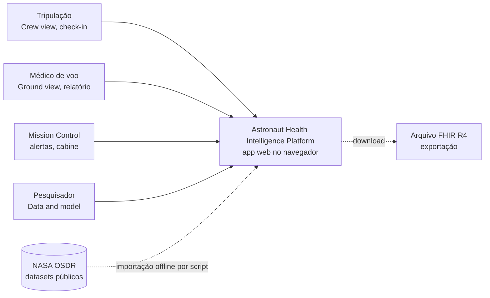
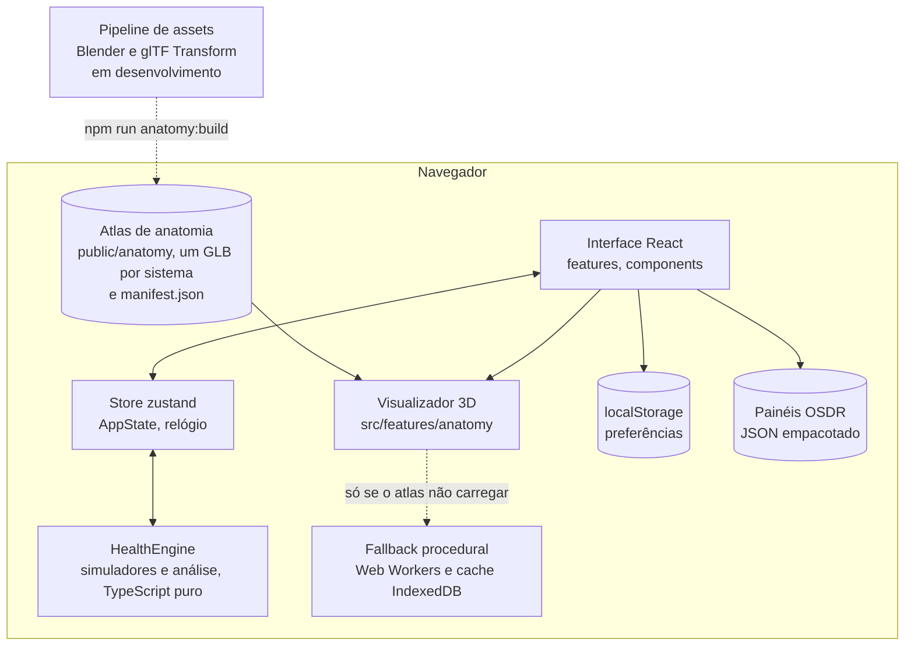
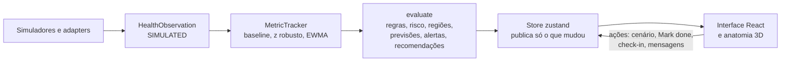

# Visão geral da arquitetura

Hoje a Astronaut Health Intelligence Platform (AHI) é um **aplicativo web que roda inteiro no navegador**. Simuladores, motor de análise, estado e interface 3D vivem no mesmo bundle. Não há backend, API REST, banco de dados nem autenticação, e o app não chama nenhum serviço externo: só carrega os seus próprios arquivos estáticos (código, painéis do OSDR e a anatomia 3D). Isso deixa a demo rápida, reproduzível e capaz de rodar offline depois da instalação.

O desenho alvo com backend está em [Arquitetura alvo](/pt/architecture/target-architecture) e é **conceitual**.

## Stack

| Camada | Tecnologia |
| --- | --- |
| Interface | React 19 + TypeScript |
| Build e servidor de desenvolvimento | Vite 8 |
| Estilo | Tailwind CSS v4 |
| 3D | three.js + react-three-fiber (com drei e postprocessing) |
| Preparação dos assets 3D (em desenvolvimento) | Blender 4.5 LTS (sem interface), glTF Transform, meshoptimizer |
| Estado | zustand |
| Gráficos | Recharts |
| Ícones | lucide-react |
| Testes | vitest |
| Lint | oxlint |
| Documentação | VitePress (este portal) |

Restrições de TypeScript: `erasableSyntaxOnly` (sem `enum` e sem parameter properties; enumerações são uniões de strings) e `noUnusedLocals`.

## Nível 1: contexto

- A ligação com o OSDR **não acontece em tempo de execução**: os scripts de importação rodam uma vez, e os painéis compactos são empacotados no app. Veja [Catálogo de datasets](/pt/data/dataset-catalog).
- O mesmo vale para a anatomia 3D: o modelo de origem (Z-Anatomy) é baixado pelo pipeline de assets em desenvolvimento, e o app distribui os arquivos já prontos. Veja [Assets de anatomia 3D](/pt/data/anatomy-assets).
- Não há sistema externo conectado: nem ISS, nem equipamentos, nem serviços de IA.

## Nível 2: contêineres

| Contêiner | Responsabilidade | Página |
| --- | --- | --- |
| Interface React | Telas, interação, 3D, gráficos | [Frontend e estado](/pt/architecture/frontend) |
| Store zustand | Implementa `AppState`, move o relógio, publica fatias que mudaram | [Frontend e estado](/pt/architecture/frontend) |
| HealthEngine | Simulação, baseline, anomalias, risco, previsão, recomendações, alertas, comunicação | [Motor e simulação](/pt/architecture/engine-and-simulation) |
| Visualizador 3D | Atlas anatômico com estruturas selecionáveis, destaques de status, coração e pulmões ao vivo | [Anatomia 3D](/pt/architecture/anatomy-3d) |
| Atlas de anatomia | Arquivos GLB estáticos (meshopt) e `manifest.json`: anatomia de referência de terceiros (Z-Anatomy, CC BY-SA 4.0), gerada pelo pipeline de assets em desenvolvimento | [Assets de anatomia 3D](/pt/data/anatomy-assets) |
| Fallback procedural | Corpo simplificado gerado em código (Web Workers), usado só quando o atlas não carrega | [Anatomia 3D](/pt/architecture/anatomy-3d#fallback) |
| Armazenamento local | Preferências e, no fallback, cache da geometria; nada de dados de saúde | [Governança e privacidade](/pt/data/governance-and-privacy) |

## Fluxo em tempo de execução

1. **Adapters** leem o estado simulado e emitem `HealthObservation` com origem, qualidade e contexto.
2. Um **MetricTracker** por pessoa e métrica mantém baseline e detectores, com custo constante por amostra.
3. **`evaluate()`** calcula status, regras, risco, regiões, previsões, alertas, recomendações e auditoria.
4. O **store** publica para a interface só as fatias que mudaram.
5. Ações do usuário voltam ao store e ao motor.

## Contrato central

Tudo gira em torno de `frontend/web/src/types/domain.ts`, compartilhado por motor, store e interface. **Só mudanças aditivas** são permitidas. Detalhes em [Modelo de dados e contratos](/pt/architecture/data-model).

## Decisões de arquitetura

| Decisão | Motivo | Consequência |
| --- | --- | --- |
| Tudo no navegador, sem backend | Demo rápida, offline e reproduzível para o hackathon | Sem persistência, sem multiusuário, sem autenticação |
| Motor em TypeScript puro, separado da interface | Testável com vitest sem DOM | 143 testes rodam sem navegador |
| Simulação semeada | Reprodutibilidade de cenários e avaliação | Mesmos dados com a mesma semente |
| Contrato de adapters | Trocar simulação por fonte real sem mudar a interface | Um backend futuro entra pelo mesmo contrato |
| Corpo 3D sobre um atlas anatômico aberto (Z-Anatomy), com fallback procedural | Anatomia real, com estruturas nomeadas que podem ser selecionadas e ligadas aos dados; o fallback mantém o painel funcionando | Os arquivos de anatomia têm licença própria (CC BY-SA 4.0, com atribuição); um pipeline com Blender gera os assets; um GLB por sistema, carregado sob demanda |
| Anatomia e saúde ligadas em um único arquivo (`atlas/health.ts`) | O atlas pode ser reconstruído sem tocar nas regras de saúde | Estruturas sem métrica relacionada ficam só de contexto, sem status |
| Estatística e regras, sem ML | Explicável e testável | Veja [IA e análise](/pt/intelligence/ai-and-analytics) |

## Próximos passos

- [Frontend e estado](/pt/architecture/frontend).
- [Motor e simulação](/pt/architecture/engine-and-simulation).
- [Arquitetura alvo](/pt/architecture/target-architecture): como um backend real se encaixaria.
