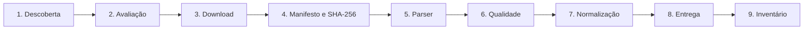

# Pipeline, normalização e qualidade

**O que precisamos, de onde vem e em que formato entregar.** Esta página é para quem contribui com dados na Astronaut Health Intelligence Platform (AHI): engenharia de dados, ciência de dados e pesquisa. Ela é a versão de site de `docs/data-guide.md`.

| | |
| --- | --- |
| Base | `PROJECT_MASTER.md` (seções 3, 4, 5, 6, 9, 16 e 17), contrato `frontend/web/src/types/domain.ts`, simuladores em `frontend/web/src/engine/`, inventário `docs/data-source-inventory.md` |
| Data | 14/11/2026. Acessos às fontes NASA conferidos nesta data |
| Status | O pipeline do OSDR está implementado (scripts Node). O pipeline do EDA e a API de ingestão estão planejados |

As regras de origem (`REAL_PUBLIC`, `DERIVED`, `SIMULATED`, `MANUAL`) estão em [Origens e proveniência](/pt/data/data-origins) e valem para tudo abaixo.

## Resumo em 1 minuto

1. **Hoje o app mostra 21 métricas ([Dicionário de dados](/pt/data/data-dictionary)), e todas vêm de simuladores ou do check-in digitado no app** (`SIMULATED` ou `MANUAL`). A única exceção são dois painéis de exames de sangue reais da Inspiration4 (OSD-569 e OSD-575), exibidos como referência histórica.
2. **O trabalho é trocar simulação por dado real onde ele existe**, e onde não existe, **ancorar a simulação em fontes científicas citáveis**.
3. **Não existe telemetria fisiológica contínua pública de astronautas** (FC, ECG, SpO₂ minuto a minuto). Para essas métricas, a estratégia é calibrar o simulador com faixas publicadas e manter o selo `SIMULATED`.
4. **Onde há dado real e público com mais impacto:** ambiente da cabine da ISS no **NASA EDA** (prioridade número 1), exames laboratoriais no **NASA OSDR** (já feito) e o catálogo oficial de medidas nas **NASA Standard Measures**.
5. **Todo dado entregue segue o modelo canônico `HealthObservation`**, com proveniência completa: fonte, accession, arquivo, SHA-256 e data de download.

## Panorama: simulado e real

| Domínio | O que o app mostra | Origem hoje | Pode virar real? | Prioridade |
| --- | --- | --- | --- | --- |
| Sinais vitais | FC, HRV, SpO₂, respiração, pressão, temperatura da pele | `SIMULATED` (Bio-Monitor) | Improvável como série contínua pública; calibrar com literatura | P1 (calibração) |
| Sono e atividade | Duração e eficiência do sono, atividade | `SIMULATED` (actigrafia) | Possível via estudos análogos (marcar como análogo) | P1 |
| Exercício | Desempenho em CEVIS, ARED e T2 | `SIMULATED` | Improvável; calibrar com literatura de contramedidas | P2 |
| Cognição e autorrelato | Tempo de reação, humor, fadiga, estresse | `SIMULATED` e `MANUAL` | Referência de protocolo nas Standard Measures | P2 |
| Hidratação | Índice de hidratação | `SIMULATED` | Improvável | P2 |
| **Ambiente da cabine** | CO₂, temperatura, umidade | `SIMULATED` | **Sim: NASA EDA (ISS)** | **P0** |
| **Radiação** | Taxa de dose e dose acumulada | `SIMULATED` | **Sim: NASA EDA e RadLab** | **P0** |
| **Laboratório** | Hemograma e painel metabólico | **`REAL_PUBLIC`** (OSD-569, OSD-575) | Já é real; ampliar | Feito, P1 para ampliar |
| Missão e contexto | Fases, cronograma, atraso de comunicação | Configuração | Sim, a partir de metadados OSDR e EDA | P1 |
| Dispositivos | Estado, bateria, sinal | `SIMULATED` | Não há fonte pública; manter simulado | Fora do escopo |

## Matriz métrica x fonte x estratégia

| Métrica | Melhor fonte real | Realismo | Estratégia recomendada |
| --- | --- | --- | --- |
| `CO2`, `CABIN_TEMPERATURE`, `RELATIVE_HUMIDITY` | NASA EDA (ISS) | **Alto** | Importar 1 ou 2 missões com CO₂ como replay `REAL_PUBLIC` |
| `RADIATION_DOSE_RATE`, `RADIATION_DOSE` | NASA EDA (doses), RadLab | **Alto** | Importar a série do EDA; RadLab quando voltar |
| Hemograma e painel metabólico | NASA OSDR | **Feito** | Ampliar com OSD-656 e os painéis multiplex do OSD-575, se houver explicação clara |
| `CORTISOL`, marcadores imunes | OSDR (Inspiration4 e outros estudos humanos) | Médio | Buscar tabelas com unidade clínica, sem ômicas |
| `SLEEP_DURATION`, `SLEEP_EFFICIENCY`, `ACTIVITY_LEVEL` | NLSP e OSDR (análogos) | Médio e baixo | Actigrafia de HERA ou repouso no leito, rotulada como análogo; senão, calibrar com literatura |
| `REACTION_TIME`, `MOOD`, `STRESS`, `PERCEIVED_FATIGUE` | Standard Measures (protocolo), NLSP | Baixo | Referência de protocolo e escala; manter `SIMULATED` e `MANUAL` |
| `HEART_RATE`, `HRV_RMSSD`, `SPO2`, `RESPIRATORY_RATE`, `SYSTOLIC_BP`, `DIASTOLIC_BP`, `SKIN_TEMPERATURE` | Nenhuma série contínua pública encontrada | **Muito baixo** | Calibrar o simulador com faixas publicadas (com DOI) e documentar no model card |
| `EXERCISE_LOAD` | Literatura de contramedidas (CEVIS, ARED, T2) | Baixo | Calibração e documentação |
| `HYDRATION` | Nenhuma | Muito baixo | Manter simulado e declarar como limitação |
| Fases e datas de missão | Metadados OSDR e EDA | Alto | Usar datas reais nos replays |

Detalhes de cada fonte em [Fontes de dados da NASA](/pt/data/sources).

## Pipeline de preparação



| Caminho | Conteúdo |
| --- | --- |
| `data/raw/<ACCESSION>/` | Arquivo original byte a byte e respostas da API |
| `data/manifests/<ACCESSION>.json` | Manifesto de proveniência |
| `data/processed/<ACCESSION>.observations.json` | Formato longo canônico |
| `frontend/web/src/data/<ACCESSION>.json` | Versão compacta para a interface (alvo: menos de 200 KB) |
| `frontend/web/scripts/<fonte>/` | Scripts reproduzíveis de descoberta e importação |

Regras do pipeline:

1. **Reprodutível:** um comando documentado refaz a importação, como `node scripts/osdr/import.mjs`.
2. **Arquivos baixados são dados não confiáveis:** cada um na sua pasta, só parse como texto, nunca executar nada.
3. **Preserve o valor original** (`metadata.original_value` e `original_unit`) ao converter unidades e documente o fator.
4. **Idempotência:** reimportar não duplica (`observation_id` estável).
5. **Prefira o arquivo `SUBMITTED` ao `TRANSFORMED`** quando o primeiro tiver coluna de unidade explícita.

## Checklist de qualidade

Todo dataset precisa passar antes de entrar no app:

1. **Esquema:** todos os campos obrigatórios presentes.
2. **Unidade:** conhecida e compatível com o `metric_code`. Unidade incompatível é rejeitada, não convertida às cegas.
3. **Timestamps:** válidos, em UTC, ordenados, com o fuso original registrado.
4. **Ausentes:** `null` com `quality.status = MISSING`, contagem no manifesto.
5. **Duplicados:** detectados e removidos por chave idempotente, contagem no manifesto.
6. **Faixa plausível:** valores fora da faixa física são **sinalizados** (`QUESTIONABLE`), nunca apagados.
7. **Proveniência:** manifesto completo, SHA-256 conferido.
8. **Coerência com metadados:** sexo, organismo, missão e pontos de coleta batem com o ISA e a descrição; divergências anotadas (como o R+194 do OSD-575).
9. **População:** `population_type` definido. Nada de análogo ou animal rotulado como astronauta.
10. **Licença e acesso:** registrados, ou "not stated".
11. **Sem travessões** em textos gerados para a interface (regra de escrita do projeto).

## Critérios de aceite

Um dataset só entra no app se:

1. tiver fonte oficial e pública com URL estável;
2. tiver unidade e período identificáveis;
3. tiver população e desenho de estudo verificados nos metadados;
4. passar no checklist de qualidade;
5. tiver um uso claro no app (uma tela ou métrica que ele alimenta);
6. vier com um relatório de adequação salvo no inventário.

Modelo de relatório (copie para `docs/data-source-inventory.md`):

```markdown
### <ACCESSION>: <título curto>

| Campo | Valor |
| --- | --- |
| Fonte e URL | |
| Data da consulta | |
| Organismo e população | |
| Tipo de população | ISS_ASTRONAUT, COMMERCIAL_ASTRONAUT, ANALOG_PARTICIPANT... |
| Missão e fases cobertas | |
| Métricas e unidades | |
| Frequência e período | |
| Arquivos, tamanho e formato | |
| Licença e acesso | |
| Qualidade (ausentes, duplicados, divergências) | |
| Métrica da AHI alimentada | |
| Decisão | Escolhido ou rejeitado, e por quê |
| Limitações | |
```

## Prioridades

| Prioridade | Entrega | Fonte | Definição de pronto |
| --- | --- | --- | --- |
| **P0** | Replay real do ambiente da ISS (CO₂, temperatura, umidade) | EDA | 1 ou 2 missões com CO₂, manifesto, JSON canônico com `subject_id: CABIN` e `REAL_PUBLIC`, relatório de adequação |
| **P0** | Série real de dose de radiação | EDA (RadLab se voltar) | Taxa e dose acumulada com unidade e método documentados |
| **P0** | Justificativa científica do catálogo | Standard Measures e HRP | Tabela métrica x Standard Measure x perigo, com links |
| **P1** | Fundamentação dos limiares de demo | Norma de habitabilidade da NASA (família NASA-STD-3001, Volume 2) e literatura | Cada limiar com fonte (documento, seção e versão) ou rótulo de demo mantido |
| **P1** | Calibração do simulador de vitais e sono | Literatura com DOI | Faixas por métrica com referência |
| **P1** | Sono ou cognição de análogos | NLSP e OSDR | Dataset análogo com proveniência, ou registro de "acesso sob pedido" |
| **P1** | Ampliar laboratório | OSDR | Cortisol ou marcadores imunes com unidade clínica |
| **P2** | Dados de exercício | Literatura de contramedidas | Faixas de desempenho documentadas |
| **P2** | Datas reais nos replays | Metadados OSDR e EDA | Fases e datas preenchidas a partir da fonte |

Sugestão de divisão do time de contribuidores: pessoa A no EDA (ambiente e radiação); pessoa B em Standard Measures, perigos e limiares; pessoa C em OSDR e NLSP (laboratório e análogos); pessoa D em literatura e calibração do simulador.

## O que não fazer

- Apresentar dado de roedor, planta, célula ou análogo como dado de astronauta.
- Preencher lacunas com zero, média ou valor "típico" sem marcar como `DERIVED` ou `is_estimated`.
- Usar a faixa de referência do laboratório como limite de alerta do app.
- Citar um número como "limite oficial da NASA" sem documento, seção e versão.
- Baixar ou tentar acessar dados de acesso controlado.
- Importar arquivo grande de ômicas para a interface.
- Esquecer de registrar o SHA-256 e a data de download.

## Esquemas de entrega

O modelo canônico `HealthObservation`, campo a campo, está em [Modelo de dados e contratos](/pt/architecture/data-model). Proposta de padronização em `metadata.population_type`: `ISS_ASTRONAUT`, `COMMERCIAL_ASTRONAUT`, `ANALOG_PARTICIPANT` (HERA, repouso no leito, confinamento), `GROUND_CONTROL`, `NOT_APPLICABLE` (cabine).

### Lote de ingestão (backend futuro)

<StatusBadge status="PLANNED" />

Formato para quando existir o backend (`POST /api/v1/observations`). Hoje os dados entram como JSON estático.

```json
{
  "subject_id": "AST-01",
  "mission_id": "MISSION-001",
  "source_id": "SIM-ASTROSKIN-001",
  "data_origin": "SIMULATED",
  "observations": [
    { "metric_code": "HEART_RATE", "value": 82, "unit": "bpm", "measured_at": "2026-11-13T14:30:00Z", "quality_status": "VALID" }
  ]
}
```

### Ambiente da cabine (entrega do EDA)

<StatusBadge status="PLANNED" />

Mesmo `HealthObservation`, com `subject_id: "CABIN"` e `metadata` explicando o vínculo com a missão de payload:

```json
{
  "observation_id": "EDA:RR-18:CO2_ppm_ISS:2018-06-30T12:00:00Z",
  "subject_id": "CABIN",
  "mission_id": "RR-18",
  "device_id": "ISS-CABIN-CO2",
  "metric_code": "CO2",
  "value": 2950,
  "unit": "ppm",
  "measured_at": "2018-06-30T12:00:00Z",
  "data_origin": "REAL_PUBLIC",
  "source_reference": { "repository": "NASA EDA", "dataset_accession": "RR-18", "file_name": "<arquivo CSV baixado>", "record_reference": "<linha>" },
  "quality": { "status": "VALID", "confidence": 1.0, "is_estimated": false },
  "context": { "mission_phase": "IN_FLIGHT", "activity": "WORK" },
  "metadata": { "eda_column": "CO2_ppm_ISS", "population_type": "NOT_APPLICABLE", "note": "ISS cabin during payload mission RR-18" }
}
```

::: warning ATENÇÃO
Exemplo ilustrativo: valor, data e nome de arquivo são marcadores. Use os valores reais do arquivo baixado.
:::

### Resultado laboratorial (formato longo, em uso)

<StatusBadge status="IMPLEMENTED" />

Arquivo `data/processed/<OSD>.observations.json`, uma linha por linha da fonte:

| Campo | Exemplo | Regra |
| --- | --- | --- |
| `subject` | C001 | Pseudônimo da fonte |
| `sex` | M | Conferido com os metadados ISA |
| `analyte` | WHITE BLOOD CELL COUNT | Nome da fonte |
| `value` | 5.4 ou null | Não numérico vira null, com o texto bruto preservado |
| `unit` | Thousand/uL | Unidade da fonte |
| `range_low`, `range_high` | 3.8, 10.8 | Faixa do laboratório. **Não é limite da NASA nem é usada para alertas** |
| `timepoint` | R+1 | Rótulo da fonte |
| `days_from_event` | 1 | L-n = n dias antes do lançamento, R+n = n dias após o retorno |
| `phase` | POST_FLIGHT | Derivado do rótulo |
| `data_origin` | REAL_PUBLIC | `DERIVED` para médias de grupo |

### Check-in diário

```json
{
  "id": "CHK-AST-02-2026-11-14",
  "astronautId": "AST-02",
  "at": 1794643200000,
  "mood": 3, "fatigue": 4, "stress": 3, "sleepQuality": 2,
  "symptoms": ["headache"],
  "note": "",
  "data_origin": "MANUAL"
}
```

Escalas de 1 a 5. `mood` e `sleepQuality`: 5 é melhor. `fatigue` e `stress`: 5 é pior.

### Resumo diário da missão (`MissionDaySummary`)

| Campo | Unidade | Observação |
| --- | --- | --- |
| `missionDay`, `date` | dia, data ISO | 1 até o dia atual |
| `sleepHours` | h | null se ausente |
| `exerciseMinutes`, `exercisePlannedMinutes` | min | Aderência ao plano |
| `restingHr`, `hrv` | bpm, ms | Valores do dia |
| `radiationDoseMgy`, `cumulativeDoseMgy` | mGy | Dose do dia e acumulada |
| `riskLevel` | status | Nível de atenção do dia |
| `data_origin` | enum | Dias antigos hoje são sintetizados (`synthesized: true`) |

### Manifesto de dataset (proveniência)

Um arquivo `data/manifests/<ACCESSION>.json` por dataset:

```json
{
  "id": "OSD-569",
  "source_name": "NASA Open Science Data Repository (OSDR)",
  "source_url": "https://osdr.nasa.gov/bio/repo/data/studies/OSD-569",
  "dataset_accession": "OSD-569",
  "dataset_version": "OSDR metadata version 4",
  "title": "...",
  "downloaded_at": "2026-11-14T11:37:00Z",
  "license": null,
  "access_classification": "public, anonymous download",
  "file_name": "LSDS-7_Complete_Blood_Count_CBC.upload_SUBMITTED.csv",
  "sha256": "<hash completo>",
  "parser_version": "ahi-osdr-import 1.0.0",
  "study_population": "4 crew members, 2 female and 2 male per sample metadata",
  "mission": "SpaceX Inspiration4",
  "study_design": "Repeated measures, 7 ground time points",
  "collection_phase": "PRE_FLIGHT and POST_FLIGHT",
  "notes": "License not stated in the source.",
  "data_origin": "REAL_PUBLIC"
}
```

Campos sem informação na fonte ficam `null` com a nota "not stated". **Nunca preencha por suposição.**

## Próximos passos

- [Fontes de dados da NASA](/pt/data/sources): status e detalhe de cada fonte.
- [Catálogo de datasets](/pt/data/dataset-catalog): o exemplo completo do OSDR.
- [Padrões, contratos e extensões](/pt/engineering/contributing#como-adicionar-um-dataset): o passo a passo no código.
