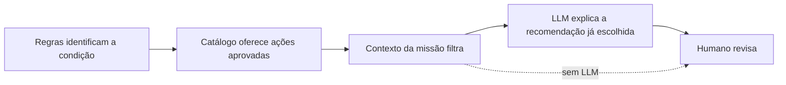

# Abordagem de IA e análise de dados

"Intelligence" está no nome da Astronaut Health Intelligence Platform (AHI), então a pergunta é justa: **onde está a IA?** A resposta curta é que, em tempo de execução, **não há LLM, não há modelo de aprendizado de máquina treinado, não há RAG, agentes nem prompts**. A inteligência da plataforma é estatística e baseada em regras, escolhida de propósito para ser explicável, testável e reproduzível.

::: info Verificado em 14/11/2026
As dependências de `frontend/web/package.json` são de interface, 3D, estado, gráficos e testes (React, three.js, zustand, Recharts, vitest e afins). Não há biblioteca de LLM, de aprendizado de máquina ou de cliente de API de IA, e o app não faz chamadas a serviços de IA.
:::

## As quatro categorias

Separamos quatro coisas que costumam ser chamadas de "IA":

| Categoria | O que é | Na AHI hoje | Status |
| --- | --- | --- | --- |
| 1. Processamento estatístico | Estatística descritiva e robusta sobre os dados da própria pessoa | Baseline (mediana, MAD, p05, p95), z robusto, deriva EWMA, persistência, qualidade do dado | <StatusBadge status="IMPLEMENTED" /> |
| 2. Pontuação por regras | Regras explícitas com identificador, nível e peso | Regras por métrica, regras combinadas, escore noisy-OR de 0 a 100, confiança, autonomia | <StatusBadge status="IMPLEMENTED" /> |
| 3. Modelos preditivos tradicionais | Modelos clássicos, sem treinamento em dataset rotulado | Holt linear amortecido com intervalo de 80% e projeção "e se" determinística | <StatusBadge status="IMPLEMENTED" /> |
| 3b. Aprendizado de máquina | Modelos ajustados a dados (anomalia multivariada, classificação de risco) | Nenhum. Isolation Forest está planejado (US-019, P1); ARIMA, XGBoost e SHAP aparecem como P2 no plano, mas não estão implementados nem agendados | <StatusBadge status="NOT_IMPLEMENTED" /> |
| 4. LLM (IA generativa) | Modelo de linguagem que gera texto | Nenhum em tempo de execução. Uma camada de explicação está planejada (US-024) | <StatusBadge status="PLANNED" /> |

### 1. Processamento estatístico

Tudo que define "o normal" e "o desvio" é estatística clássica e robusta, calculada no navegador sobre os dados da própria pessoa. Nada é aprendido de uma população. Detalhes e fórmulas em [Linha de base pessoal](/pt/intelligence/personal-baseline) e [Detecção de anomalias](/pt/intelligence/anomaly-detection).

### 2. Pontuação por regras

O nível de atenção sai de regras transparentes. Cada uma tem identificador (por exemplo R-FAT-01), condição legível, frase em linguagem simples e peso conhecido. O escore combina os pesos por noisy-OR. Qualquer pessoa pode refazer a conta à mão. Veja [Avaliação de risco](/pt/intelligence/risk-assessment).

### 3. Modelos preditivos tradicionais

A previsão usa suavização exponencial de Holt com tendência amortecida, um método clássico de séries temporais com três parâmetros fixos (alpha, beta, phi). Não há treinamento: o modelo se ajusta à série recente a cada cálculo. A comparação "e se" roda o próprio simulador sem ruído. Veja [Previsão](/pt/intelligence/forecasting) e [Recomendações](/pt/intelligence/recommendations).

### 3b. Aprendizado de máquina (planejado)

O plano do projeto (`PROJECT_MASTER.md`, seção 9.3) segue o princípio "estatística explicável primeiro, depois aprendizado de máquina":

| Método | Objetivo | Prioridade no plano | Pré-requisito |
| --- | --- | --- | --- |
| Isolation Forest | Anomalia multivariada | P1 | Dados reais com volume suficiente |
| ARIMA | Séries temporais adequadas | P2 | Séries longas e estacionárias |
| XGBoost | Estimar risco | P2 | **Dataset rotulado suficiente**, que não existe hoje |
| SHAP | Explicar modelos compatíveis | Junto com XGBoost | Um modelo de ML para explicar |
| Análise de sobrevivência | Tempo até evento | Futuro | Dados longitudinais apropriados |

Também citados no plano e **não implementados**: regra IQR e CUSUM. A mediana com MAD e a deriva EWMA cumprem papéis equivalentes.

::: warning ATENÇÃO
Treinar um modelo clínico com poucas pessoas ou com dados simulados seria enganoso. O documento mestre lista isso como não objetivo do MVP: "Treinamento de modelo clínico robusto exclusivamente com pequenas bases históricas".
:::

### 4. LLM: camada de explicação planejada

O documento mestre (seção 9.7 e US-024, prioridade P2) prevê uma camada de **explicação em linguagem natural**. O desenho é restrito:

*Conceitual (não implementado).*

Critérios do US-024:

- o LLM **só recebe uma recomendação já selecionada** pelas regras;
- resposta estruturada, mostrando fonte e limitações;
- não pode criar diagnóstico ou prescrição;
- **fallback sem LLM**: a plataforma continua funcionando igual sem ele.

O LLM **não pode**: inventar limite clínico, diagnosticar, recomendar medicamento, criar tratamento, transformar correlação em causalidade nem ocultar incerteza ou origem simulada. O documento mestre também lista "LLM como núcleo de decisão clínica" entre o que evitar.

## O que não existe na plataforma

| Item | Status |
| --- | --- |
| LLM em tempo de execução | <StatusBadge status="NOT_IMPLEMENTED" /> |
| Treinamento ou ajuste fino de modelos | <StatusBadge status="NOT_IMPLEMENTED" /> |
| RAG (busca em documentos para alimentar um modelo) | <StatusBadge status="NOT_IMPLEMENTED" /> |
| Agentes autônomos ou prompts | <StatusBadge status="NOT_IMPLEMENTED" /> |
| Envio de dados a serviços de IA externos | <StatusBadge status="NOT_IMPLEMENTED" /> |
| Uso dos datasets reais do OSDR para treinar ou ajustar o motor | <StatusBadge status="NOT_IMPLEMENTED" /> |

## IA no desenvolvimento

O projeto foi desenvolvido com assistência de IA (Claude Code) para escrever código, testes e documentação. Isso é uma **ferramenta de desenvolvimento**, não uma funcionalidade da plataforma: nada dessa assistência roda dentro do app. Todo o código passa pelos mesmos testes, checagem de tipos e build no CI.

## Por que esta escolha

| Critério | Estatística e regras | ML ou LLM no MVP |
| --- | --- | --- |
| Explicação | Cada nível tem regra e peso legíveis | Exige camada extra (SHAP) ou não é garantida |
| Dados necessários | Funciona com o histórico da própria pessoa | Exige dataset rotulado que não existe |
| Teste | Comportamento determinístico, coberto por testes unitários | Mais difícil de testar e reproduzir |
| Risco de alucinação | Nenhum | Real para LLM |
| Execução offline no navegador | Sim | Difícil ou inviável |

## Próximos passos

- [Visão geral e status dos métodos](/pt/intelligence/overview).
- [Model card](/pt/validation/model-card): uso pretendido e limitações.
- [Roadmap](/pt/resources/roadmap): quando ML e LLM poderiam entrar.
