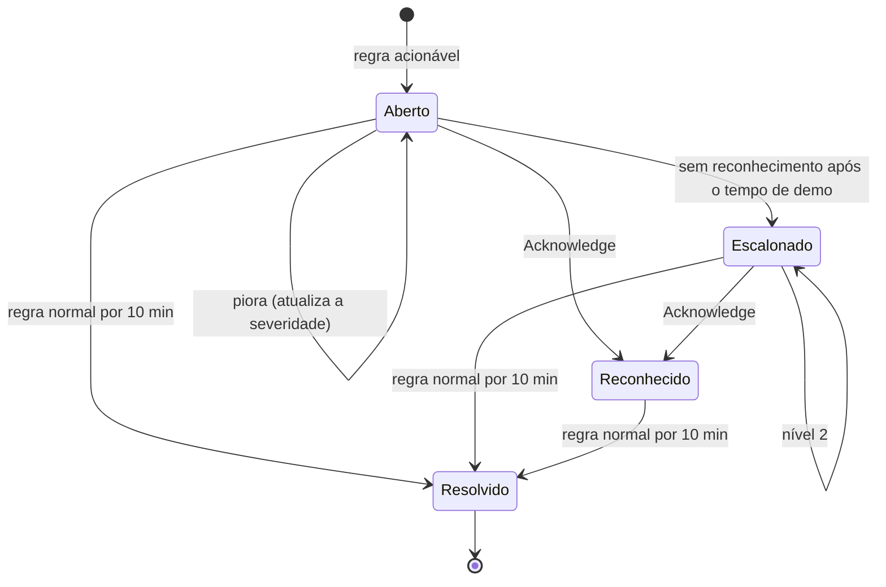

# Alertas e escalonamento

## O que faz

Transforma regras importantes em **alertas** que alguém precisa reconhecer. A Astronaut Health Intelligence Platform (AHI) evita alarmes duplicados, resolve sozinha os alertas cuja condição passou e **escalona** alertas graves que ninguém reconheceu.

## Entradas

| Entrada | Origem |
| --- | --- |
| Regras acionáveis, já agrupadas pelas regras combinadas | [Avaliação de risco](/pt/intelligence/risk-assessment) |
| Relógio simulado | [Motor e simulação](/pt/architecture/engine-and-simulation) |
| Reconhecimento ("Acknowledge") | Interface (<OriginBadge origin="MANUAL" />) |

## Método

### Quando um alerta nasce

| Tipo de regra | Gera alerta? |
| --- | --- |
| Qualquer regra em HIGH ou CRITICAL | Sim |
| Regra MODERATE de tendência, combinada, de ambiente ou de qualidade do dado | Sim |
| Pico agudo isolado em MODERATE (z robusto) | Não. Só muda o status |
| Autorrelato (R-PSY-01 a R-PSY-04) | **Nunca.** Gera só fatores e recomendações de bordo |

O teste "acute MODERATE z blips are not actionable; trends and data quality are" cobre essa regra.

### Ciclo de vida

- **Um alerta ativo por pessoa e regra.** Se a regra piora, o alerta é atualizado. Se ele já tinha sido reconhecido, um novo alerta é criado, para que a piora seja vista.
- **Resolução automática** depois de 10 minutos simulados com a regra normalizada ("Resolved, back in normal range").
- **Histórico** de até 150 alertas; alertas reconhecidos e resolvidos continuam no histórico.
- Cada alerta guarda pessoa (ou cabine), severidade, regra, métrica, região, horários e o texto "Decision support only, not a diagnosis."

### Escalonamento

Um alerta HIGH ou CRITICAL **não reconhecido e não resolvido** sobe de nível depois de tempos fixos, contados desde a criação. Os tempos são configuração de demo (`ESCALATION` em `config.ts`), não procedimento oficial:

| Severidade | Nível 1 | Nível 2 |
| --- | --- | --- |
| CRITICAL | 5 min | 15 min |
| HIGH | 30 min | 90 min |
| MODERATE | não escalona | não escalona |

- Uma avaliação atrasada pula direto para o nível certo (teste "a late evaluation jumps straight to the right level").
- Reconhecer ou resolver **interrompe** o escalonamento.
- Cada passo vai para a auditoria como `ALERT_ESCALATED`.
- Na interface, o cartão ganha o selo "Escalated" e o texto "Unacknowledged for ... Escalated".

### Pacote automático para a Terra

Quando um alerta chega a HIGH ou CRITICAL, um pacote de saúde é enviado sozinho pelo "Earth link" (uma vez por alerta). Veja [Autorrelato e link com a Terra](/pt/intelligence/self-report-and-earth-link).

### Auditoria

A trilha de auditoria ("Activity log") registra reconhecimentos, escalonamentos, intervenções, mudanças de cenário, check-ins e mensagens com a Terra, do mais novo para o mais antigo, com até 300 eventos.

### Premissas

- Os tempos de escalonamento representam uma política de demo, não uma regra de voo.
- Uma pessoa reconhece o alerta na própria interface; não há notificação externa.

### Interpretação

"Escalated" significa só que **ninguém reconheceu** um alerta grave dentro do tempo de demo. Não significa que a condição clínica piorou.

## Saídas

`Alert` (severidade, título, detalhe, região, métrica, regra, criação, reconhecimento, resolução, escalonamento) e `AuditEvent`. Na interface: gaveta de alertas (abas "Open" e "History"), sino com contador, faixa CRITICAL sobre o cabeçalho do corpo e som opcional de dois tons para alertas CRITICAL novos (desligado por padrão). Detalhes da tela em [Tour do produto](/pt/product/product-tour#gaveta-de-alertas).

## Limitações

- Sem notificação fora do app (e-mail, pager, rádio).
- A auditoria vive só na memória do navegador e some ao recarregar a página.
- Os tempos de escalonamento não foram validados com operações reais.

## Status

<StatusBadge status="IMPLEMENTED" /> Coberto por `alerts.test.ts` (5 testes de escalonamento), `risk.test.ts` (deduplicação, resolução automática, histórico, regras acionáveis, agrupamento) e `engine.test.ts` ("acknowledging an alert writes an audit event", alerta único agrupado no evento cardíaco).

## Próximos passos

- [Recomendações, autonomia e what-if](/pt/intelligence/recommendations).
- [Autorrelato e link com a Terra](/pt/intelligence/self-report-and-earth-link).
- [Cenários e demo guiada](/pt/product/demo-scenarios): ver o escalonamento ao vivo.
