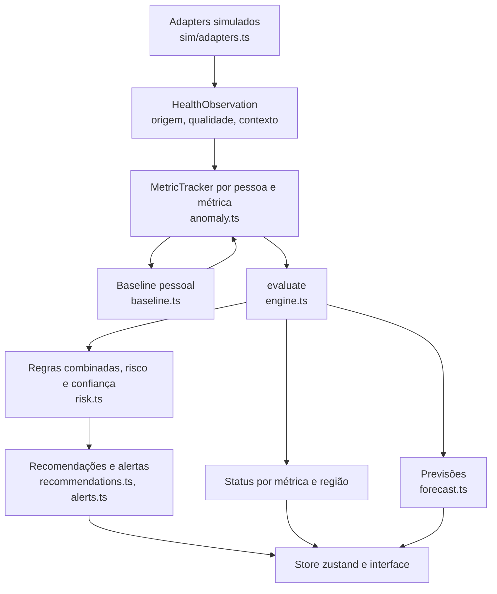

# Visão geral e status dos métodos

O motor de inteligência de saúde da Astronaut Health Intelligence Platform (AHI) fica em `frontend/web/src/engine/`. É **TypeScript puro**, roda no navegador e é coberto por testes com vitest. Ele transforma observações simuladas em status, risco, previsões, alertas e recomendações explicáveis.

::: warning ATENÇÃO
O motor é **estatístico e baseado em regras**. Não há aprendizado de máquina, LLM nem modelo treinado em tempo de execução. Todo número fixo é configuração de demo, não limite oficial da NASA. Veja [Abordagem de IA e análise de dados](/pt/intelligence/ai-and-analytics) e [Limiares e limitações](/pt/intelligence/thresholds).
:::

## Versões

| Componente | Versão (em `config.ts`) |
| --- | --- |
| Motor | `ahi-engine 2.0.0` |
| Modelo de risco | `AHI transparent rules v2.0 (demo)` |
| Baseline | `robust-baseline v1 (median/MAD)` |
| Previsão | `Damped Holt linear smoothing v1` |
| Catálogo de recomendações | `rec-catalog v2.0` |

## Pipeline

Em palavras:

1. **Adapters** emitem observações canônicas com origem, qualidade e contexto de atividade. Veja [Simulação de dispositivos e cenários](/pt/intelligence/scenario-simulation).
2. Um **MetricTracker** por pessoa e métrica mantém histórico limitado, a [baseline pessoal](/pt/intelligence/personal-baseline) e os detectores da [detecção de anomalias](/pt/intelligence/anomaly-detection), com custo constante por amostra.
3. **`evaluate()`** junta tudo: regras combinadas e escore na [avaliação de risco](/pt/intelligence/risk-assessment), [previsão](/pt/intelligence/forecasting), [recomendações](/pt/intelligence/recommendations) e [alertas](/pt/intelligence/alerts).
4. O check-in e a comunicação com a Terra entram como fatores e mensagens. Veja [Autorrelato e link com a Terra](/pt/intelligence/self-report-and-earth-link).

A arquitetura do código (relógio, publicação, estado) está em [Motor e simulação](/pt/architecture/engine-and-simulation).

## O que está implementado e o que não está

| Método | Para que serve | Status | Página |
| --- | --- | --- | --- |
| Baseline robusta por contexto (mediana, MAD, p05, p95) | Normal pessoal | <StatusBadge status="IMPLEMENTED" /> | [Linha de base pessoal](/pt/intelligence/personal-baseline) |
| z robusto da mediana de 3 leituras | Mudança rápida | <StatusBadge status="IMPLEMENTED" /> | [Anomalias](/pt/intelligence/anomaly-detection) |
| Deriva EWMA do z | Mudança lenta e persistente | <StatusBadge status="IMPLEMENTED" /> | [Anomalias](/pt/intelligence/anomaly-detection) |
| Persistência em métricas diárias | Noites, sessões ou testes seguidos fora da faixa | <StatusBadge status="IMPLEMENTED" /> | [Anomalias](/pt/intelligence/anomaly-detection) |
| Qualidade e atualidade do dado | `NO_DATA`, sinal questionável | <StatusBadge status="IMPLEMENTED" /> | [Anomalias](/pt/intelligence/anomaly-detection) |
| Limiares fixos de demo | Rede de segurança | <StatusBadge status="IMPLEMENTED" /> | [Limiares](/pt/intelligence/thresholds) |
| Regras combinadas | Padrões que importam juntos | <StatusBadge status="IMPLEMENTED" /> | [Risco](/pt/intelligence/risk-assessment) |
| Escore de risco 0 a 100 por noisy-OR | Nível de atenção | <StatusBadge status="IMPLEMENTED" /> | [Risco](/pt/intelligence/risk-assessment) |
| Holt linear amortecido com intervalo de 80% | Projeção de curto prazo | <StatusBadge status="IMPLEMENTED" /> | [Previsão](/pt/intelligence/forecasting) |
| Regra de saída da faixa e de recuperação | "Projected to leave your normal range in ..." | <StatusBadge status="IMPLEMENTED" /> | [Previsão](/pt/intelligence/forecasting) |
| Projeção "e se" determinística, sem ruído | Discussão de uma ação | <StatusBadge status="EXPERIMENTAL" /> | [Recomendações](/pt/intelligence/recommendations) |
| Regra IQR (intervalo interquartil) | Citada no plano como alternativa robusta | <StatusBadge status="NOT_IMPLEMENTED" /> | A mediana e o MAD cumprem esse papel |
| CUSUM | Pequenas mudanças acumuladas | <StatusBadge status="NOT_IMPLEMENTED" /> | A deriva EWMA cumpre esse papel |
| Isolation Forest | Anomalia multivariada | <StatusBadge status="PLANNED" /> | [IA e análise](/pt/intelligence/ai-and-analytics) |
| ARIMA | Séries temporais adequadas | <StatusBadge status="NOT_IMPLEMENTED" /> P2 no plano, não agendado | [IA e análise](/pt/intelligence/ai-and-analytics) |
| XGBoost e SHAP | Risco com dataset rotulado e sua explicação | <StatusBadge status="NOT_IMPLEMENTED" /> sem dados rotulados | [IA e análise](/pt/intelligence/ai-and-analytics) |
| Explicação com LLM | Linguagem natural de uma recomendação já escolhida | <StatusBadge status="PLANNED" /> | [IA e análise](/pt/intelligence/ai-and-analytics) |

## Modelo de página

Cada página desta seção segue a mesma ordem: **O que faz**, **Entradas**, **Método** (fórmulas com variáveis, premissas, interpretação e limitações), **Saídas**, **Limitações** e **Status**. As evidências (testes e avaliação) estão em [Resultados e evidências](/pt/validation/results).

## Próximos passos

- [Linha de base pessoal](/pt/intelligence/personal-baseline): o ponto de partida de tudo.
- [Abordagem de IA e análise de dados](/pt/intelligence/ai-and-analytics): o que é e o que não é IA aqui.
- [Model card](/pt/validation/model-card): uso pretendido e limitações do motor.
