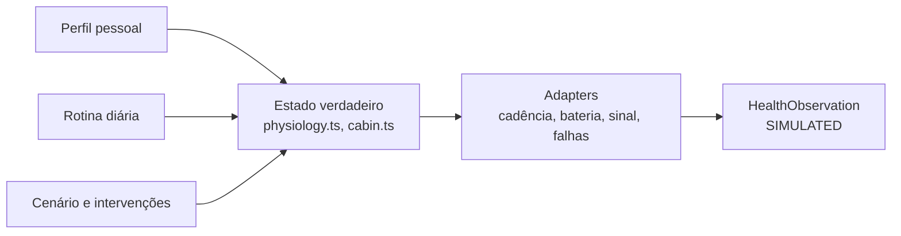

# Simulação de dispositivos e cenários

## O que faz

Gera, no navegador, os dados de uma tripulação de 4 pessoas e da cabine, como se viessem de equipamentos reais. Na Astronaut Health Intelligence Platform (AHI) **toda leitura de dispositivo é simulada** e carrega `data_origin: 'SIMULATED'`. Os seis cenários roteirizados alteram esse "estado verdadeiro" para testar o motor.

::: warning ATENÇÃO
O modelo fisiológico é **simplificado e plausível**, não validado. Os parâmetros de cada perfil são valores de simulação, não referência para pessoas reais. Dado simulado não é evidência clínica.
:::

## Entradas

| Entrada | Detalhe |
| --- | --- |
| Semente | `20261114` (em `config.ts`). Cada canal de ruído tem seu próprio fluxo semeado |
| Perfis da tripulação | Idade, sexo e deslocamento individual semeado (`profiles.ts`) |
| Rotina | Cronograma diário em UTC (`schedule.ts`) |
| Cenário ativo e intervenções registradas | `scenarios.ts` |

## Método

### Camadas da simulação



1. **Estado verdadeiro.** Alvos fisiológicos por atividade, ritmo circadiano, efeito do cenário, atraso de primeira ordem e ruído.
2. **Adapters.** Leem o estado verdadeiro como um equipamento leria: cadência, bateria, sinal, falhas e marcação de valores estimados ou questionáveis.

### Fisiologia

- **Ruído suave.** Processo de Ornstein-Uhlenbeck (OU): ruído correlacionado no tempo, não um tremor aleatório a cada minuto. Um teste confirma que ele é fortemente autocorrelacionado em defasagens curtas e tem variância unitária.
- **Resposta com atraso.** A frequência cardíaca segue o alvo por um atraso de primeira ordem (`valor += (alvo - valor) x (1 - e^(-dt/tau))`): sobe em cerca de 1 minuto e se recupera em cerca de 2,5 minutos.
- **Exercício.** Aquecimento, série principal e desaquecimento por aparelho; o ARED tem séries. A FC máxima prevista usa a fórmula de Tanaka (`208 - 0,7 x idade`).
- **Sono.** O relógio de actigrafia informa duração e eficiência às 06:00 UTC.

### Rotina diária (UTC)

| Horário | Atividade |
| --- | --- |
| 22:00 a 06:00 | Sono (o horário de dormir atrasa com fadiga) |
| 06:00 a 07:00 | Pós-sono, higiene, café (`REST`) |
| 07:00 a 12:00 | Trabalho |
| 12:00 a 13:00 | Almoço (`REST`) |
| 13:00 a 19:00 | Trabalho |
| 19:00 até dormir | Noite (`REST`) |
| Bloco de 1 h | Exercício (CEVIS, ARED ou T2 em rodízio diário) mais 20 min de recuperação |
| 07:30 e 19:30 | Testes curtos de reação |

### Cabine

CO₂ com oscilação diária em torno de 2600 ppm, temperatura e umidade com ruído OU, e taxa de dose com modulação orbital (período de cerca de 92,7 min) e passagens pela Anomalia do Atlântico Sul. São valores de simulação, não medidas da ISS. O contexto científico está em [Radiação e ambiente da cabine](/pt/science/radiation-and-environment).

### Adapters simulados

| Adapter | ID | Tipo (`DeviceKind`) | Métricas |
| --- | --- | --- | --- |
| Camiseta inteligente (Bio-Monitor) | `DEV-BIO-AST-0n` | `BIO_MONITOR` | FC, HRV, SpO₂, respiração, temperatura da pele, pressão |
| Relógio de actigrafia | `DEV-ACT-AST-0n` | `ACTIGRAPHY` | Atividade, duração e eficiência do sono |
| Cicloergômetro, aparelho resistido, esteira | `DEV-EX-CEVIS`, `DEV-EX-ARED`, `DEV-EX-T2` | `EXERCISE_CEVIS`, `EXERCISE_ARED`, `EXERCISE_T2` | Desempenho de exercício |
| Teste de reação (app) | `APP-RST-AST-0n` | interno | Tempo de reação |
| Registro de ingestão de líquidos (app) | `APP-H2O-AST-0n` | interno | Índice de hidratação |
| Sensor ambiental da cabine | `DEV-ENV-01` | `ENV_SENSOR` | CO₂, temperatura, umidade |
| Monitor de radiação de área | `DEV-DOS-AREA` | `DOSIMETER` | Taxa de dose |
| Dosímetro pessoal | `DEV-DOS-AST-0n` | `DOSIMETER` | Dose acumulada |

Cada adapter implementa `read(simNow)`, `readEvents(from, to)` (opcional, para métricas diárias) e `status(simNow)`. Estados: `ONLINE`, `DEGRADED` (sinal fraco, valores `QUESTIONABLE`), `DATA_STALE` e `OFFLINE`, com bateria e sinal. Unidades, cadências e regiões estão no [Dicionário de dados](/pt/data/data-dictionary). Os equipamentos reais equivalentes estão em [Monitoramento de saúde em missões](/pt/science/health-monitoring-in-missions).

### Os seis cenários

Todos começam às **08:00 UTC** do tempo simulado (14/11/2026), sobre 5 dias de histórico por minuto e 14 dias de métricas diárias. Cada cenário devolve uma **severidade de 0 a 1** que evolui a partir do início.

| Cenário (`ScenarioId`) | Interface | Quem | O que muda |
| --- | --- | --- | --- |
| `NOMINAL` | "Nominal day" | Todos | Nada: todos dentro das próprias faixas |
| `ACUTE_CARDIO` | "Acute cardio event" | ORION (AST-01) | FC sobe para cerca de 145 bpm em repouso e SpO₂ cai para cerca de 89% entre os minutos 2 e 14 |
| `SENSOR_FAILURE` | "Sensor failure" | VEGA (AST-03) | Camiseta `DEGRADED` aos 10 min, `DATA_STALE` aos 20 e `OFFLINE` aos 45 |
| `ENVIRONMENTAL_CO2` | "Cabin CO₂ rise" | Cabine e todos | Degradação do removedor eleva o CO₂ em cerca de 3900 ppm ao longo de cerca de 3,5 h; respiração e tempo de reação mudam |
| `PROGRESSIVE_FATIGUE` | "Progressive fatigue" | LYRA (AST-02) | Em 54 h: dorme mais tarde, eficiência do sono cai, HRV cai até 38% e FC de repouso sobe até 8 bpm |
| `PERFORMANCE_DECLINE` | "Exercise performance decline" | ATLAS (AST-04) | Rendimento dos treinos cai cerca de 7,5% por dia, no máximo 32% |

### Alívio hipotético das intervenções

```text
alívio(t) = alívio_max x (1 - e^(-(t - registro) / tau))
```

| Cenário | Intervenção | Alívio máximo | tau |
| --- | --- | --- | --- |
| Fadiga | `SLEEP_EXTENSION` | 0,85 | 18 h |
| Fadiga | `REST_PROTOCOL` | 0,40 | 12 h |
| Fadiga | `MEDICAL_CONSULT` | 0,30 | 24 h |
| Evento agudo | `REST_PROTOCOL` | 0,55 | 25 min |
| Evento agudo | `MEDICAL_CONSULT` | 0,95 | 12 min |
| Queda de desempenho | `EXERCISE_ADJUSTMENT` | 0,70 | 24 h |
| Queda de desempenho | `REST_PROTOCOL` | 0,20 | 24 h |
| CO₂ | `CABIN_VENTILATION` | 0,90 | 40 min |

Esses números são um **recurso de simulação para a demo**, nunca uma afirmação sobre desfechos clínicos.

### Premissas

- Uma tripulação de 4 pessoas, em uma missão análoga à ISS (`ISS analog (simulated)`), no dia 44 de 180 planejados.
- O contexto de atividade é conhecido pelo cronograma.
- Os equipamentos reais existem a bordo da ISS, mas a AHI **não tem acesso** a eles nem a seus dados.

### Interpretação

Os cenários servem para **demonstrar e testar** o motor. Os tempos de detecção medidos sobre eles mostram consistência interna, não desempenho no mundo real. Veja [Resultados e evidências](/pt/validation/results).

## Saídas

`HealthObservation` com origem `SIMULATED`, estados de `Device`, check-ins simulados e o histórico inicial. Origem: <OriginBadge origin="SIMULATED" />.

## Limitações

- Fisiologia simplificada: sem interação entre sistemas além do que cada cenário define.
- Calibração com faixas publicadas ainda não foi feita (prioridade P1 em [Pipeline e qualidade](/pt/data/pipeline-and-quality#prioridades)).
- O mesmo simulador gera os dados e serve de referência na avaliação, o que favorece o motor.

## Status

<StatusBadge status="IMPLEMENTED" /> Coberto por `engine.test.ts` (reprodutibilidade com a mesma semente, histórico pronto na inicialização, os seis cenários) e `stats.test.ts` (aleatoriedade semeada e ruído OU).

## Próximos passos

- [Cenários e demo guiada](/pt/product/demo-scenarios): como apresentar cada cenário.
- [Motor e simulação](/pt/architecture/engine-and-simulation): relógio, passos e publicação.
- [Fontes de dados da NASA](/pt/data/sources): o caminho para trocar simulação por dado real.
