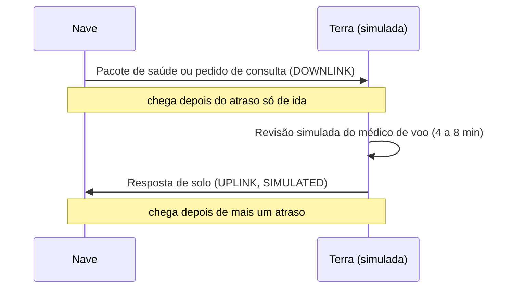

# Autorrelato e link com a Terra

Esta página cobre dois módulos ligados a dois perigos do voo espacial: **Isolation and Confinement** (o check-in diário) e **Distance from Earth** (a comunicação com atraso). A tela de cada um está em [Recursos da missão](/pt/product/mission-features).

## Check-in diário

### O que faz

Complementa os sinais objetivos com o que a pessoa relata: humor, fadiga, estresse, qualidade do sono e sintomas. Na Astronaut Health Intelligence Platform (AHI) o autorrelato **corrobora** padrões, mas **nunca dispara alerta sozinho**.

### Entradas

| Campo | Escala | Melhor |
| --- | --- | --- |
| `mood` | 1 (very low) a 5 (very good) | 5 |
| `fatigue` | 1 (rested) a 5 (exhausted) | 1 |
| `stress` | 1 (calm) a 5 (very stressed) | 1 |
| `sleepQuality` | 1 (very poor) a 5 (very good) | 5 |
| `symptoms` | lista: headache, congestion, back pain, nausea, eye discomfort, trouble sleeping | |
| `note` | texto livre para o oficial médico de bordo | |

Origem: <OriginBadge origin="MANUAL" /> quando digitado na interface; <OriginBadge origin="SIMULATED" /> quando gerado pela simulação.

### Método

**Geração simulada.** Um check-in por astronauta por manhã simulada, por volta das 07:00 UTC (deslocamento pessoal semeado de até 20 min), nos 14 dias pré-gerados e ao vivo. As respostas seguem o estado simulado: a fadiga progressiva sobe fadiga e estresse e baixa humor e qualidade do sono; CO₂ alto torna dor de cabeça muito mais provável; a queda de exercício adiciona dor muscular.

**Check-in manual.** `submitCheckIn` vira o check-in do dia: substitui o simulado, e um segundo manual no mesmo dia substitui o primeiro.

**Comparação com a própria pessoa.** Humor, fadiga e estresse viram observações (`MOOD`, `PERCEIVED_FATIGUE`, `STRESS`) e passam pela mesma [baseline pessoal](/pt/intelligence/personal-baseline) das métricas diárias:

```text
respostas inteiras -> MAD costuma ser 0 -> escala = piso de 0,75
faixa = mediana ± 2 x 0,75 = mediana ± 1,5
2 respostas seguidas fora da faixa, ou 1 resposta a 3 pontos de distância -> MODERATE
```

| Regra | O que olha | Nível máximo | Alerta? |
| --- | --- | --- | --- |
| R-PSY-01 | Humor abaixo do normal da pessoa | MODERATE | Nunca |
| R-PSY-02 | Fadiga acima do normal | MODERATE | Nunca |
| R-PSY-03 | Estresse acima do normal | MODERATE | Nunca |
| R-PSY-04 | Sintomas relatados no dia | Fator informativo (peso 0,05) | Nunca |

**Corroboração.** Fadiga de 4 ou mais nos 2 últimos check-ins vira um fator extra do padrão R-FAT-01 ("You also reported high fatigue in your last 2 check-ins"), **sem subir o nível**. Todas as regras de autorrelato compartilham um único peso no [escore de risco](/pt/intelligence/risk-assessment).

**Interpretação.** Sintomas aparecem como fato relatado ("You reported a headache today"), nunca como conclusão ou diagnóstico.

### Saídas

`CheckIn`, observações de autorrelato, fatores de risco e recomendações de bordo (por exemplo "Check in with the crew medical officer and plan some recovery time").

### Limitações

- Autorrelato é subjetivo. As respostas simuladas são um modelo de como pessoas poderiam responder.
- As perguntas são uma versão simplificada, inspirada nas NASA Standard Measures, não um questionário validado.

## Earth link

### O que faz

Simula a comunicação entre a nave e a Terra **com o atraso da luz** do perfil ativo, e mostra o que isso muda: quanto tempo uma resposta leva e o que a tripulação deve fazer a bordo primeiro.


### Entradas

| Perfil (`CommProfileId`) | Rótulo | Atraso só de ida | Ida e volta |
| --- | --- | --- | --- |
| `ISS` | "ISS (low Earth orbit)" | 0,5 s | 1 s |
| `MOON` | "Moon" | 1,3 s | 2,6 s |
| `MARS_NEAR` | "Mars (closest)" | 4 min | 8 min |
| `MARS_FAR` | "Mars (farthest)" | 22 min | 44 min |

Os atrasos são valores públicos aproximados do tempo de luz (`COMM_PROFILES` em `catalog.ts`). O perfil padrão é ISS.

### Método



```text
arrivesAt = sentAt + atraso_só_de_ida
status    = IN_TRANSIT enquanto relógio < arrivesAt; depois DELIVERED
resposta  = chegada + revisão (4 a 8 min, semeada por mensagem) + atraso_só_de_ida
resposta mais cedo possível = 2 x atraso + 4 min  (cerca de 48 min em "Mars (farthest)")
```

| Tipo de mensagem | Quem envia | Recebe resposta? |
| --- | --- | --- |
| `HEALTH_PACKET` | A pessoa ("Send health packet") ou o sistema, automaticamente, quando um alerta chega a HIGH ou CRITICAL (uma vez por alerta) | Sim |
| `CONSULT_REQUEST` | A pessoa ("Request flight surgeon consult") | Sim |
| `HANDOVER_REPORT` | O relatório de turno ("Send to ground") | Não |
| `GROUND_REPLY` | O médico de voo simulado | |

**A resposta simulada** reconhece a mensagem, pede para seguir o protocolo de bordo e reavaliar em 10, 30, 60 ou 120 minutos (CRITICAL, HIGH, MODERATE ou LOW), **nunca prescreve medicamento** e diz que é simulada.

**Passos a bordo primeiro.** Nos perfis de Marte, itens HIGH ou CRITICAL que precisam de revisão em solo ganham um primeiro passo a bordo. Detalhes em [Recomendações, autonomia e what-if](/pt/intelligence/recommendations).

**Independência da velocidade.** Os tempos usam horários agendados, não o momento da avaliação. Por isso os resultados não dependem da velocidade da simulação (teste "timing does not depend on how often it is processed").

**Auditoria.** `COMM_SENT`, `COMM_RECEIVED` e `COMM_PROFILE_CHANGED`.

### Saídas

`CommMessage` (direção, tipo, título, corpo, envio, chegada, estado, alerta ou recomendação relacionados, origem). Respostas de solo têm origem <OriginBadge origin="SIMULATED" />.

### Limitações

- Não há médico de voo real nem fluxo real de revisão: as respostas são modelos fixos.
- O atraso é constante por perfil; não há janelas de perda de sinal nem largura de banda limitada.

## Status

<StatusBadge status="IMPLEMENTED" /> Coberto por `checkins.test.ts` (8 testes: geração diária, métricas de autorrelato, estado simulado, CO₂ e dor de cabeça, check-in manual, teto em MODERATE sem alerta, contagem de fadiga alta) e `comms.test.ts` (9 testes: atraso, independência do processamento, respostas não prescritivas, pacote automático, passo a bordo em Marte, auditoria, troca de perfil).

## Próximos passos

- [Recursos da missão](/pt/product/mission-features): as telas de check-in e "Earth link".
- [Riscos à saúde em voos espaciais](/pt/science/spaceflight-hazards): por que isolamento e distância importam.
- [Alertas e escalonamento](/pt/intelligence/alerts).
