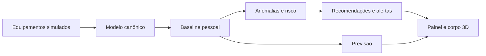
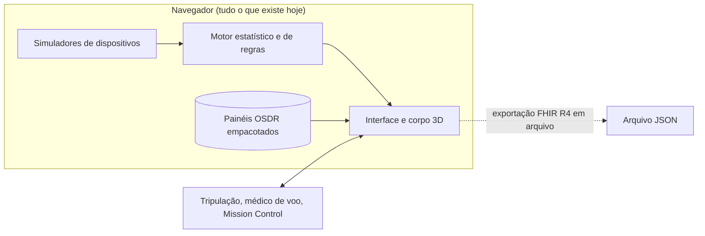

# Introdução

A **Astronaut Health Intelligence Platform** é um protótipo de monitoramento de saúde e apoio à decisão para tripulações em missões espaciais longas. Foi criada para o **NASA Space Apps Challenge 2026**, no desafio **Health Monitoring Software**. Nesta documentação usamos a sigla **AHI**.

A ideia em uma frase: integrar os sinais dos equipamentos que os astronautas vestem e usam, comparar cada sinal com o normal da própria pessoa, detectar desvios e tendências cedo e mostrar tudo em um corpo 3D que qualquer pessoa da tripulação entende em segundos.

## O problema

Missões espaciais expõem a tripulação a riscos que afetam saúde, bem-estar e desempenho. A equipe precisa acompanhar indicadores fisiológicos, comportamentais e ambientais e entender tendências antes que virem problemas operacionais.

O Human Research Program (HRP) da NASA organiza esses riscos em **cinco perigos do voo espacial humano**. A tabela mostra como a AHI trata cada um. A base científica está em [Riscos à saúde em voos espaciais](/pt/science/spaceflight-hazards).

| Perigo (nome NASA) | O que significa | Como a AHI trata |
| --- | --- | --- |
| Radiation | Exposição à radiação espacial | Taxa de dose da cabine, dose acumulada por pessoa e orçamento de dose de demo na visão de missão |
| Isolation and Confinement | Isolamento e confinamento | Sono, humor, fadiga e estresse no check-in diário |
| Distance from Earth | Distância da Terra, atraso de comunicação, recursos médicos limitados | Perfis de comunicação ISS, Lua e Marte, com mensagens atrasadas e passos a bordo primeiro |
| Gravity Fields | Microgravidade e transições de gravidade | Desempenho de exercício (CEVIS, ARED, T2) e hidratação |
| Hostile/Closed Environments | Ambientes fechados e hostis | CO₂, temperatura e umidade da cabine |

### O problema prático

- Os sinais vêm de **muitos equipamentos**, com frequências, unidades e formatos diferentes. Há medidas por minuto, por sessão, por dia e por amostra.
- O **suporte médico está longe**. Em Marte, uma pergunta à Terra e a resposta levam no mínimo 8 minutos e podem passar de 44 minutos.
- Um número isolado cruzando uma linha arbitrária diz pouco. O que importa é **padrão, persistência e contexto** em relação ao normal de cada pessoa.

## Objetivos

Os objetivos vêm do documento mestre do projeto (`PROJECT_MASTER.md`, seção 2.3):

1. Integrar dados históricos, públicos e simulados em um modelo canônico.
2. Estabelecer uma baseline (linha de base) individual para cada pessoa e métrica.
3. Detectar desvios e padrões persistentes.
4. Projetar tendências quando houver dados suficientes, com incerteza explícita.
5. Classificar níveis operacionais de atenção com regras transparentes.
6. Apresentar recomendações não prescritivas e explicáveis.
7. Registrar alertas, decisões e intervenções em auditoria.
8. Demonstrar cenários controlados no hackathon.

## A solução

Na prática, a tela responde três perguntas, nesta ordem:

1. **Quem** precisa de atenção? (lista da tripulação)
2. **O quê** está acontecendo? (corpo 3D e frase de status)
3. **Por quê** e **o que fazer**? (painel "What needs attention")

O motor é estatístico e baseado em regras. Não há LLM nem modelo de aprendizado de máquina em tempo de execução. Veja [Abordagem de IA e análise de dados](/pt/intelligence/ai-and-analytics).

## Escopo

| Dentro do escopo (implementado) | Fora do escopo do MVP |
| --- | --- |
| Tripulação simulada de 4 pessoas, com dispositivos simulados | Diagnóstico automático ou decisão clínica autônoma |
| Baseline pessoal, anomalias, risco, previsão, recomendações, alertas | Prescrição de medicamentos ou tratamentos |
| Comunicação com atraso, check-in, visão de missão, relatório de turno | Substituir o médico de voo ou o Mission Control |
| Dois datasets reais do NASA OSDR como referência histórica | Conexão em tempo real com dispositivos da ISS |
| Corpo 3D sobre um atlas anatômico real (anatomia de referência), "Ground view" e "Crew view" | Controle remoto de equipamentos |
| Documentação bilíngue, testes e avaliação reproduzível | Garantia de previsão de eventos médicos |

A lista completa, com status e origem de cada capacidade, está na [Matriz de status das funcionalidades](/pt/overview/feature-status).

## Limites do sistema

- O app roda **inteiro no navegador**. Não há backend, API REST, banco de dados nem autenticação. Isso tudo está planejado em [Arquitetura alvo](/pt/architecture/target-architecture).
- **Não há conexão com a ISS** nem com equipamentos reais. O contrato de adapters está pronto para fontes reais no futuro.
- O "médico de voo" que responde pelo "Earth link" é **simulado**.
- Os dados reais da NASA **não são a tripulação mostrada** e não alimentam baselines, regras ou limiares.
- O **corpo 3D** é um modelo de referência de terceiros (atlas Z-Anatomy, CC BY-SA 4.0), o mesmo para todos os tripulantes. Não é um exame de ninguém e não é dado de saúde ([Assets de anatomia 3D](/pt/data/anatomy-assets)).
- Os **olhos** são estruturas só de contexto, sem status. O acompanhamento da SANS (síndrome neuro-ocular associada ao voo espacial) está no [roadmap](/pt/resources/roadmap).

As categorias de origem de dado (`SIMULATED`, `MANUAL`, `DERIVED`, `REAL_PUBLIC`) estão explicadas em [Origens e proveniência dos dados](/pt/data/data-origins).

## Princípios

1. **Apoio à decisão, não diagnóstico.** Itens HIGH e CRITICAL exigem revisão humana.
2. **Cada pessoa comparada consigo mesma.** A faixa pessoal define o status primeiro. Os poucos limiares fixos são configuração de demo.
3. **Dado ausente nunca é normal.** Falta de dado vira `NO_DATA` (cinza), nunca verde.
4. **Explicável.** Cada status vem com a regra, o motivo em linguagem simples e o peso no escore.
5. **Origem sempre visível.** Selo `SIMULATED` na barra superior e em cada gráfico.
6. **Correlação não é causalidade.** Coincidências entre ambiente e fisiologia são mostradas como coocorrência.
7. **Linguagem simples primeiro.** "All good", "Keep an eye", "Act soon", "Act now" antes de qualquer termo técnico. Cor nunca é a única pista.

## Próximos passos

- [Casos de uso e partes interessadas](/pt/overview/use-cases): quem usa e para quê.
- [Configuração, comandos e problemas](/pt/engineering/quick-start): rode o app em 2 minutos.
- [Tour do produto](/pt/product/product-tour): cada área da tela explicada.
- [Uso responsável](/pt/overview/responsible-use): o que a AHI não faz.
