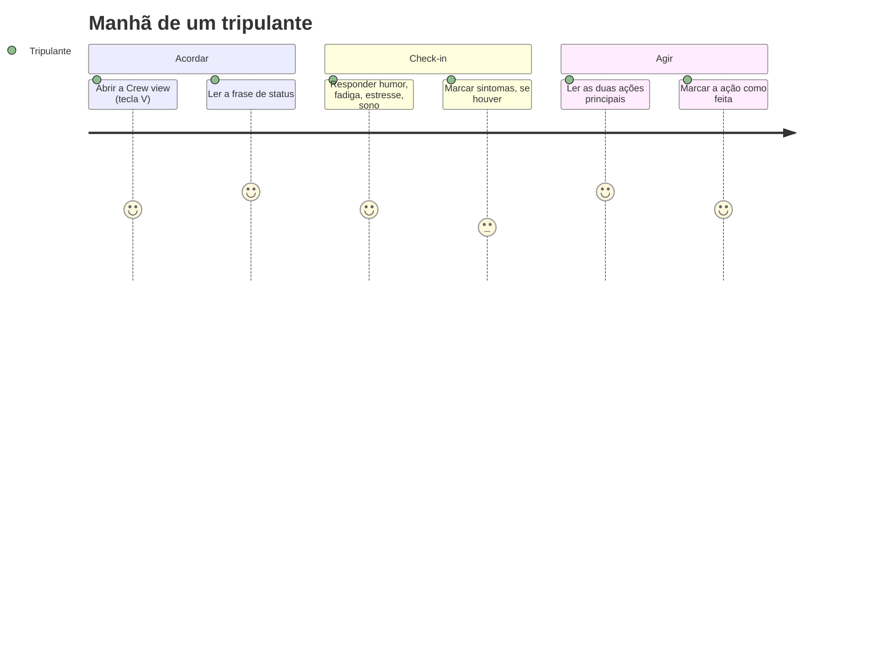

# Jornadas de usuário e papéis

Esta página mostra **como cada papel usa** a Astronaut Health Intelligence Platform (AHI), passo a passo. Quem são os papéis e o que precisam está em [Casos de uso e partes interessadas](/pt/overview/use-cases); o que cada área da tela faz está no [Tour do produto](/pt/product/product-tour).

::: info Papéis não são contas
Não há login nem controle de acesso: qualquer pessoa vê tudo. Os papéis abaixo são **formas de usar** a mesma interface. Autenticação e controle de acesso por papel estão [planejados](/pt/architecture/target-architecture).
:::

## Tripulação: "como eu estou?"

1. Troca para a **"Crew view"** (seletor "Ground" / "Crew" ou tecla `V`) e escolhe a própria pessoa.
2. Lê a **frase de status** em linguagem simples e os vitais em "Your body vs your normal".
3. Faz o **check-in diário** de 30 segundos. As respostas são comparadas com as anteriores dela, nunca com outras pessoas ([como funciona](/pt/intelligence/self-report-and-earth-link)).
4. Vê no máximo **duas ações** em "What to do now" ("Do this now", "Do this soon", "When you can") e registra o que fez.
5. Lê quanto tempo uma resposta da Terra levaria no perfil atual.

## Oficial médico de bordo: "o que posso fazer agora?"

1. Na **"Ground view"**, seleciona o tripulante com status "Act soon" ou "Act now".
2. Em "Recommended actions", filtra pelo selo **"Can act on board now"**.
3. Em perfil Marte, encontra o primeiro passo a bordo: "Crew medical officer: start the onboard assessment protocol now", com o tempo mínimo até a resposta da Terra.
4. Registra a ação com **"Mark done"**; ela vai para a auditoria.

## Médico de voo: "por que mudou e o que recomendo?"

1. Na **lista da tripulação**, vê quem precisa de atenção.
2. No **corpo 3D**, clica no chip do sistema (ou no órgão destacado na cor do status) para abrir o detalhe.
3. No gráfico, compara a linha medida com a **faixa pessoal** e o **cone de previsão**; usa o ícone (i) para ver como o normal foi aprendido.
4. Em **"Why"**, lê os fatores com peso e a confiança.
5. Usa **"Compare"** para discutir a trajetória hipotética com e sem uma ação ([limitações](/pt/intelligence/recommendations)).
6. Responde pedidos de consulta pelo **"Earth link"** (na demo, as respostas são simuladas).
7. No fim do turno, gera o **"Shift handover"**, imprime ou exporta em FHIR R4.

## Mission Control: "há risco operacional?"

1. Abre a **gaveta de alertas** (tecla `A`), reconhece alertas e acompanha o **escalonamento**.
2. Olha a faixa **"Cabin"** (CO₂, temperatura, umidade, radiação) e o estado dos **dispositivos**.
3. Percorre a **linha do tempo** da tripulação para ver quando cada pessoa mudou de estado.
4. Em **"Mission overview"**, acompanha a dose acumulada contra o orçamento de demo, a aderência ao exercício e o sono.

## Pesquisador: "de onde vem cada número?"

1. Clica no selo **`SIMULATED`** para ver os adapters ativos.
2. Abre **"Tools" > "Data and model"**: datasets reais com proveniência, dispositivos simulados, model card e origens dos dados.
3. Confere o SHA-256 dos arquivos reais contra os manifestos em `data/manifests/` ([Catálogo de datasets](/pt/data/dataset-catalog)).

## Avaliador do hackathon: "o que isto faz, em 2 minutos?"

1. Clica em **"Start demo"**: 10 passos que trocam cenários, velocidade e pessoa sozinhos.
2. Usa as setas para avançar e `Esc` para sair.
3. Lê a [Matriz de status das funcionalidades](/pt/overview/feature-status) para separar o que é real do que é plano.

Detalhes da demo em [Cenários e demo guiada](/pt/product/demo-scenarios).

## Resumo por papel

| Papel | Visão principal | Telas | Ação típica |
| --- | --- | --- | --- |
| Tripulação | "Crew view" | Frase de status, vitais, check-in, duas ações | Check-in, "Mark done" |
| Oficial médico de bordo | "Ground view" | Ações com autonomia, primeiro passo em Marte | "Mark done" |
| Médico de voo | "Ground view" | Detalhe do sistema, "Why", previsão, "Compare", relatório | Revisar, responder, passar o turno |
| Mission Control | "Ground view" | Alertas, cabine, dispositivos, linha do tempo, visão de missão | "Acknowledge" |
| Pesquisador | Diálogo "Data and model" | Datasets reais, origens, model card | Conferir proveniência |
| Avaliador | Demo guiada | Todas | Assistir e navegar |

## Próximos passos

- [Tour do produto](/pt/product/product-tour).
- [Recursos da missão](/pt/product/mission-features).
- [Design system e acessibilidade](/pt/product/design-system).
