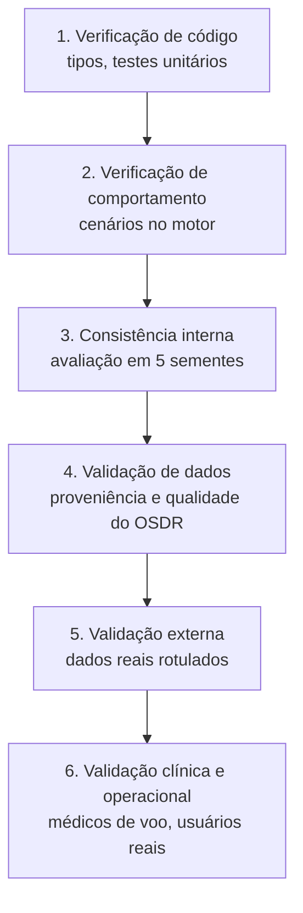

# Estratégia de validação

Validar um sistema de apoio à decisão em saúde tem várias camadas. Esta página separa **o que a Astronaut Health Intelligence Platform (AHI) já verifica**, **o que cada evidência prova** e **o que ainda falta**. Os números estão em [Resultados e evidências](/pt/validation/results).

::: warning ATENÇÃO
Toda evidência atual vem de **dados simulados** pelo mesmo simulador que a plataforma usa. Ela mostra que o software faz o que foi desenhado para fazer. **Não mostra desempenho clínico**, sensibilidade ou especificidade no mundo real.
:::

## Camadas

| Camada | Pergunta | Como | Status |
| --- | --- | --- | --- |
| 1. Verificação de código | O código faz o que a função promete? | `npx tsc -b`, 143 testes vitest | <StatusBadge status="IMPLEMENTED" /> |
| 2. Verificação de comportamento | Cada cenário produz o padrão esperado? | Testes de cenário em `engine.test.ts` | <StatusBadge status="IMPLEMENTED" /> |
| 3. Consistência interna | O motor detecta os cenários e fica quieto no nominal, com várias sementes? | `npm run evaluate` | <StatusBadge status="IMPLEMENTED" /> |
| 4. Validação de dados | Os dados reais são o que dizem ser? | SHA-256, conferência com metadados ISA, checklist de qualidade | <StatusBadge status="IMPLEMENTED" /> |
| 5. Validação externa | O motor funciona em dados que não gerou? | Dados reais com desfechos rotulados | <StatusBadge status="PLANNED" /> |
| 6. Validação clínica e operacional | Ajuda pessoas reais a decidir melhor, com segurança? | Revisão de médicos de voo, testes com usuários | <StatusBadge status="PLANNED" /> |

## O que cada evidência prova

| Evidência | Prova | Não prova |
| --- | --- | --- |
| Testes unitários | Fórmulas e regras implementadas como documentado | Que as fórmulas e regras são as certas |
| Testes de cenário | Que cada cenário dispara o comportamento esperado | Que os cenários representam a realidade |
| Avaliação nominal (0 alertas falsos) | O motor não alarma à toa **nos dados do simulador** | Taxa de falsos alarmes com sensores e pessoas reais |
| Tempos de detecção | Ordem de grandeza e consistência entre sementes | Antecedência real antes de um evento clínico |
| Proveniência do OSDR | Os arquivos são os publicados pela NASA, sem alteração | Que esses dados representam tripulações de longa duração |

## Critérios de aceite atuais

Usados para considerar uma mudança no motor aceitável:

1. Todos os testes passam e a checagem de tipos está limpa.
2. O cenário nominal continua com **zero alertas da tripulação em MODERATE ou acima** na avaliação.
3. Cada cenário anormal continua sendo detectado, com o nível de pico esperado: CRITICAL só no evento agudo; padrões lentos limitados a HIGH; falha de sensor em MODERATE, nunca normal.
4. `evaluation.json` e `docs/model-card.md` são regenerados e a mudança é explicada no pull request.

## Ameaças à validade

| Ameaça | Efeito | Mitigação atual |
| --- | --- | --- |
| Mesmo simulador gera dados e testa o motor | Resultados otimistas | Declarado em todas as páginas de resultado; validação externa planejada |
| Parâmetros ajustados olhando os cenários | Sobreajuste aos cenários | Avaliação em 5 sementes; cenário nominal como controle |
| Modelo fisiológico simplificado | Padrões reais podem ser diferentes | Calibração com literatura planejada |
| Poucos cenários | Cobertura limitada de situações | Lista de cenários pode crescer ([como adicionar](/pt/engineering/contributing#como-adicionar-um-cenario)) |
| Sem usuários reais | Usabilidade não comprovada | Linguagem simples e acessibilidade básica; testes de usabilidade planejados |

## O que faltaria para uso real

1. Dados reais com desfechos rotulados e consentimento, separados por pessoa para teste.
2. Fundamentação de cada limiar com fonte citável e aprovação de médico de voo ([Limiares](/pt/intelligence/thresholds)).
3. Medida de sensibilidade, especificidade, antecedência e cobertura do intervalo de previsão.
4. Avaliação de usabilidade com tripulantes, médicos de voo e equipes de controle.
5. Processo regulatório adequado, se algum dia virar produto clínico.

## Próximos passos

- [Resultados e evidências](/pt/validation/results).
- [Model card](/pt/validation/model-card).
- [Matriz de rastreabilidade](/pt/validation/traceability).
