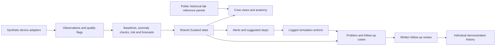

# Architecture and data

## Current system

Astromigos is a static React and TypeScript application built with Vite and Tailwind CSS. Zustand holds live simulation state. Three.js and React Three Fiber render the anatomy viewer; Recharts renders trend visualizations. The application does not require a backend or an API key.

## Simulation and analysis

The engine under `frontend/web/src/engine/` provides seeded synthetic device behavior, contextual personal baselines, robust deviation checks, drift detection, combined rules, risk summaries, forecasts, and recommendation management.

The state store advances simulation time and publishes changed slices. Display speeds change how much simulated time passes per real second. All fixed safety thresholds are demo configuration, not official NASA limits. Forecasts and intervention responses are hypothetical mathematical outputs, not validated medical predictions or treatment effects.

The [engine reference](../frontend/web/src/engine/README.md) contains detailed implementation notes. It predates the Astromigos presentation, so older branding, fictional callsigns, and speed examples there are historical technical context. Current UI controls and the current source configuration are authoritative.

## Anatomy

The anatomy manifest and GLB files live in `frontend/web/public/anatomy/`. The application loads its own static atlas assets and maps selected structures to the body systems that have monitored signals.

This is shared reference geometry derived from Z-Anatomy and BodyParts3D. It is not patient imaging and does not adapt to each demonstration profile's body. The asset license, modifications, excluded content, and required attribution remain in [the anatomy notice](../frontend/web/public/anatomy/LICENSE.md).

## Individual medical history

`src/features/medicalhistory/` owns the history model, dialog, and local-storage behavior. Records are explicitly associated with an astronaut identifier. Conditions, allergies, medications, procedures, and notes are categories of demonstration records, not verified personal facts.

The timeline combines profile records with current-run check-ins, alerts, and actions. Cabin events are shared context. The absence of a record is shown as “No records provided,” which is different from asserting that someone has no allergies or conditions.

User-entered demo records persist locally when browser storage is available. Corrupt entries are rejected during parsing. Storage failures leave the current session usable and display a persistence limitation. There is no server synchronization, login, or medical-record access-control layer.

## Problem and follow-up tracking

`src/features/casetracker/` derives cases from engine alerts and recommendations. Matching uses the subject, triggering rule, and episode timing, so repeated issues and actions remain associated with the correct case. Cabin cases can appear as shared issues for affected crew views.

Case states are:

| State | Meaning |
| --- | --- |
| Open | An alert, recommendation, triggering rule, affected signal, or related body-system state remains active or unknown. |
| Awaiting follow-up | Relevant signals have cleared, but a written resolution review is still missing. |
| Resolved | Signals are clear and a review note has been explicitly recorded after clearance. |

Logging an intervention, acknowledging an alert, or dismissing a recommendation is not evidence of resolution. The tracker compares retained samples around detection with current measurements and the current personal range. It describes movement relative to that range without claiming a causal treatment effect.

Every scenario run has a unique identifier. Tracker notes are scoped to that identifier so reused engine alert IDs cannot mix notes from different runs. Personal follow-up notes are also added to the individual's local demonstration history. Tracker state itself is session-based and is not a durable cross-run archive.

## Data origins

| Origin | Use |
| --- | --- |
| Simulated | Live device measurements, synthetic physiology, scenario events, and simulated replies. |
| Derived | Status, explanations, baseline bands, risk summaries, and forecasts computed from inputs. |
| User entry | Fictional notes, records, check-ins, and logged actions entered through the interface. |
| Real public | Included OSDR historical lab reference panels, separate from the live simulation. |

The included OSDR panels concern Inspiration4 and must not be presented as Artemis II measurements. Existing metadata records source accessions, filenames, collection context, and hashes; it also records where source metadata does not state a license.

## Deployment

Vite produces HTML, JavaScript, CSS, images, the anatomy atlas, and a worker bundle in `frontend/web/dist`. Asset URLs honor the deployment base so the same app can run at a host root or a GitHub Pages project path.

GitHub Actions installs locked dependencies, runs tests, builds with the Pages base path, verifies the static artifacts, and deploys through GitHub's Pages actions. No credentials are embedded in browser code.
